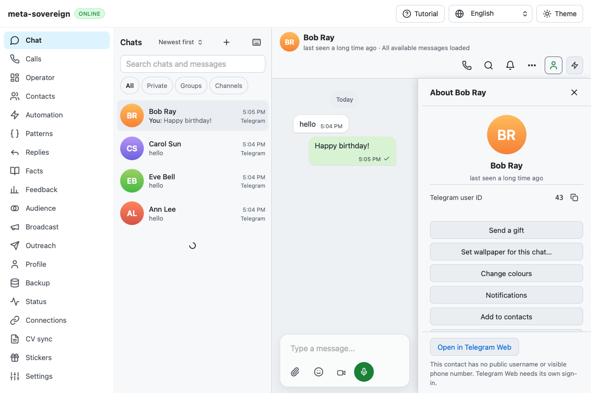

# WebKit profile selection diagnostic

[Checks run 42658182735](https://github.com/link-foundation/meta-sovereign/actions/runs/42658182735), created at 2026-11-09 16:46:43 UTC for exact commit `46fba37df2fc8183366a41c3e809ff548dbbce8f`, passes Rust, all nine runtime jobs, Chromium and the other required jobs. WebKit alone fails. Desktop, Pages, Links and Security workflows on that SHA pass. This workflow is not passing overall.

WebKit job log lines 2037–2040 identify `profile-extras`: at 17:05:36 UTC it times out waiting for the birthday row. Its saved screenshot shows Bob's profile still selected after the fixture attempts to click Ann. Other WebKit scenarios, including the expanded question/salary controls, pass. The complete workflow log, 2,131-line WebKit log, metadata and downloaded browser artifact files are preserved with verified hashes in `data/ci-profile-selection.tar.gz`.

The single focused local WebKit scenario passes without changing its behavior. That does not establish a root cause or justify increasing timeouts. No birthday rendering correction is claimed. The production selection path now has opt-in `metaSovereignDebug` events for list selection, hash selection and fallback selection; these contain identifiers and decisions, never message text. The fixture enables them, keeps a bounded pointer/click/hash trace, and verifies the selected chat before inspecting birthday metadata. A failed selection includes the actual URL, selected row and event trace. This distinguishes a missed pointer, navigation overwrite and missing metadata on the next observed failure. The focused scenario also passes with the diagnostics enabled.

This remains a recorded intermittent CI failure pending the next exact-head run. It does not close any remaining issue-wide criterion.

Follow-up: exact diagnostic commit `3eeb296505e42bf7040c6a0b6294c5613a199b68` passes the complete WebKit browser job in [run 42663162218](https://github.com/link-foundation/meta-sovereign/actions/runs/42663162218). The run is still not passing overall: Node/macOS reaches its job deadline and reports a separate startup assertion failure. [That investigation](ci-node-macos.md) preserves the evidence. A passing diagnostic rerun does not establish why the earlier pointer selection failed.
