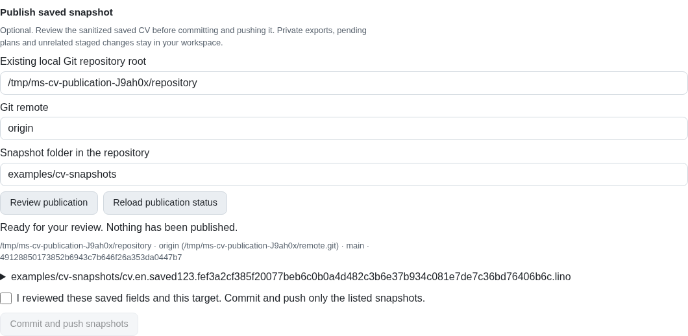
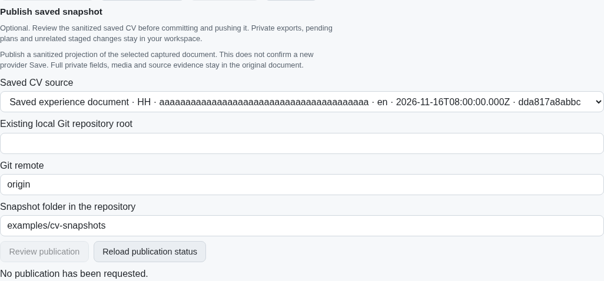

# CV publication browser ownership

Parent `bf15f721` fails Chromium shard 3 in
[job 133562826705](https://github.com/link-foundation/meta-sovereign/actions/runs/43941245198/job/133562826705).
Raw log lines 1424–1442 show a strict locator resolving two publication states.
The earlier snapshot and native-export scenarios select every
`[data-cv-publication]` on the page. Adding the separate experience-document
review makes that locator ambiguous, even while its containing details are closed.
The retained browser artifact contains the failure log, without a screenshot.

Both older scenarios now select the publication panel inside the native-save
watch. The experience scenario retains its separate document-owned panel.
Strict locators, consent, source changes, four locales, phone layout, private
original/index checks and non-replaying recovery all remain enabled. Product
behavior is unchanged.

Reproduce the actual published helper failure and restore the working helpers:

```sh
E2E_EXECUTABLE_PATH=/usr/bin/google-chrome python -B experiments/issue-56/publication-panel-before.py
RUN_BROWSER_E2E=1 E2E_EXECUTABLE_PATH=/usr/bin/google-chrome node --max-old-space-size=384 js/tests/e2e-cv-publication-browser.mjs
```

The reproduction fails at the same two-state strict locator. The focused
current Chromium group passes all three publication scenarios in sequence:
two owner-snapshot pushes including a lost receipt, one native-export push,
and one experience-document push. Each retains its original four-language,
phone, private-data and non-replaying recovery checks. Scoped lint and format
checks pass. This does not run a full browser matrix. Hosted Chromium/WebKit verification remains
required. No original acceptance criterion is completed by this test correction.

Independent Playwright MCP confirms two total panels, exactly one in each
owner, and an explicit native-save review reaching `planned` while the
experience panel stays `none`. Publish remains disabled without consent. Its
owned fixture closes with zero pushes and intact private originals; the only
console error is the fixture's absent favicon. Both screenshots were inspected.
The browser and fixture are closed, separately from the user's running server.
Raw hosted/local logs, source bytes, MCP receipts and screenshot hashes are
preserved in [the evidence archive](data/ci-publication-panels.tar.gz) and
[manifest](data/ci-publication-panels.tar.sha256.json).

Native-save review:



Separate experience-document review:



The complete issue remains active in
[PR #57](https://github.com/link-foundation/meta-sovereign/pull/57).
