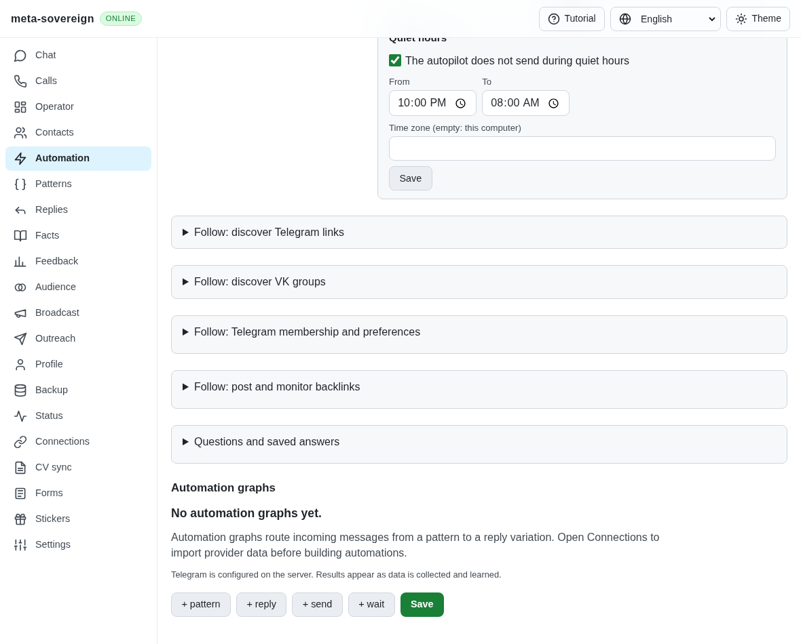
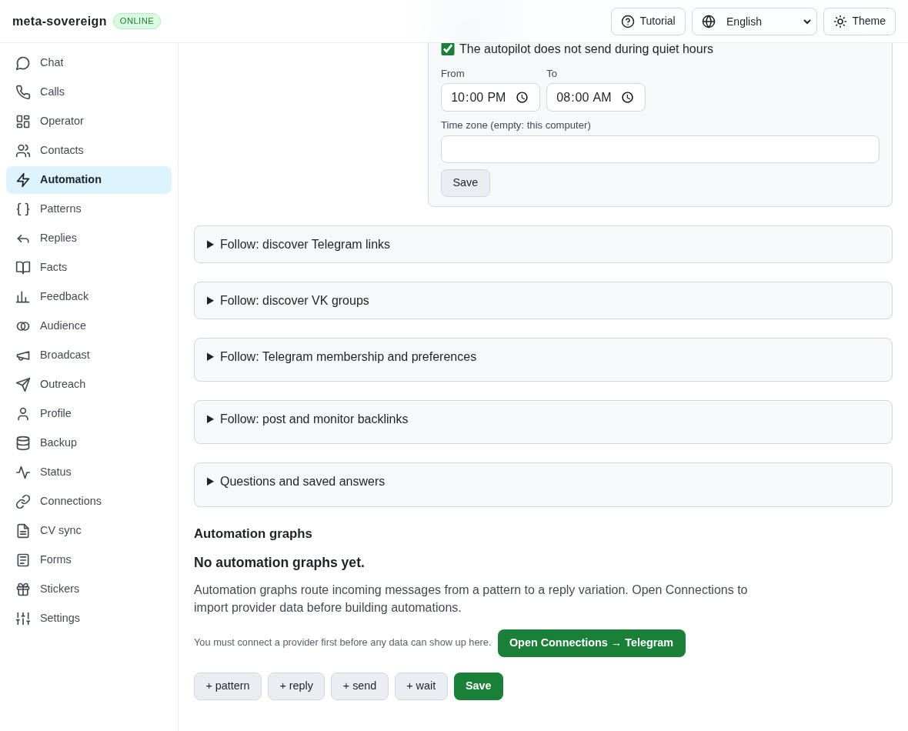
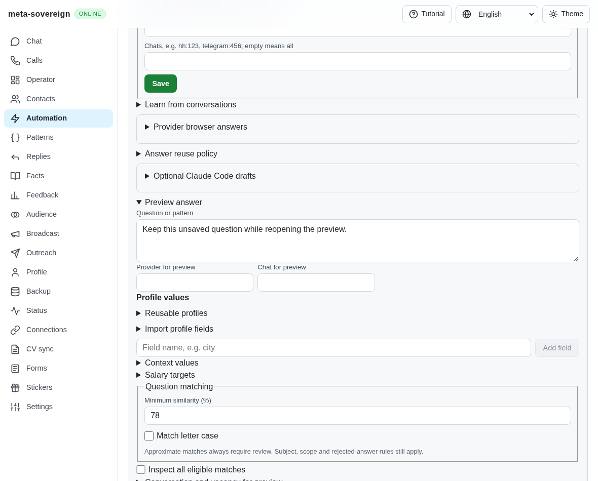
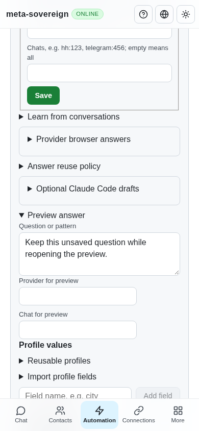

# Questions disclosure: repeated navigation retained an open document

Issue: https://github.com/link-foundation/meta-sovereign/issues/56

PR: https://github.com/link-foundation/meta-sovereign/pull/57

This corrects browser fixture opening, and refreshes the checked-in production UI bundle. It does not change native disclosure behavior or increase any CI/test deadline. All unchecked issue criteria remain unfinished and PR 57 stays draft.

## Root cause and hosted evidence

[Checks 43065220252](https://github.com/link-foundation/meta-sovereign/actions/runs/43065220252), commit `ff7a9d711fcde7f556a9105350282aed6a731220`, fails Chromium's Questions group. Raw job lines 2664–2686 show the root becoming closed before the “Learn from conversations” summary times out. The screenshot downloaded from the actual browser artifact shows the same closed root; it was verified as PNG before viewing. Full Chromium/WebKit logs are archived with this case.

The failing locator is the notice-learning helper. The shared Questions fixture invokes it first for ordinary learning, then for pattern learning, using the identical `/?notice-learning=1#/automation` URL. A focused real-browser probe establishes that this navigation retains the same Document and its open native `
` elements. The old unconditional root-summary click therefore closes the section. The second learning summary cannot be clicked while its parent is closed. This explains the captured root toggle without guessing about React timing.

The first local attempt additionally found a stale checked-in `app.min.js`: the current notice-learning source was present but its “Passive notice” label was absent from the bundle. That attempt's log and screenshot are retained separately. The focused `build-web.mjs` bundling step, required by `docs/CONTRIBUTING.md`, refreshes the tracked asset. The disclosure baseline below uses the actual parent fixture helpers and the freshly built current source, so it isolates the opening defect rather than the stale-bundle failure.

## Correction and reproduction

`openQuestionDisclosure` reads the native `open` property and clicks the visible summary only for a closed section. Question previews, history learning and notice learning reuse it. Already open sections retain their native state and unsaved values. No forced click, DOM state assignment, artificial reload or retry loop is introduced.

The Questions entry retains both notice-learning modes, adds three real-browser disclosure states and logs bounded phase timings for the final history/notice/disclosure scenarios. Existing CI contracts require these calls, and the existing Questions group remains mandatory in Chromium and WebKit with its original 180-second subprocess budget.

To reproduce against parent `d771106d1b338f714735a3601033905b27a1b276`, first build the UI with `node js/scripts/build-web.mjs`. Then run `E2E_EXECUTABLE_PATH=/path/to/chromium python3 experiments/issue-56/question-disclosure-before.py`. It restores only the actual parent helpers for two finite browser probes, checks their failures and restores the current helpers in `finally`.

The ordinary probe completes the first notice-learning mode, retains the exact Document, then fails the second mode because the root closes. The preview-only probe opens two nested sections, revisits the same fragment URL and fails the old repeated opener. Both use a five-second action limit and an isolated memory store; no application server or authenticated account is used.

## Focused verification

- Both actual-parent probes fail with the expected hidden-control click timeout. Native click/toggle traces include the same document identity before and after navigation and the final closed root.
- With the correction, both notice-learning modes complete, including persistence/replay counts, unapproved proposals and mobile checks (three existing cases per mode).
- The new preview regression passes all three states: initially closed sections, repeated opening of already open sections, and reopening a manually closed nested section. Unsaved preview text remains intact.
- The existing HH archive-history browser check passes after adopting the same opening helper.
- Twenty-one focused Node checks pass: eighteen CI contracts and three browser import-graph checks.
- Independent Playwright MCP reproduces the old close on a retained Document, then verifies repeated native opening and retained preview text on desktop and phone, with zero page errors. Its isolated server records zero model calls and zero sends. The MCP browser and server are closed afterward.
- Scoped lint, formatting, syntax/secret checks and the unchanged duplication gate are recorded in the evidence archive. Full runtime/browser/build matrices remain in GitHub CI.

Two MCP harness attempts failed before the application check (a trailing function semicolon and the runner's unavailable dynamic-import callback); their raw responses are retained. The successful independent script uses ordinary Playwright locators and native summary clicks without dynamic imports.

## Visual evidence

Hosted failure:

Independent reproduction and corrected native opening:

| Before                                                                                          | After                                                                                                     |
| ----------------------------------------------------------------------------------------------- | --------------------------------------------------------------------------------------------------------- |
|  |  |

## Evidence and remaining work

The subsequent `96cd0227` Checks run 43069574330 is cancelled at 17:54:40 UTC after the next push at 17:51:28. Before cancellation, Chromium reproduces the same hidden learner at raw lines 2607–2627, both new text groups pass, and the old combined history group reaches its deadline at lines 2744–2758. WebKit is cancelled while running a different earlier scenario (line 2309), before reaching these new checks. The aggregate correctly reports `e2e-browser: cancelled` (gate log lines 282–284). Every completed runtime/static/native job and its security workflow pass; this cancelled matrix is not exact-head success. All downloaded logs are preserved.

The checksummed `data/ci-question-disclosure.tar.gz` archive retains raw before/after logs, source snapshots, the downloaded hosted screenshot, full preceding browser job logs, scoped check outputs and independent MCP responses. `experiments/issue-56/collect-question-disclosure.py` asserts the observations before collecting evidence.

Exact new-head hosted verification is still required. Earlier startup, history-group and network corrections each require their own current-head evidence; this fixture correction does not establish those results. All remaining issue-56 requirements, real-account checks and unavailable-device criteria remain unfinished.
