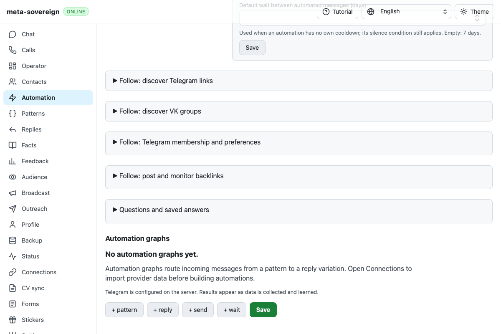
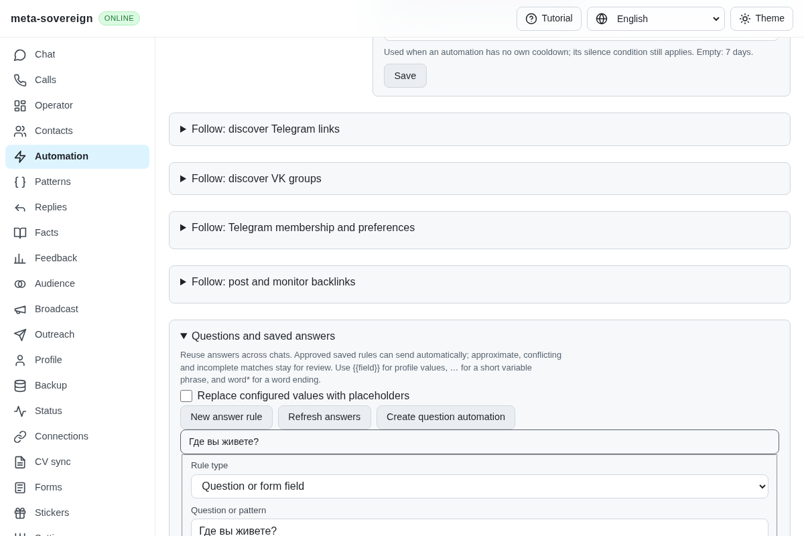

# Keep restored saved-answer disclosures open during verification

The exact `72dc955297ef1c6b6bbd25f67c3d77ae25e6951c` source failed
[WebKit shard 7](https://github.com/link-foundation/meta-sovereign/actions/runs/44348205096/job/134960472696)
in [PR57](https://github.com/link-foundation/meta-sovereign/pull/57).
Lines 793–795 of the retained full job log identify a saved-question lookup
timeout. The failure screenshot shows its parent disclosure closed. After
reloading, the test unconditionally clicked the summary; that closes a section
when the browser restores it open.

The test now uses the existing `openQuestionDisclosure` helper after reload.
The saved-question selection, exact answer and equivalent-question assertions,
production controls, native engines and hosted budgets remain unchanged.
This correction changes the test only.

The finite regression loads the exact published entry, restores the open state
through visible controls, and stops after its existing persistence assertions.
The published code closes the section and fails the same lookup. The corrected
entry passes all three persistence checks with the section open and zero
provider sends. Each run uses an isolated memory store and closes its own
browser/server. The probe alone uses a three-second locator bound; CI deadlines
are unchanged. The full Chromium/WebKit sequence remains mandatory in CI.

```sh
# Set QUESTION_RELOAD_PARENT=1 to load the published entry instead.
RUN_BROWSER_E2E=1 E2E_BROWSER=chromium E2E_EXECUTABLE_PATH=/usr/bin/google-chrome E2E_ARTIFACT_DIR=ci-logs/question-reload-current QUESTION_RELOAD_BEFORE=ci-logs/question-reload-current-open.png QUESTION_RELOAD_AFTER=ci-logs/question-reload-after.png NODE_OPTIONS=--max-old-space-size=384 node experiments/issue-56/question-reload-disclosure.mjs
python3 -B experiments/issue-56/collect-question-reload-disclosure.py
```

Published WebKit failure:



Focused native Chromium verification after the correction:



The [evidence archive](data/question-reload-disclosure.tar.gz) and
[manifest](data/question-reload-disclosure.tar.sha256.json) retain full hosted
diagnostics, original/current entries, the probe, screenshots and scoped checks.
No acceptance criterion is completed here. The inventory remains **88 verified
/ 30 unfinished** and PR57 remains draft and unmerged.
