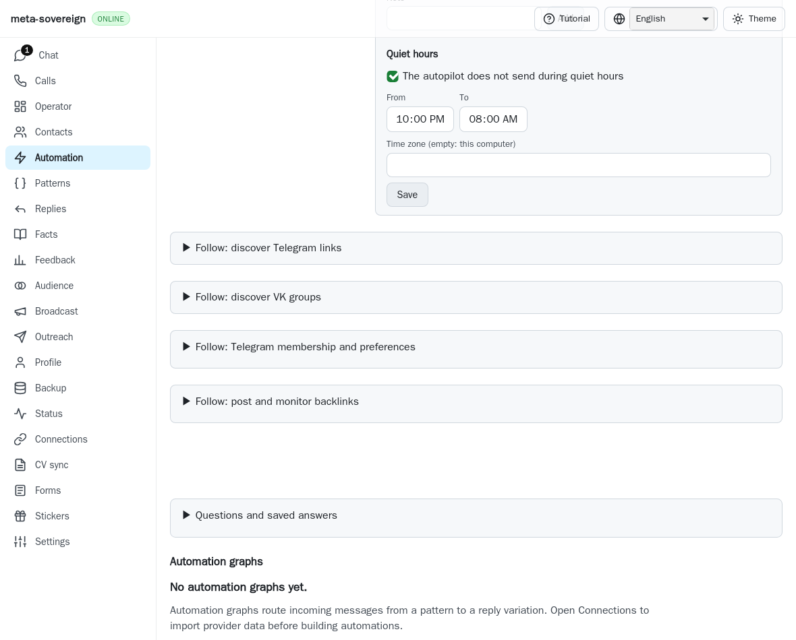
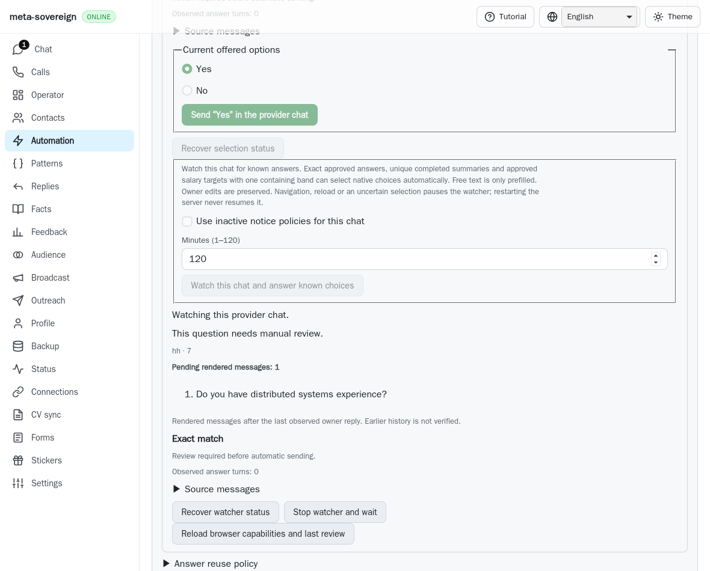

# Native question disclosure activation

At source `8c2260b6dc99ad04e44f2b2001b774be98b0ede5`,
[WebKit partition 2](https://github.com/link-foundation/meta-sovereign/actions/runs/44083368164/job/134043186046)
failed before the first question watcher case. Raw job log lines 2377–2379
record trusted pointer-down and focus on the root summary, without a click
or toggle; the root remained closed. Lines 2385–2407 show the subsequent
15-second wait for its hidden child summary. The downloaded failure PNG also
shows the closed root. Sixteen browser controls and three summary cases had
already passed. This is an opener failure, rather than evidence of a failed
watcher assertion.

The correction reuses the existing native disclosure helper for both summaries.
It focuses the visible summary, checks actual focus, presses Enter once and
checks the resulting open state. It neither assigns `open` nor repeats a toggle.
The existing mandatory Follow regression already verifies that helper against
coordinate movement and checks preservation of owner edits. All question cases,
including the new owner-clear retry and repeated-answer review, remain enabled.

The finite question experiment moves the summary after focus, between native
pointer-down and pointer-up. It reproduces the missing click/toggle and hidden
child timeout against the actual failing helper. The corrected helper completes
the same isolated native WebKit review case, records one layout movement and
reports no page errors. An earlier probe using ordinary Playwright `click`
recovered the movement and passed five parent watcher cases; its final case-count
mismatch was not a reproduction. That negative probe is retained separately.
The historical trace does not measure layout movement, so the finite experiment
establishes a reproducible failure mechanism, not proof of that historical cause.

```sh
PYTHONDONTWRITEBYTECODE=1 python experiments/issue-56/watch-disclosure-coordinate-parent.py
NODE_OPTIONS=--max-old-space-size=384 node experiments/issue-56/watch-disclosure-coordinate.mjs
```

The parent wrapper expects the bounded failure and always restores the helper.
The screenshots show the failed parent opener and successful native review:




The checked archive retains raw job logs, job metadata, the downloaded hosted
failure PNG, both local results, the negative probe and exact parent/current
helper bytes. Hosted verification of the published correction remains required.
All forty unchecked original criteria remain unfinished; PR57 stays unmerged.
