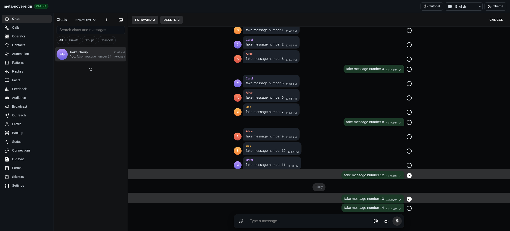
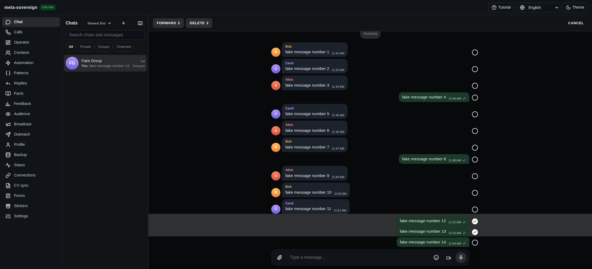

# Selection seam fixture crosses midnight

Issue [#56](https://github.com/link-foundation/meta-sovereign/issues/56),
PR [#57](https://github.com/link-foundation/meta-sovereign/pull/57), 2026-11-15.

Exact published `060048e9` Checks run `43656081415`, created at 00:01:12 UTC,
fails Chromium shard 1 job `132635591776`. Preserved job-log lines 971–974
report the 2200px selection seam assertion: selected pixels are `[47,48,50,255]`
but a 68px interior span is `[8,9,11,255]`. The downloaded artifact is a valid
2200×1000 PNG. It shows message 12 at 23:59, a **Today** divider, then message
13 at 00:00. Input tracing places both actual selection clicks on their rows.

The test seeds messages one minute apart using `Date.now()`. At approximately
00:07 UTC the sampled pair crosses midnight. The application correctly inserts
a date divider and starts a new sender run; the test incorrectly assumes those
rows are adjacent and samples every pixel across the divider as a selected seam.

Pin the fixture to a fixed noon UTC date and explicitly set its browser context
to UTC. An added precondition checks that message 13 directly follows message
12 before interaction. All existing selection, clipboard, context-menu, geometry,
pixel, appearance, viewport, engine and deadline checks remain. This correction
does not change production rendering or hide date dividers.

## Focused reproduction

Run `node experiments/issue-56/selection-clock.mjs --before`, then the same command
without `--before`. Chrome defaults to `/usr/bin/google-chrome`; override it with
`E2E_EXECUTABLE_PATH`. The finite script evaluates the actual complete fixture
seed from exact `060048e9` or the working file, with the former clock fixed at
`2026-11-15T00:07:32Z`. It opens one owned memory-store server, one browser and
one 2200px viewport, and reuses the original pixel sampling and tolerance.

- Before: a real Today divider, 65.59px inter-row gap and two pixel colors;
  the original uniformity assertion fails as expected.
- After: adjacent rows, 3.20px inter-row gap and one pixel color; the original
  assertion passes. Selection and clearing preserve bubble geometry within the
  original one-pixel tolerance in both comparisons.
- Both comparisons have zero page exceptions, no provider account and fully
  closed browser/server resources. Full browser and appearance matrices remain
  in hosted CI; they are not repeated locally.

The [checked evidence](data/selection-clock.tar.gz) and
[SHA-256 manifest](data/selection-clock.tar.sha256.json) retain the actual hosted
failure, artifact, source snapshots, exact-parent seed, before/after results and
screenshot hashes. All five corrected-head `d34db92c` workflows pass, including
every browser shard; see [hosted verification](hosted-verification-d34.md).
Every remaining incomplete criterion stays active; PR57 remains draft and unmerged.
