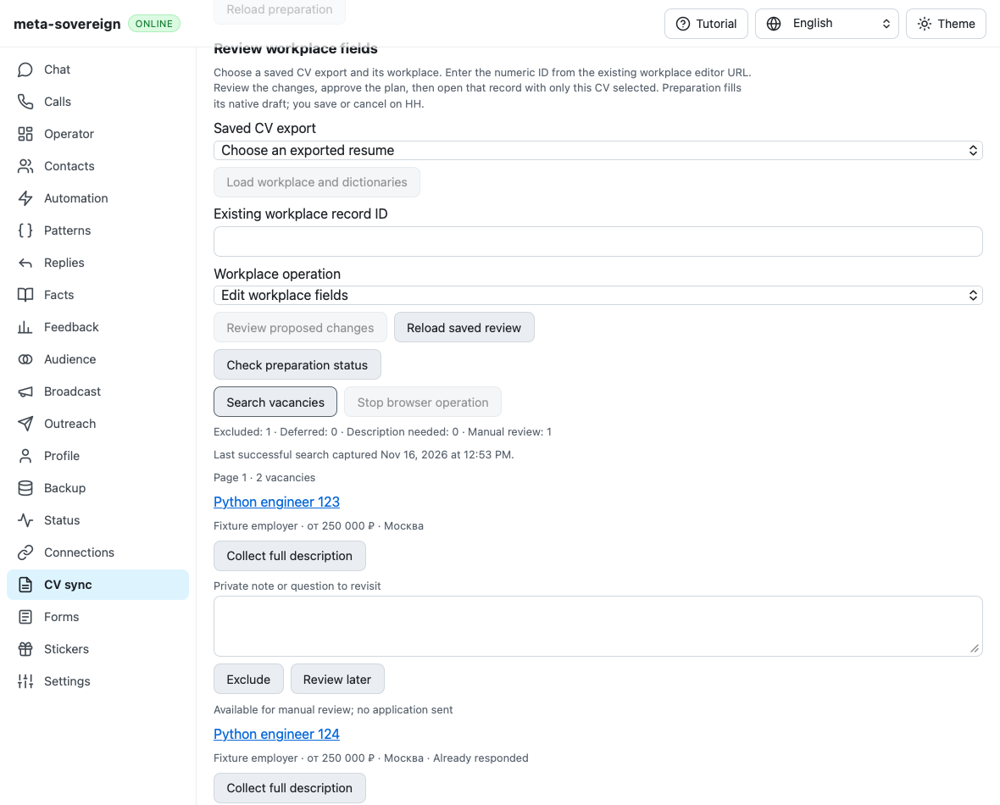

# Native exclusion entry remains unresolved

The first attempt of [run 43866354517](https://github.com/link-foundation/meta-sovereign/actions/runs/43866354517), created 2026-11-16 at 12:24:56 UTC for `5936c54435477feceab16c2ce6d8db6f74e22817`, fails WebKit fourth-shard job `133298002525`. Its preserved raw log lines 1057–1074 show an empty exclusion textarea and empty acknowledged `excludeText` setting. The first vacancy is `review`, and the second is `responded`. The 30-second wait for `needs-description` therefore fails.

These decisions match the actual saved settings. The fixture called `fill('final paragraph')` before Search, but it captured no event or immediate native/rendered receipt of that call. The evidence cannot distinguish a missing native input from a later controlled-value reset. The existing same-turn input-order probe passes; neither it nor another passing retry proves the hosted cause.

The shared fixture input trace now records focus, control node identity, native value length and rendered/default length, retaining only the latest 60 events and no entered text or keyboard keys. It installs in both the current document and future reloads. Selection prints an entry snapshot before each Search when the existing CI input-debug flag is enabled, then retains the bounded trace on failure. VK cache refusal diagnostics reuse it after reload. Product behavior, test assertions and deadlines remain unchanged.

The native screenshot comes from [artifact 14228426951](https://github.com/link-foundation/meta-sovereign/actions/runs/43866354517/artifacts/14228426951), whose ZIP SHA-256 is `1bde840a4e6fd493ef125519e0e94b537cb4b941ec12be2c24e9d6db22fbf124`. It shows the actual failed decision state before fixture cleanup:

All VK scenarios in this job passed, including cache reload. Those passing scenarios do not explain the earlier cache failure or the current vacancy failure. The failed attempt remains evidence even if a repeated CI attempt passes. HH02, HH03, HH05 and VK24 stay unfinished; the complete issue remains active and PR57 stays draft and unmerged.

Two focused Node checks pass for event bounds, value privacy, current/reloaded document installation and the existing résumé trace. One owned WebKit selection case passes with four input snapshots, no provider clicks and no page errors; all fixture resources close. That local result remains a negative reproduction. Scoped lint and formatting pass.

Evidence: [archive](data/ci-selection-entry.tar.gz), [hash manifest](data/ci-selection-entry.tar.sha256.json).
