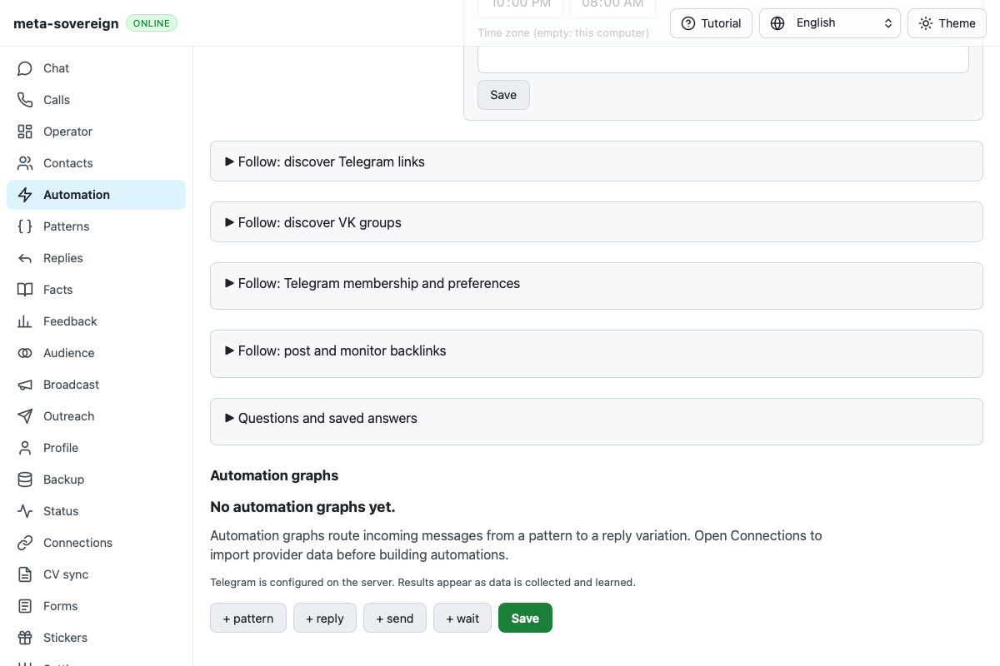
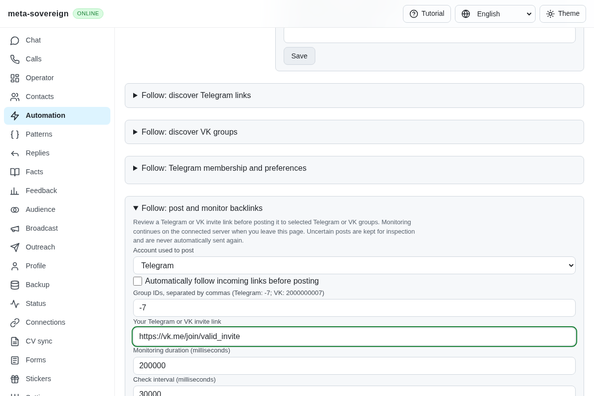

# Telegram Backlinks native disclosure investigation

[PR #57](https://github.com/link-foundation/meta-sovereign/pull/57) remains draft
and unmerged. This unit adds diagnostics; it does not establish a fix for the
hosted disclosure failure or complete the other unchecked issue criteria.

Published `bd954afdf44e681abbf5d4cc97b1bd8ed50efb9a` Checks run
[43487554932](https://github.com/link-foundation/meta-sovereign/actions/runs/43487554932),
created `2026-11-13T18:57:17Z`, fails WebKit shard 3, job `132101730005`.
Raw job lines 1918–1939 show the Telegram Backlinks fixture's first
`selectOption` timing out after 30 seconds because its source field is hidden.
The downloaded artifact is a verified 1200 × 800 PNG. It shows the outer
Backlinks disclosure closed, with no dialog obscuring it.

The same production control previously failed in the ordinary VK Backlinks
fixture. That fixture already uses the shared default-off disclosure trace;
the Telegram fixture did not. The Telegram fixture now captures snapshots
after initial navigation, after its original summary click and on failure.
The existing helper retains at most 64 events per document, including trusted
pointer/click targets, native toggles, node identity, document time origin and
open/connected state. It excludes provider text and field values. Hosted CI
already enables `CI_FOLLOW_DISCLOSURE_DEBUG=1`. The native click, assertions,
navigation and deadlines stay unchanged.

One focused Linux WebKit replay passes the complete existing Telegram
Backlinks workflow. Its trace shows the trusted pointer/click sequence opening
the same connected node. An independent Playwright MCP replay against the
isolated fixture also opens the original node and edits the visible Telegram
fields without page errors. Its initial script-format error was corrected
before collecting the successful result. Both browsers and fixture servers
are closed after the checks. Neither passing local replay explains the hosted
closed state; the next hosted recurrence must retain its event trace.

Reproduce the native workflow with `RUN_BROWSER_E2E=1 E2E_BROWSER=webkit
CI_FOLLOW_DISCLOSURE_DEBUG=1 node js/tests/e2e-follow-telegram-backlinks-browser.mjs`.
For the independent MCP check, start
`node experiments/issue-56/telegram-backlinks-ui.mjs`, navigate to its printed
isolated URL, and execute the function in
`experiments/issue-56/telegram-backlinks-disclosure-mcp.mjs` with the trailing
semicolon stripped. Send `quit` to close the fixture. The
[checksummed archive](data/ci-telegram-backlinks.tar.gz) retains source,
exact-parent job/artifact metadata, failure logs and local observations.

The parent native Rust and Linux/Windows Bun jobs pass. That verifies their
preceding units, not the unpublished native owner-clock unit. Exact new-head
hosted checks, the disclosure root cause, durable native replication and all
other unchecked original requirements remain unfinished.
