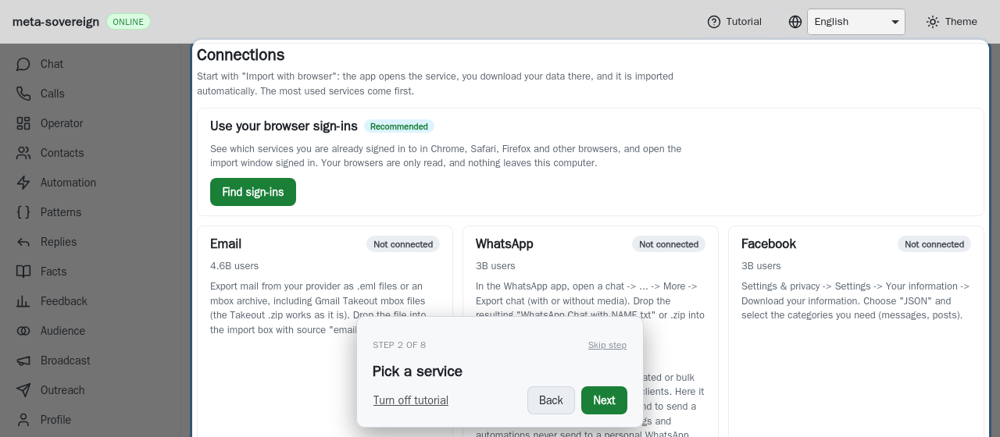
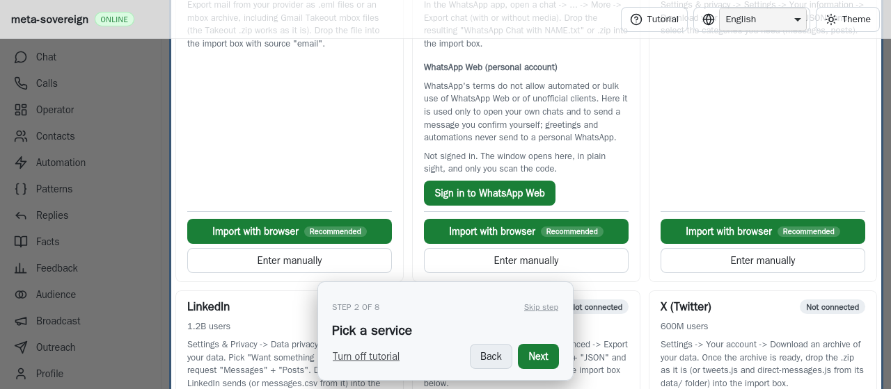
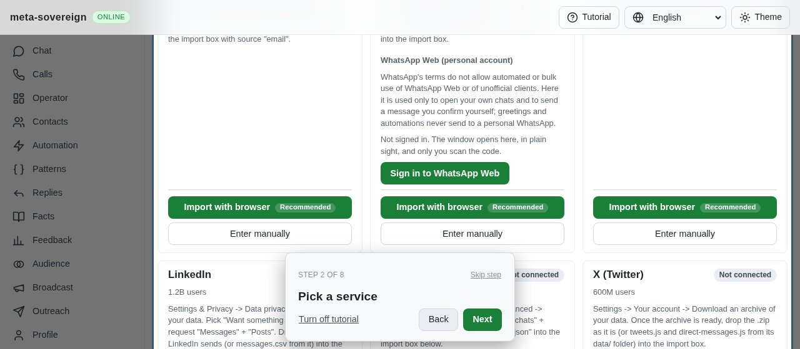

# Keep the tutorial's required control on screen

[PR 57](https://github.com/link-foundation/meta-sovereign/pull/57) retains a failing WebKit result from [Checks run 42886382414](https://github.com/link-foundation/meta-sovereign/actions/runs/42886382414), for exact commit `cea1af881de48120c78528be6faeeb713e63a788`. Full downloaded log line 93,361 reports the short-desktop / tall-card Email control at top 736, height 36, outside a 560px viewport. The compact tutorial card occupies top 405, height 143; the button is not covered by that card, but it is off screen. The later `38b69101` matrix passes; that intermittent success does not explain or remove this condition.

## Cause and correction

The clearance pass checked overlap with the tutorial card but accepted a required control outside the viewport or behind the sticky header. The deterministic unit regression supplies an unoccluded control below the viewport, above it and behind the header. Before the correction it reports `clear` without scrolling. Screen bounds and the header are now part of the check, retaining the existing finite scrolling and gesture ownership.

The real browser regression exposed a second cause. A correction to clearance alone revealed the button during the first pass, but an independent reveal retry later scrolled the whole tall section back to its top. The preserved diagnostic log records control top 357 during clearance and top 717 afterward. Both passes now use the same actual Email button, while the whole services section remains highlighted. This avoids conflicting scroll destinations. Position-only diagnostic tracing is opt-in through the existing `metaSovereignDebug` flag.

The existing walk's bounded settlement loop now waits for any unready condition, including missing or offscreen controls, within its unchanged twelve-attempt budget. Its final assertion still requires a found, uncovered, onscreen control; no timeout or acceptance condition is relaxed.

## Reproduction and verification

`TUTORIAL_CONTROL_ONLY=1 RUN_BROWSER_E2E=1 E2E_BROWSER=webkit node js/tests/e2e-tutorial-card-resize-browser.mjs` selects only the new regression. Its isolated empty fixture opens the actual Connections page in a 1280×560 viewport, makes the first service's required control start below the viewport and withholds tutorial-card ResizeObserver notifications. It lets all bounded production placement attempts finish without clicking or scrolling the control from the test. Before the correction the button remains at top 717.40625, bottom 753.40625 and is not clickable. Afterward it remains at top 357.40625, bottom 393.40625 and the hit test reaches the actual button.

The new helper also runs by default in the existing mandatory card-resize browser check, after its earlier import-panel regression. Forty-four focused Node checks and 44 Deno checks pass. The WebKit card-resize check and the existing short-desktop tutorial walk with normal and enlarged text pass. Independent Playwright MCP reproduces the same fixture geometry and confirms the button is clickable without owner scrolling. All isolated servers and browsers are closed afterward. Full browser/runtime matrices remain hosted checks for the new commit.

The added spacing is a deliberate fixture condition, not a production style change. These screenshots show the actual page and tutorial before and after the correction:

The [archive](data/tutorial-required-control.tar.gz) and [manifest](data/tutorial-required-control.tar.sha256.json) preserve the full earlier CI log and exact metadata, failing unit/browser checks, intermediate tracing, passing focused checks, source/test snapshots and screenshot hashes. This resolves the investigated placement condition; all unchecked issue-wide requirements remain required and PR 57 remains draft and unmerged.
