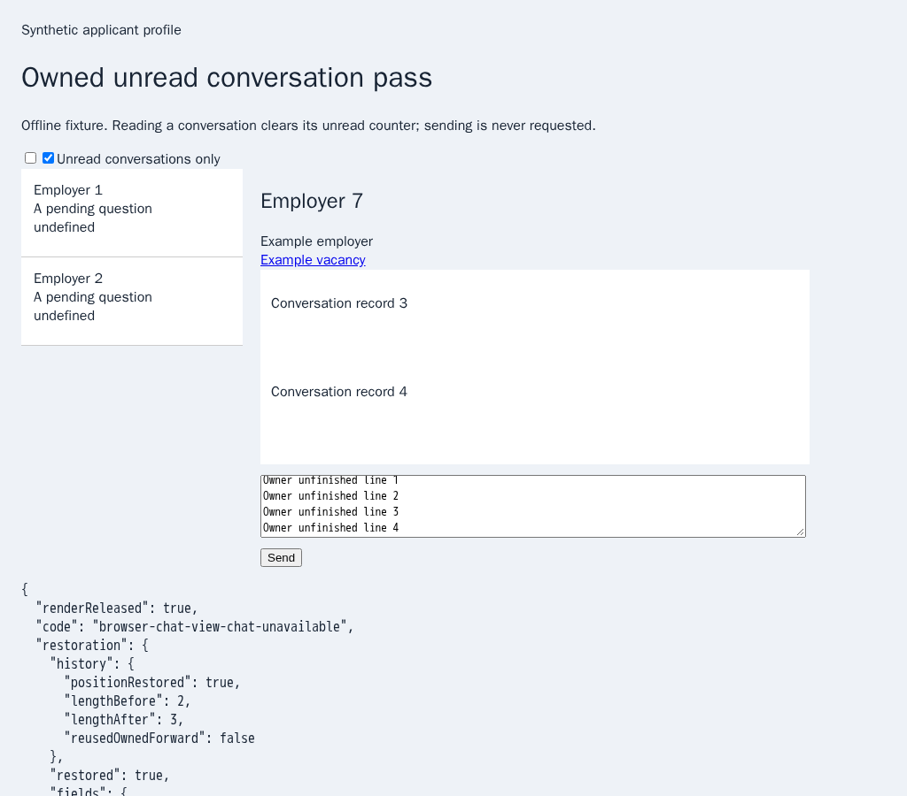
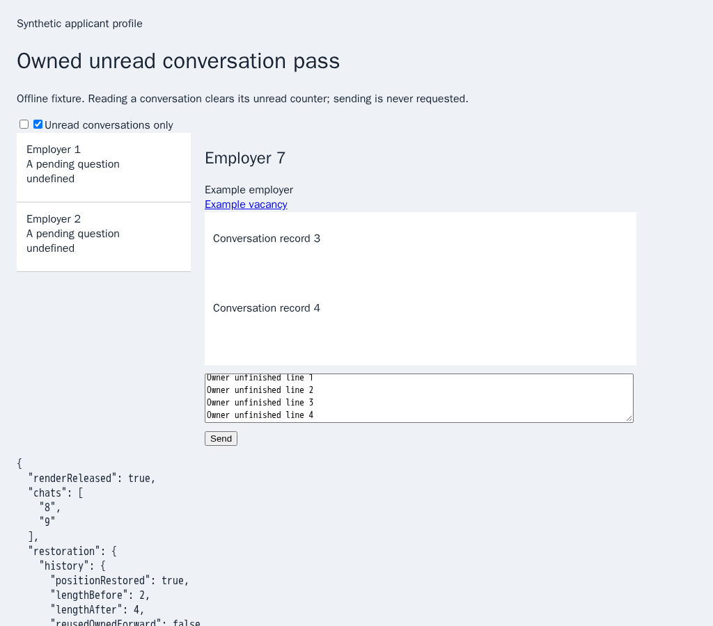

# Rechecking a chat after its virtual list renders

PR: https://github.com/link-foundation/meta-sovereign/pull/57

Chromium job `132370298746`, run `43569152391`, failed on published commit
`e8533c0c478ee997c3974caf63798bd74e1619f3`. The complete 1,449-line job log and
browser artifact are preserved. Log lines 1153–1164 report
`browser-chat-view-chat-unavailable`; lines 1174–1189 report successful restoration
of the owner's original chat state. The artifact identifies the unread guards
group but contains no screenshot of that failure.

An ordinary local run of all ten relevant guards passes. That does not establish
the hosted trigger. Targeted inspection found a race: a virtual render can finish
after locating the target but before reading the list status. A settled bottom
then causes the earlier “missing” result to be treated as current.

The finite regression releases one native virtual render exactly between those
reads. The unchanged published reveal code fails with the same error even though
chat 9 has rendered. The correction rechecks that target before refusing at the
settled end. Existing deadlines, ownership, fresh activation and restoration
guards remain in force. Default-off diagnostics report the end recheck result.
The precise timing of the original hosted render was not recorded.

```sh
RUN_BROWSER_E2E=1 E2E_BROWSER=chromium E2E_EXECUTABLE_PATH=/opt/google/chrome/chrome node --max-old-space-size=384 experiments/issue-56/unread-reveal-native.mjs
node --max-old-space-size=384 --test --test-concurrency=1 js/tests/browser-unread-conversations.test.js js/tests/question-browser-unread.test.js js/tests/browser-chat-history-tail.test.js
node --max-old-space-size=384 experiments/issue-56/chat-navigation-mcp.mjs --reveal
```

The native regression also checks a target that remains unavailable. It must
refuse, never activate that chat and still restore the owner state. Twenty focused
Node checks pass. Independent MCP uses the production scan bundle with an
independent native page adapter: both chats are read, while owner return interrupts
the pass and preserves the new draft. No send or page error occurs; browsers and
fixtures close. The new cases join the existing hosted unread-guards group.

The controlled parent failure restores the owner state before returning its error:



The corrected pass visits both chats and restores the same state:



The reusable parent reproduction is `PYTHONDONTWRITEBYTECODE=1 python3 experiments/issue-56/unread-reveal-before.py`.

Sources, the complete hosted log and artifact, local failures/successes and
screenshots are preserved in `data/ci-unread-reveal.tar.gz` and its per-file
`data/ci-unread-reveal.tar.sha256.json` manifest. Final exact-head CI and every
original unchecked requirement remain required; PR57 remains draft and unmerged.
