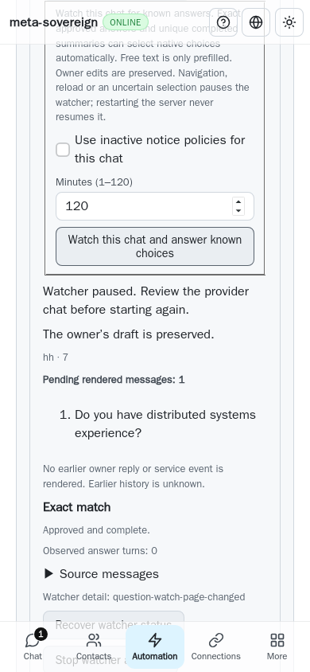

# WebKit watch disclosure investigation

The first current-chat watch scenario in [Checks run 43107866221](https://github.com/link-foundation/meta-sovereign/actions/runs/43107866221), created 2026-11-11 21:59:29 UTC for `2efd33cd`, failed before starting a watch. Job `130817278611` reaches the native parent summary click, then waits for the hidden child “Provider browser answers” summary until the unchanged 15-second deadline. Raw job lines 858–891 identify the first `open()` call, after the preceding controls and summary-choice scenarios passed. Pipeline job `130825471218` lines 349–354 reports the corresponding browser/test/CodeQL failures. This is a different observation from the earlier retained-document disclosure case; its root cause has not been established.

Two bounded local WebKit runs execute the real production watch fixture, with all five cases passing and no page errors. They cover delayed native choices, automatic draft clearing, preserved owner edits, lost-response recovery and same-URL navigation pausing the original watch. The local traces show trusted pointer/click delivery, the same root node opening and the child opening normally. These passing runs do not reproduce or fix the hosted failure.

The fixture now supports `CI_QUESTION_WATCH_DEBUG=1`, enabled explicitly in browser CI and otherwise off. It reuses the bounded input/detail recorder to record control identity, native click/toggle delivery, node identity and current open state before and after the two original clicks. It records no question, answer or draft contents. Failed runs capture all still-open pages without scrolling into the hidden child; capture errors retain the original failure. Opening behavior, assertions, deadlines and watch scenarios are unchanged. The next hosted recurrence must supply evidence before changing that behavior.

Local commands:

```sh
CI_QUESTION_WATCH_DEBUG=1 NODE_OPTIONS=--max-old-space-size=384 node experiments/issue-56/watch-disclosure-browser.mjs
```

The installed WebKit is used without downloading browsers; the browser and fixture are closed after each run. Five PNGs preserve the passing local states. The image below is a local paused-watch result, not a before/after claim for the unresolved hosted failure.

Four browser-shard contract checks pass. Scoped lint, formatting and secret scanning pass; duplication remains below the unchanged 6.5% gate at 38,711 / 596,699 lines (6.49%).



Evidence: [ci-watch-disclosure.tar.gz](data/ci-watch-disclosure.tar.gz), its adjacent SHA-256 manifest, source snapshots, both full local traces, exact hosted job/pipeline logs and timestamp/SHA metadata. The current `f7f63482` Security run passes, including JavaScript CodeQL; the broader Checks run was still queued when this investigation was recorded. Hosted watch confirmation and every unchecked issue criterion remain unfinished; PR57 stays draft and unmerged.
