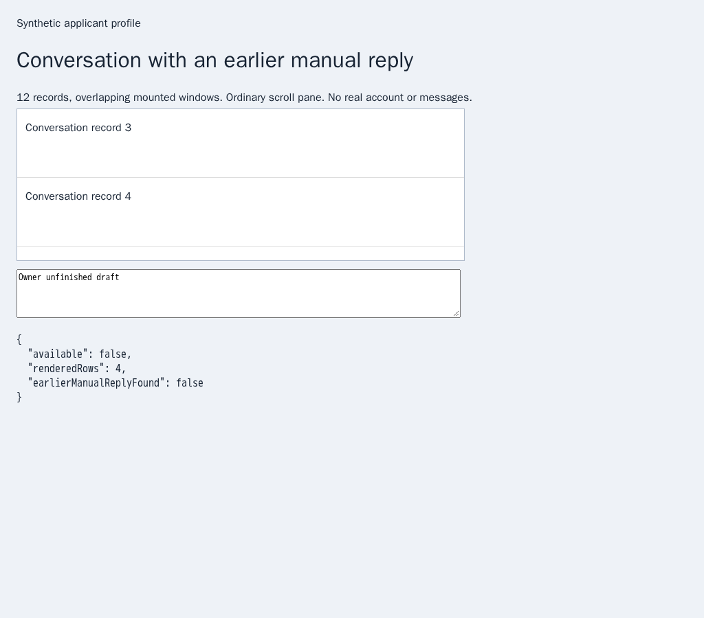
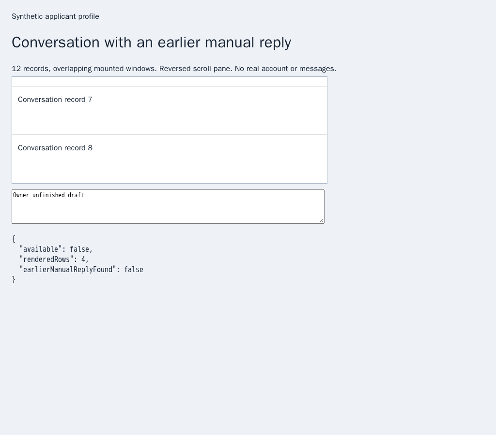
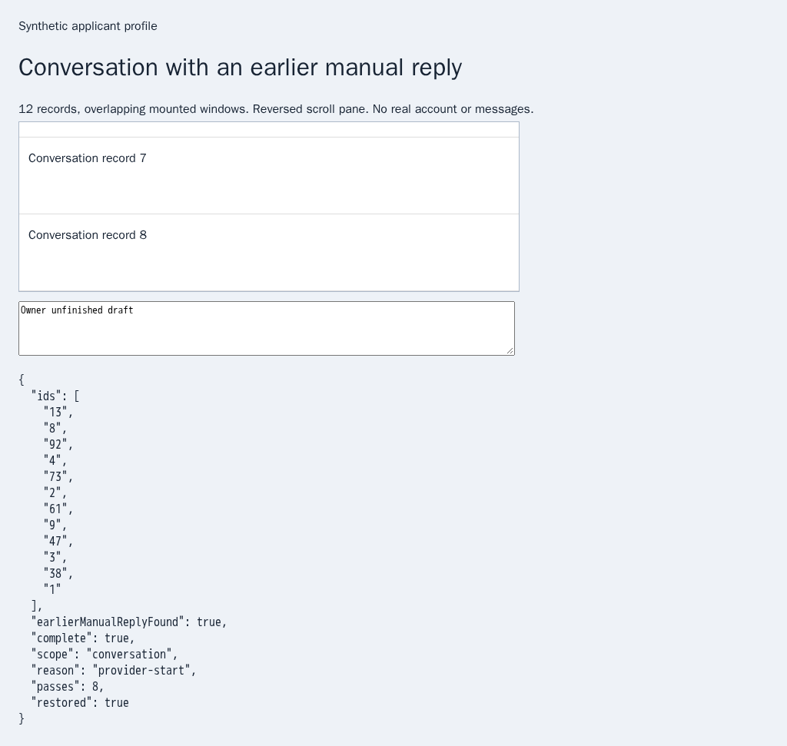
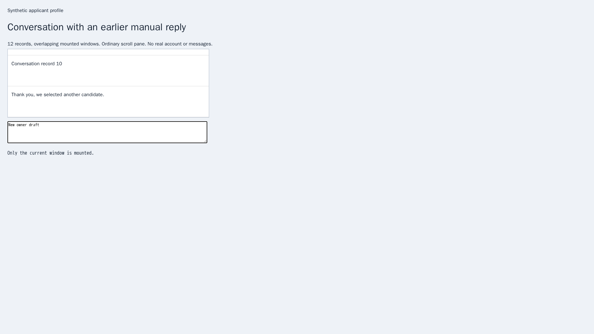

# Read complete HH history before deciding whether a reply is needed

Issue [56](https://github.com/link-foundation/meta-sovereign/issues/56), [PR 57](https://github.com/link-foundation/meta-sovereign/pull/57). This is a prerequisite for reference requirements C9 and D. Guarded background acknowledgement/rejection delivery, shared CLI/Lino/React orchestration and live provider verification remain unfinished.

## Reproduction and correction

Parent `e0b0bbdcd11b06679337a5c5b40e72f02da9af5d` reads only mounted HH messages. In the finite twelve-record fixture, an earlier manual reply is outside that window. Reading the latest rejection alone cannot establish that another reply is needed. The actual-parent admission regression fails because no conversation traversal exists; before screenshots preserve the mounted-window limitation in ordinary and reversed panes.

`createBrowserSender().scanConversation({source: 'hh', chat: '7'})` now traverses overlapping mounted windows in one verified native conversation. It starts at the newest edge, walks toward older messages and merges by overlap in provider DOM chronology. Numeric message IDs never establish order. Gaps, reordered or edited records, navigation, replaced containers and owner activity stop collection with explicit incomplete coverage.

Only reaching the oldest edge with the provider's original vacancy-application marker proves complete conversation coverage. A stalled edge without that marker remains incomplete. Defaults bound collection to 500 records, 100 passes and 30 seconds; validated overrides have finite maxima. The transcript has a separate one-million-character limit, and the existing native reader limits each mounted window and message body. Loading passes consume the same budgets. `MS_BROWSER_HISTORY_DEBUG=1` enables count/reason diagnostics without message or draft text.

The browser check exposed ephemeral answer-control metadata on each mounted tail. Transcript collection excludes that metadata: the last mounted record changes as scrolling removes newer records. Stable bodies, IDs, direction, timestamps and application markers remain checked. A later send must independently inspect current native controls and revalidate the conversation; a history result never authorizes delivery.

The scanner captures the reading anchor and composer values privately without writing the draft. It restores the anchor after virtual rows remount, preserving selection. Wheel, touch, keyboard, pointer, input, changed draft values and changed composer nodes give the owner control; restoration then stops. Original and replacement documents retain their own identity. Cancellation and shutdown drain queued and active scans and remove temporary ownership listeners. Other providers require an explicit traversal contract and otherwise refuse without opening a browser.

## Verification

- Actual parent: the public admission regression fails; both browser fixtures confirm traversal is unavailable and miss the earlier manual reply.
- Nineteen focused Node checks pass, including eight new history checks, existing list contracts and queued cancellation/shutdown for both scanners.
- Thirty focused production Chromium cases pass: sixteen history cases, twelve existing HH scan cases and two HH list cases. These include active shutdown and are registered for both CI browser engines. The earlier standalone probe also passes fifteen history cases.
- Independent Playwright MCP recovers all twelve records in ordinary and reversed panes, including the earlier manual reply, while preserving draft, selection and original scroll offsets `300` and `-300`. A stalled edge remains incomplete; new owner input remains untouched. There are no page errors, native clicks or text sends. The browser closes afterward.

```sh
PYTHONDONTWRITEBYTECODE=1 python3 experiments/issue-56/conversation-history-before.py
node --test --test-concurrency=1 --test-timeout=10000 js/tests/browser-conversation-history.test.js js/tests/hh-chat-scan.test.js js/tests/hh-chat-scan-sender.test.js
RUN_BROWSER_E2E=1 E2E_EXECUTABLE_PATH=/opt/google/chrome/chrome node js/tests/e2e-question-chat-lists-browser.mjs
node experiments/issue-56/conversation-history-mcp.mjs
```

The last command prepares an independently executable MCP script in `ci-logs`; the evidence archive retains the actual MCP response. All conversations and routes are synthetic, isolated from the user's application server and real provider accounts. The [verified archive](data/conversation-history.tar.gz) preserves sources, parent snapshots, checks and screenshot hashes.

## Visual evidence

The reading position and draft stay the same. The result changes from an incomplete mounted window to a complete transcript containing the earlier manual reply.

| Layout   | Parent                                                                                          | Fixed                                                                                         |
| -------- | ----------------------------------------------------------------------------------------------- | --------------------------------------------------------------------------------------------- |
| Ordinary |  |  |
| Reversed |  |  |



## Hosted verification remains required

The exact-parent [Checks run 43055400720](https://github.com/link-foundation/meta-sovereign/actions/runs/43055400720) was created on 2026-11-11 at 16:08:57 UTC for `e0b0bbdc`. Its Chromium [job 130645101775](https://github.com/link-foundation/meta-sovereign/actions/runs/43055400720/job/130645101775) fails before tests. Preserved raw job log lines 662–670 report missing font packages because `security.ubuntu.com` cannot resolve; line 674 records the failed command. The separate [Pages run 43055400825](https://github.com/link-foundation/meta-sovereign/actions/runs/43055400825) also cannot resolve Ubuntu archive/security hosts and is cancelled during browser dependency installation (raw lines 1299–1324). These failures do not verify the new implementation. Exact new-head CI, older unresolved browser failures and every unchecked issue criterion remain active; PR 57 stays draft and unmerged.
