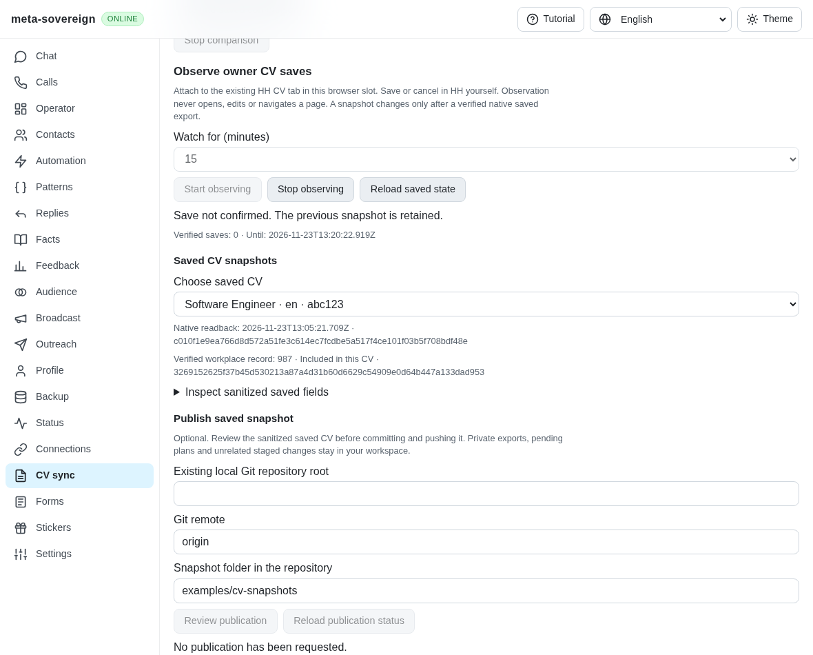
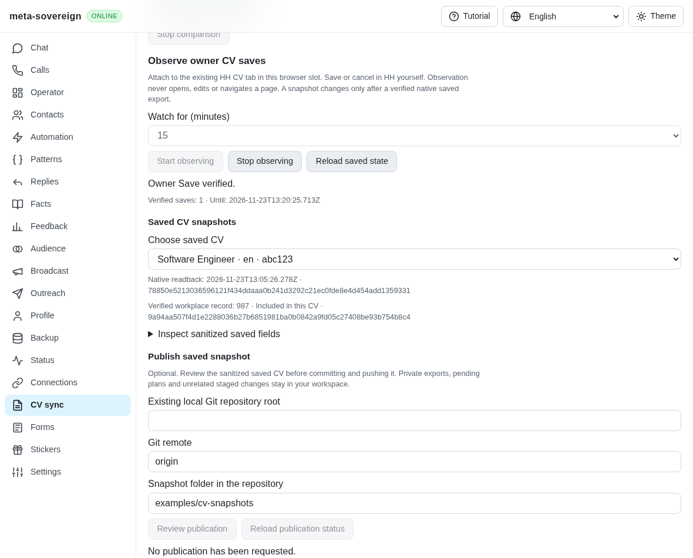
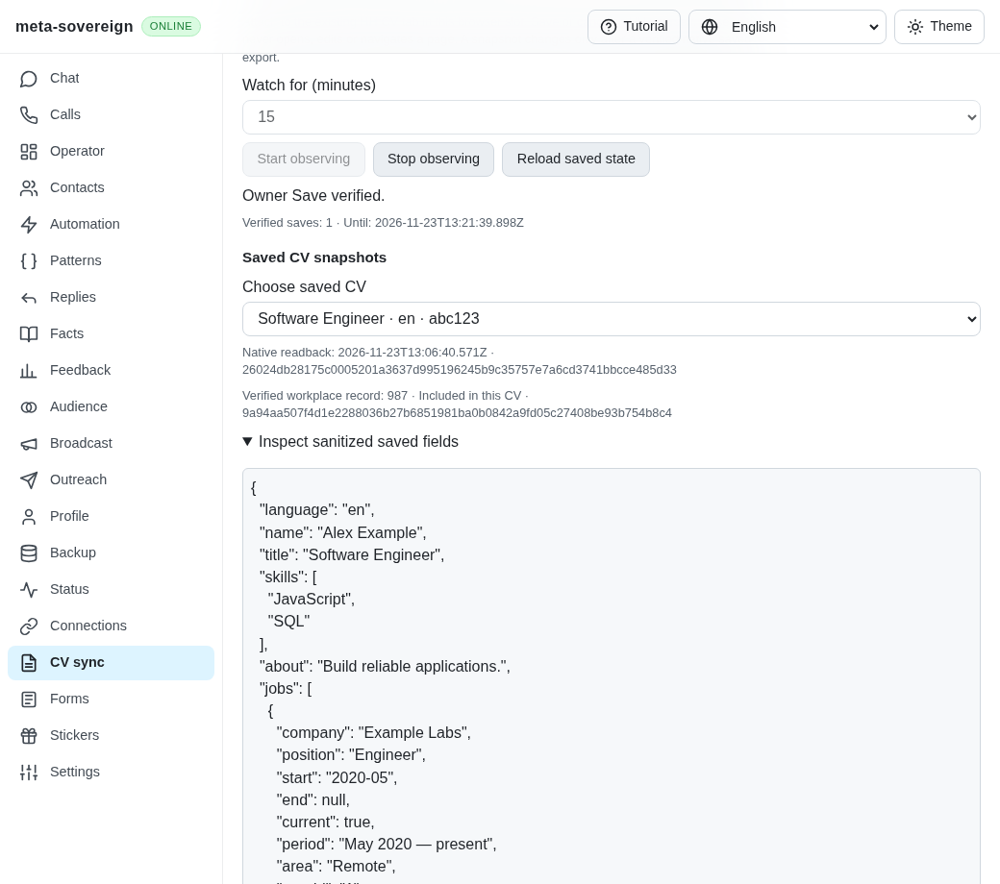
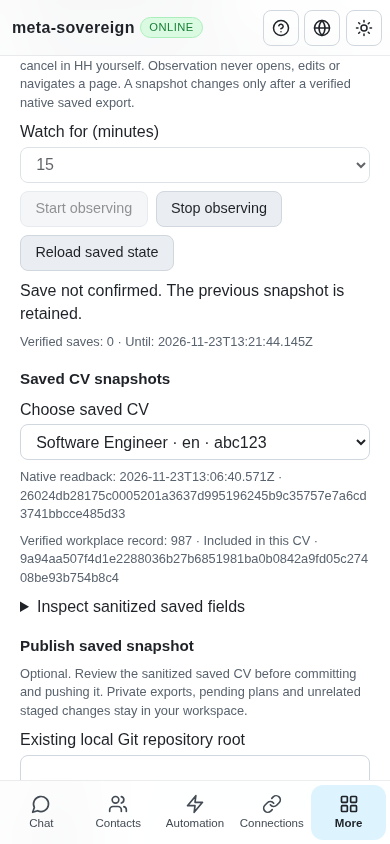
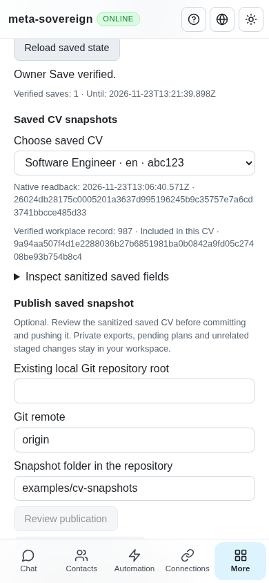

# Owner Save verification for identical HeadHunter workplace copies

## Reproduction

Attach the Save watcher while the target-only copy is open. Keep the original
fields unchanged and click Save in the native form. In parent
`f1467967b26789dd735b21705a975d998ea2c775`, the provider can return one additional
record ID while the exported CV lags behind. The watcher accepted one matching
old job and refused a fresh export containing both identical jobs. Three focused
tests reproduced the missing verification. Chromium reproduced both outcomes
using the actual parent modules without replacing files in the checkout.

## Verification rule

While the new form is open, the watcher reads the complete native ID list and
all CV exports represented in the form. These reads use the existing bounded
authenticated GETs. Start checks the current page and has a finite readback
deadline. The watcher retains only per-job fingerprints until the watch ends.

After trusted owner Save, readback requires one additional native ID and
preserves every prior ID. The exact new record must match the final owner fields
and complete native membership. Each checked CV export must preserve the prior
jobs and contain one additional fully matching job. Each unchecked CV must
preserve its previous jobs. The check is independent of export ordering and
preserves duplicates. A missing or stale export retains the previous published
snapshot. The browser watcher issues no native Save, Cancel or navigation.

The same snapshot and watch receipts remain available through the CV panel,
foreground CLI and both Lino encodings. The pre-Save comparison stays private
and in memory. The watcher publishes only the existing sanitized snapshot.

## Checks and evidence

Node, Deno and Bun each pass 52 focused checks. The Chromium Save-watch entry
checks identical and distinct jobs, stale exports, other CV membership, older
and ambiguous native IDs, metadata mismatch, retained snapshots and inert HTML.
Playwright MCP shows the new record `987` with two jobs, recovers it after phone
reload without rereads, and refuses the stale export without replacing the
acknowledged snapshot. The MCP run records two owner Saves and two drained
attachments. All provider operations use the isolated fixture.

The [evidence archive](data/cv-copy-save.tar.gz) preserves exact-parent source
and refusal logs, focused verification and screenshot hashes. This covers part of
HH14–HH16 and HH18 in [PR #57](https://github.com/link-foundation/meta-sovereign/pull/57).
The complete reviewed copy/Save/detach sequence, independent Add and authenticated
HeadHunter parity remain open.
