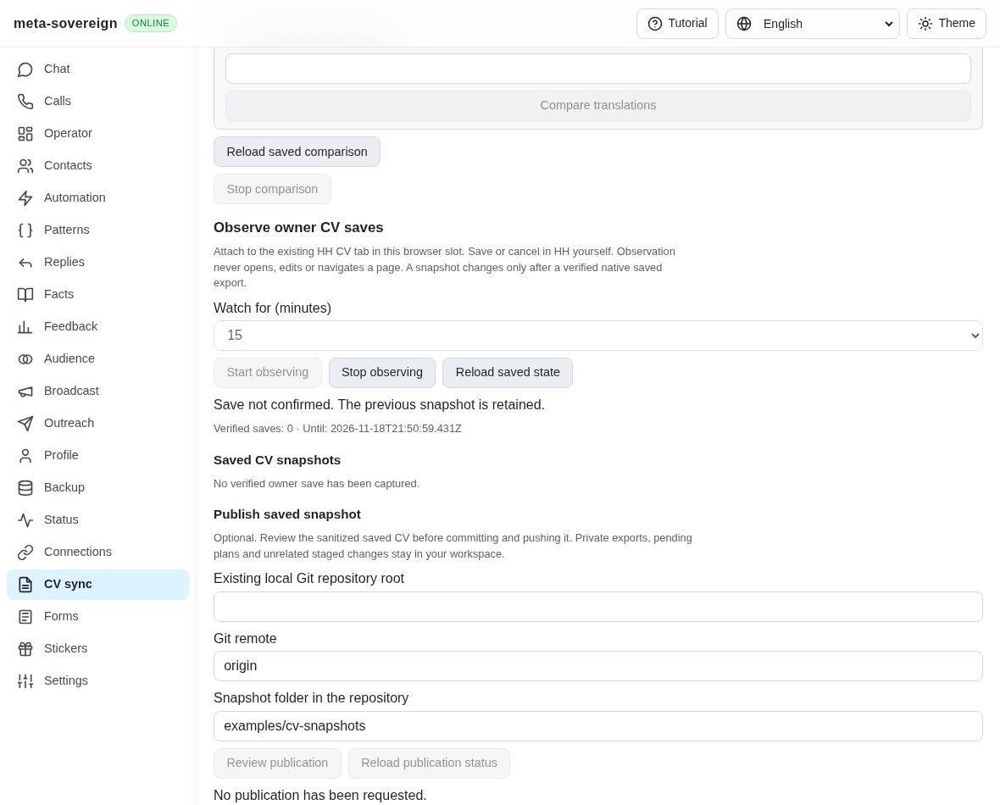
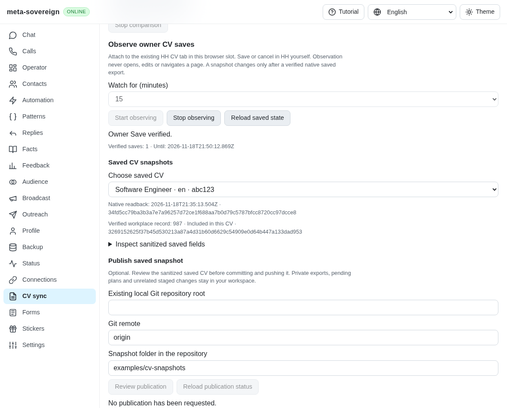
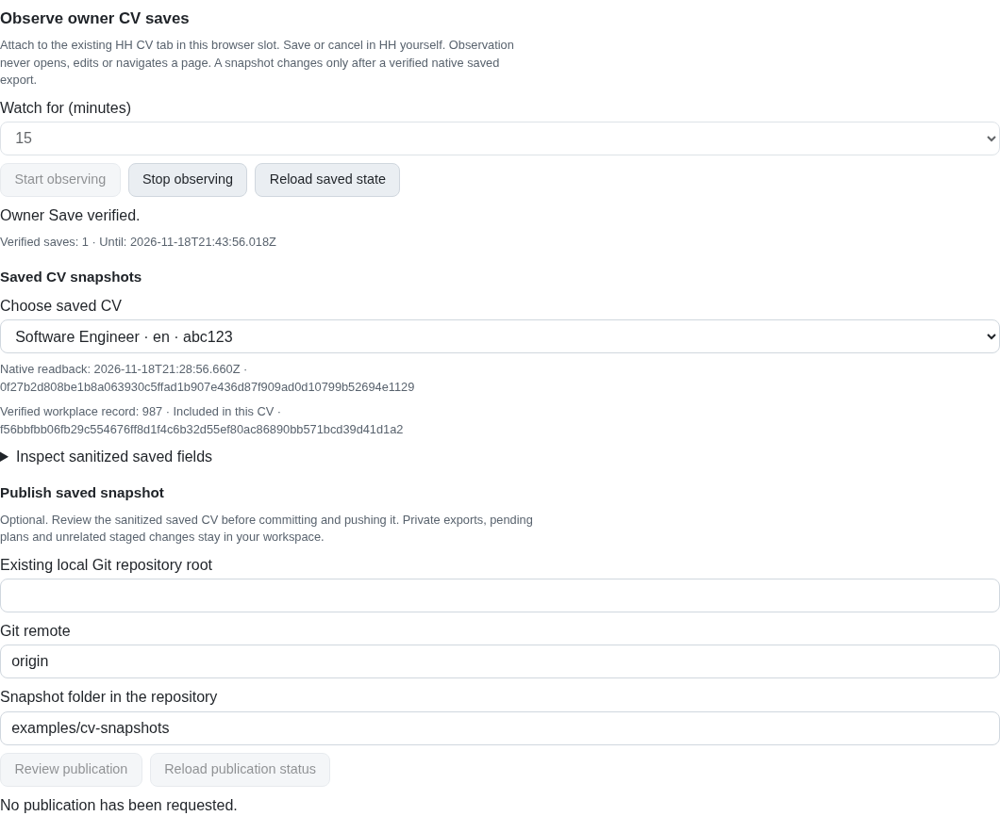
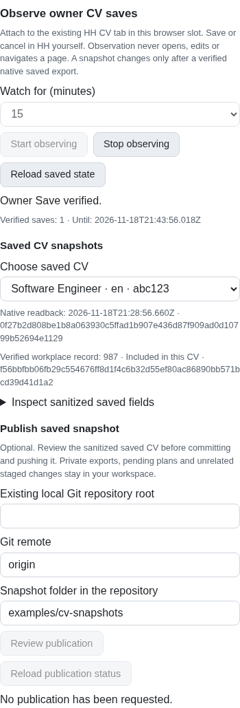

# Owner-created workplace Save identity

PR: https://github.com/link-foundation/meta-sovereign/pull/57

A watcher started on an existing new-workplace form can now verify an owner Save
when complete inert native lists expose one additional numeric record ID. It
then applies the existing exact-record, final-field, membership and fresh-export
checks. This is an HH18 prerequisite; **88/118 criteria remain verified and all
30 unfinished criteria remain required**, including shared copy/save/detach.

## Reproduction and cause

Open a new workplace in HH yourself, leave that form open, start observing that
browser slot, edit the final fields and click its native Save yourself. The
creation URL has no record ID. At parent `a50bf56d`, the captured null identity
cannot pass exact saved-record readback even after the form closes. Matching an
older exported job cannot establish the newly created identity.

The finite parent replay substitutes only the actual parent cycle or runtime
module, restores it in `finally`, and retains the current fixture. Five focused
checks fail against the parent cycle while five independent controls pass. The
native parent reports `not-saved` and fails the new-identity assertion after a
real trusted owner Save. Browser launch failures are retained separately and are
not counted as reproduction evidence.

## Verification contract

Before installing the passive observer on an existing new workplace form, capture
the saved workplace list using an authenticated fixed GET to
`https://hh.ru/profile/edit/experience`. No `resumeFrom` query alters membership.
The response retains the existing no-cache, redirect refusal, 15-second network
and 2 MiB streamed UTF-8 bounds. Parse it as an inert document, never executing
scripts. Require one main region, one native Add control and an unambiguous list
of at most 1,000 unique numeric edit links. Refuse challenges, incomplete controls,
pagination, busy state, foreign origins, duplicate identities and unexpected
query parameters. An explicitly empty list permits the first saved workplace.

After trusted Save, retain the existing closed-form predicate, finite read
retries and cancellation checks. Require exactly one added identity and no
disappearing baseline identities. Read that exact numeric record and verify
every captured field, checkbox membership and affected fresh CV export before
publishing sanitized snapshots. An older matching record, multiple additions or
changed metadata cannot replace prior snapshots. Only a completed publication
can advance this watcher's in-memory baseline. Stop drains issued reads and
leaves the owner tab and draft open. Diagnostics remain default-off under
`CI_CV_WATCH_DEBUG=1`, reporting counts and fixed phases without fields or IDs.

Existing known-ID workplace and About verification retain their earlier paths;
they do not fetch this additional list. Starting observation elsewhere and only
later opening a new form has no pre-Save baseline and stays unconfirmed. Restart
observation with the existing new form open to establish that baseline.

Client-only list identities, hidden/incomplete metadata and authenticated live
HH parity are still unfinished. Complete HTML Add/edit controls are a supported
readback shape, not proof of every current provider rendering. No automatic copy,
old-record deselection, batch checkpoint or provider-side success is claimed.

## Focused evidence

```sh
node --max-old-space-size=384 --test --test-concurrency=1 js/tests/cv-created-workplace.test.js js/tests/cv-save-watch.test.js js/tests/cv-save-watch-recovery.test.js js/tests/cv-save-watch-controls.test.js
python3 -B experiments/issue-56/cv-created-workplace-before.py
CI_CV_WATCH_DEBUG=1 node --max-old-space-size=384 experiments/issue-56/cv-created-workplace-native.mjs --screenshots
```

Thirty-two focused Node checks pass. One isolated native Chromium scenario
verifies the new record, older-record refusal, ambiguous additions, mismatched
metadata, retained other-CV jobs, Stop preserving the draft, eight inert-list
refusals and script non-execution. Both engines remain registered in the existing
mandatory hosted `cv-save-watch` entry; matrices are not run locally.

Independent Playwright MCP operates the actual app/server against an owned routed
provider fixture. It confirms the saved ID, final description, per-CV evidence,
mismatch retention, reload without replay, four UI languages and phone layout.
Two owner Saves and two attach/detach pairs drain. The fixture has no authenticated
provider. Its console retains a favicon 404 and four `ERR_CACHE_WRITE_FAILURE`
messages during reload; no page exceptions occur. These warnings remain
unexplained. The first MCP screenshot's tutorial overlay is retained as a
diagnostic; the final screenshot dismisses it using the normal Escape action.

Before, with the actual parent runtime:



After, with exact new workplace identity:



Independent MCP verification:





The [checksummed source-bound archive](data/cv-created-workplace.tar.gz) retains
the parent/current sources, regressions, raw logs, initial launch/routing
diagnostics, pinned reference blobs and inspected images. Exact published-source
CI remains required. WebKit shard 4 of earlier run `44392503456` fails its existing
180-second visibility/feedback group bounds; that is separate unfinished CI work.
