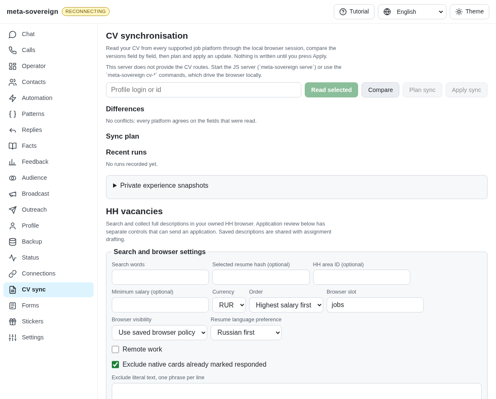
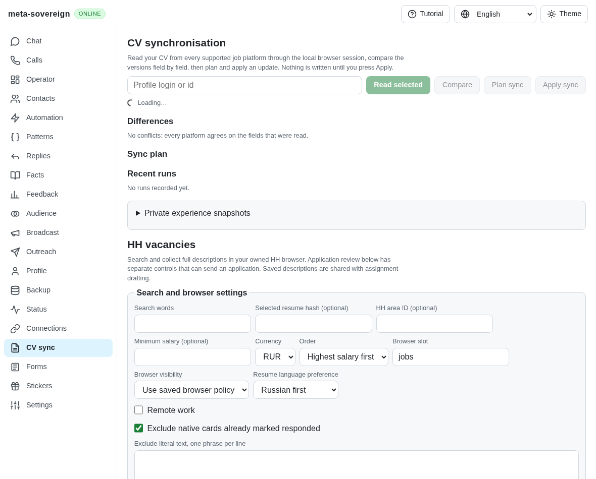

# CV initial loading and browser synchronization

This fixes two timing assumptions found while reviewing [PR #57](https://github.com/link-foundation/meta-sovereign/pull/57).
All remaining issue requirements stay required.

The CV controls initially allowed Compare while the platform catalogue and saved
snapshots were still loading. A comparison could therefore submit an empty
selection, especially immediately after a locale reload. Holding
`/api/cv/platforms` reproduces the enabled button on commit `8cbe939c`.
The controls now remain busy until initial reads settle. Loading uses the shared
localized loading message and does not claim the CV routes are unavailable.
The existing load failure display remains available.

`cv-loading-inspect.mjs`, included in the mandatory CV browser scenario, holds the
catalogue request, requires disabled Compare, releases the request, and verifies
an actual company/time comparison. The published parent records
`disabledDuringLoad: false`; the fixed native Chromium/MCP run records `true`.
The focused CV render tests cover the loading message and disabled actions in
all four locales.

The earlier Chromium experience-plan lane failed its phone overflow assertion.
The same fixture passed locally at 390px without screenshots, including every
locale. Its viewport resize also changes the React shell asynchronously. All
four experience browser inspections now wait for the actual compact shell before
measuring overflow. The assertion remains strict and reports measured widths;
no CSS or assertion threshold was relaxed. Hosted confirmation remains required.

The T3 Code references in [Chat References](../../CHAT-REFERENCES.md) guide the
shared loading and responsive-layout behavior. No external source was copied.

## Browser evidence

The synthetic fixture uses its own local server and no provider account. The
before and after images show the same held initial request.

Validation: 18 focused CV render tests, native Chromium comparison across the
four locales, native Chromium experience-plan inspection, Playwright MCP before
and after captures, SPA build, formatting and strict lint. Full runtime/browser
matrices remain on GitHub CI. An unrelated Windows/Bun export fixture race was
also identified in the preserved job log; it is tracked by the LinkedIn
acquisition unit rather than presented as a passing hosted check here.
