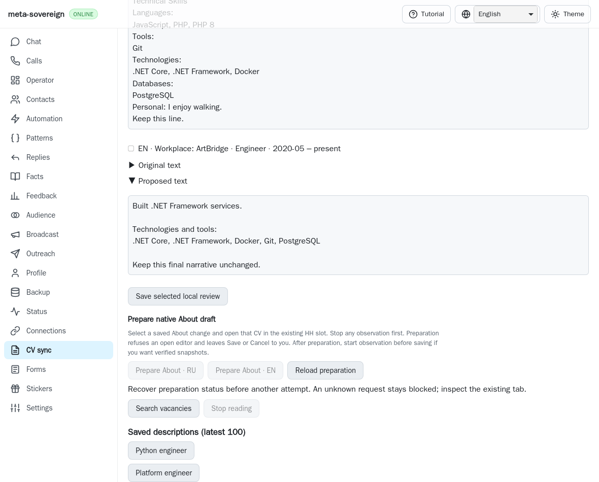
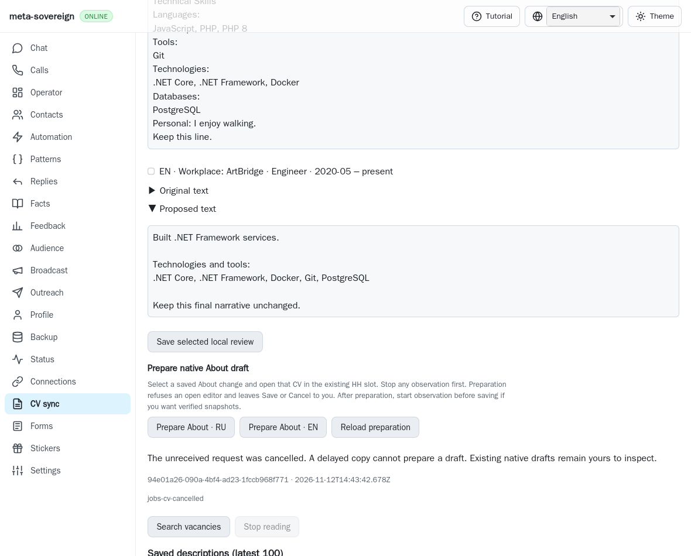
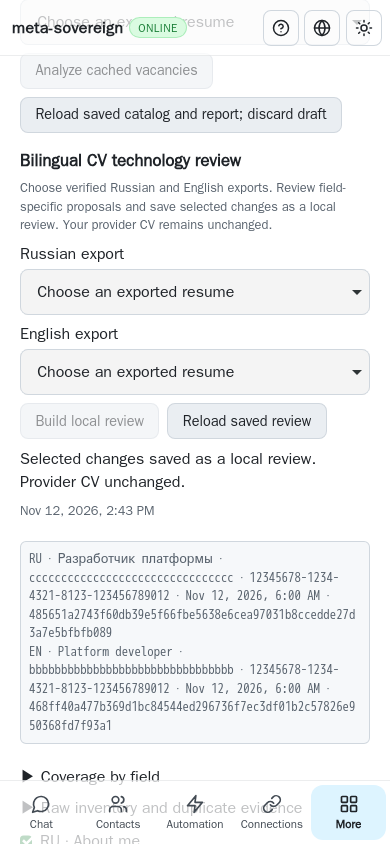

# Published cancellation investigation (d76215a1)

This is the preserved investigation published in `d76215a1`. Its archived
source and logs remain unchanged. See [the merged evidence](cv-prepare-cancel.md)
for the combined receipt validation, shared-store flush gating and independent
MCP verification. The MCP availability statement below describes that earlier
continuation only.

An explicit cancellation now recovers the pending About preparation that never
reached the server. The server flushes a request-specific cancellation receipt
before enabling another preparation. A delayed copy of the old POST returns
that receipt without attaching to the provider. CLI, both default Lino
transports and all four CV locales share this behavior in
[PR57](https://github.com/link-foundation/meta-sovereign/pull/57).

## Reproduction and cause

On published `9c188c96c4d4f2e6f3e3c48ba23701355eb908bb`, save a selected bilingual
About review, intercept and abort its preparation POST before it reaches the
server, then reload preparation and the page. GET returns null and the persisted
intent correctly prevents another write, but there is no way to settle that
unreceived request. Discarding the local intent alone would permit an old POST
to arrive after a replacement had started.

The focused first regression fails against that published service because
`cv-prepare-cancel` is absent. The before native WebKit replay uses the unchanged
published UI bundle with the current fixture server, aborts the original POST,
and fails on the missing cancellation button. It never invokes the new server
operation during that replay. Source snapshots, logs and before/after images
are retained in the adjacent checksummed archive.

## Durable identity and truthful results

Cancellation accepts only a bounded request ID and browser slot. The service
serializes cancellation with preparation admission. If the request is absent,
it flushes a bounded `cancelled` receipt containing identity, timestamps and
`providerSaved: false`, with null CV hash and language. It then saves the latest
slot pointer. Late preparation with that ID returns the cancellation without
source resolution, attachment, navigation or keyboard work. Restart recovery
reads the same receipt; a different slot cannot claim it.

If preparation was already admitted, cancellation waits for it to drain and
returns its actual receipt. It never presses native Cancel, rolls back an owner
draft or replaces a confirmed result with a fictitious cancellation. A failed
flush or malformed acknowledgement leaves the browser recovery guard in place.
The UI clears its local pending identity only after a validated terminal receipt;
GET-null and page reload continue to hold it. Obsolete slot/read responses are
discarded. Cancellation itself never saves a provider CV.

`vacancies-cv-prepare-cancel --request-id=<id> --browser-slot=jobs` and trusted
POST `/api/vacancies/cv-prepare-cancel` share the service. GET is refused, existing
origin/body limits apply, and text and binary Lino are both covered. Status
remains read-only. The pending CV panel exposes **Cancel pending request**;
confirmed cancellation explains that any native drafts remain the owner's to
inspect. A new explicit preparation receives a different persisted request ID.

## Verification and limits

Twenty-two focused checks pass in Node and Deno, including the existing native
preparation/control cases plus cancellation durability failure, restart,
foreign-slot refusal, late POST, admission draining, CLI store ownership,
trusted Lino routes, malformed receipts and four-locale rendering. The native
WebKit workflow checks keyboard activation, unknown GET, desktop/phone reload,
a rejected delayed POST and a fresh explicit preparation: the delayed POST
causes zero attachments; the fresh request attaches/detaches once and performs
zero Saves, with no page errors. The existing native preparation scenarios also
remain mandatory in the same hosted browser group.

Playwright MCP is unavailable in this continuation. Actual WebKit runs through
the installed Playwright library and the production service/browser-commander
fixture. These deterministic native checks do not establish authenticated HH
parity. All owned contexts, servers and temporary stores close. Full matrices
remain in CI; exact new-head completion is required after publication.

The reusable browser experiment is
`experiments/issue-56/cv-prepare-cancel-browser.mjs`; run with
`RUN_BROWSER_E2E=1 E2E_BROWSER=webkit`. The focused regression is
`js/tests/cv-prepare-cancel.test.js`. The collector preserves source, actual
parent snapshots, logs and screenshot hashes in
[`data/cv-prepare-cancel-published.tar.gz`](data/cv-prepare-cancel-published.tar.gz).

Shared-workplace identity, native workplace editing/copy/detach, durable edit
batches, bilingual provider save/readback and all other unchecked issue
criteria remain unfinished. PR57 stays draft and unmerged.
