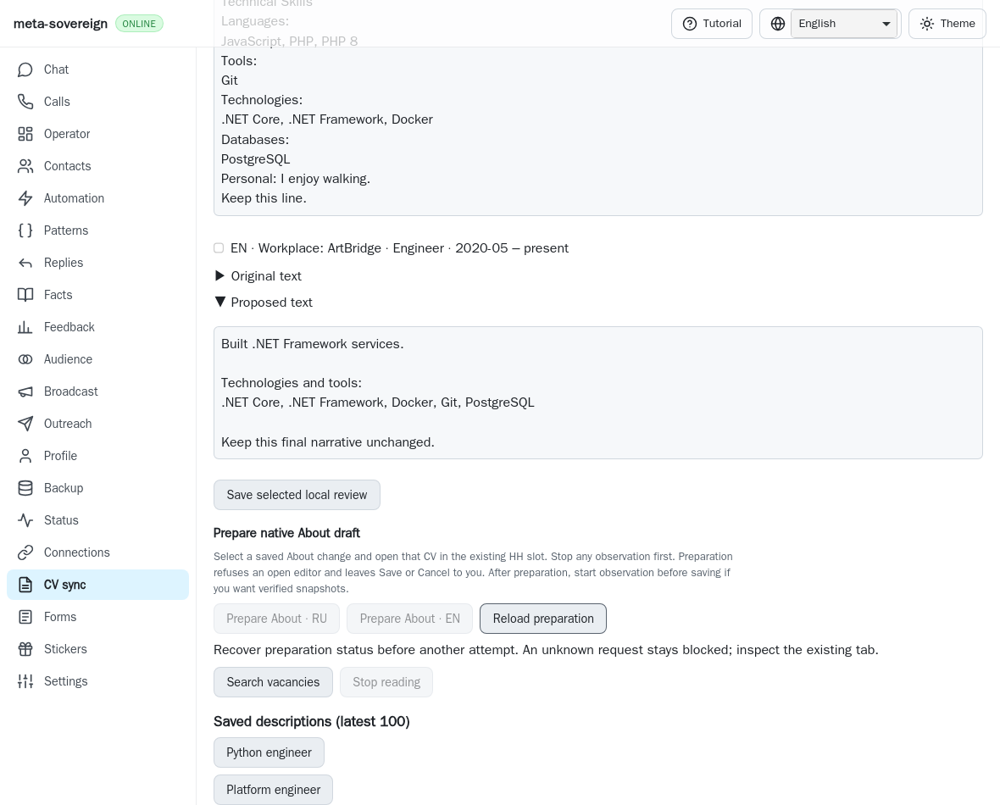
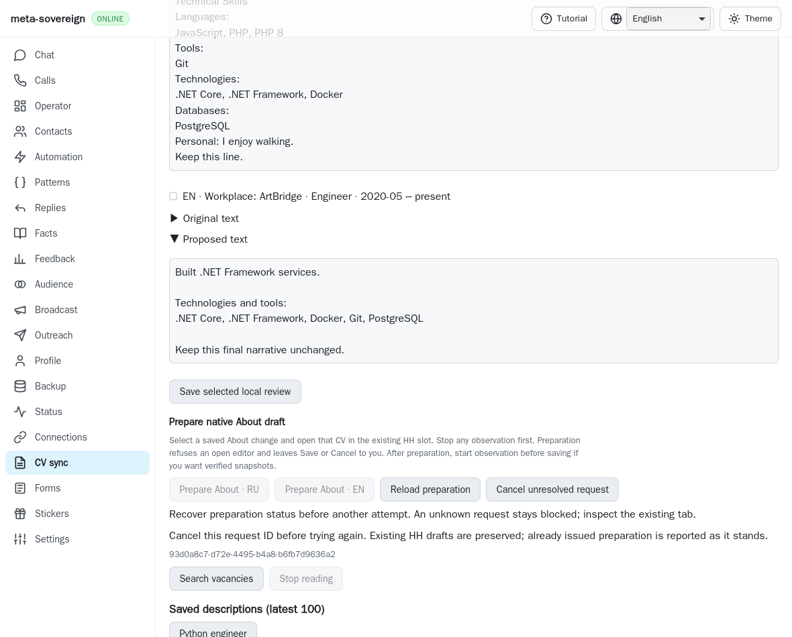
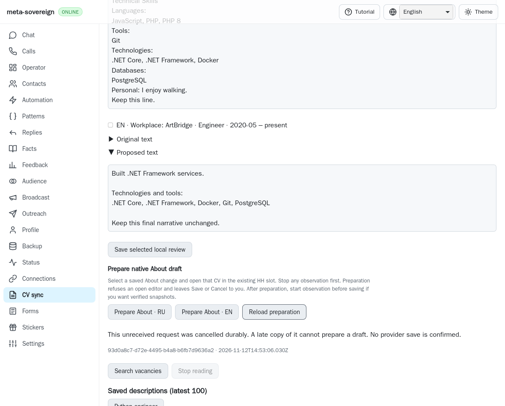
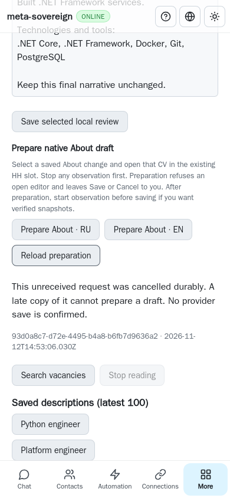

# Recover an unreceived About preparation

An About preparation whose POST never reached the server can now be explicitly
cancelled by its original request ID. The server persists that decision before
acknowledging it and returns the cancellation for any late preparation using
that ID. CLI, both Lino encodings and the four localized CV panels share this
operation in [PR57](https://github.com/link-foundation/meta-sovereign/pull/57).
This advances HH14/HH16 and R-AA5; their full scope remains unfinished.

## Reproduction and root cause

On published parent `6e5f3ca7a102ed326ff4c186fba4a85f6a2ee9fc`, abort an About
preparation before its POST reaches the server. Reload preparation status and
the page. The browser correctly retains its original UUID and blocks another
preparation, but GET returns no receipt and there is no cancellation operation
or control. Clearing local intent would permit a delayed original POST to race
a replacement. The parent replay substitutes the actual published service and
bundle, proves both missing operations, captures the before screenshot and
restores the working bytes in `finally`.

## Durable cancellation and truthful states

Cancellation validates only the request UUID and browser slot. For an unknown
request it stores a bounded versioned cancellation receipt containing those
identities, its timestamp and `providerSaved: false`. It does not fabricate a CV
hash, selected language or reviewed change. The receipt uses the same durable
request key as preparation, so a late copy returns that receipt before source
resolution or browser attachment. Repeated cancellation and restart preserve
the decision. A new explicit UUID can prepare normally.

Services sharing a store serialize admission. Status and late preparations
wait for an in-progress cancellation write to flush; failed persistence rolls
back the unacknowledged row and returns an error. Existing preparation receipts
take precedence: cancellation waits for admitted work and reports its actual
state. It never clicks native Cancel, erases text, closes an editor or claims
that an issued draft was undone. The slot's latest issued preparation pointer
remains unchanged; an older cancellation can always be inspected by UUID.

The browser retains the original pending UUID until an identity-checked
preparation or cancellation receipt arrives. Failed writes, absent/malformed
acknowledgements and lost replies preserve the guard. GET recovers the exact
request without replay. Slot generations and read revisions discard obsolete
responses. The explicit cancellation control explains the issued-draft rule and
displays the pending UUID; a confirmed cancellation displays its identity and
timestamp. Reload and keyboard activation do not dispatch mutations.

## Interfaces

- `vacancies-cv-prepare-cancel --request-id=<uuid> --browser-slot=jobs` returns
  the cancellation or existing preparation and closes its owned store. A late
  `vacancies-cv-prepare` returns a nonzero status when no preparation occurred.
- Trusted POST `/api/vacancies/cv-prepare-cancel` retains the existing 8 KiB
  mutation body limit and origin guard. GET on that mutation returns 405.
- GET `/api/vacancies/cv-prepare-status?requestId=<uuid>&browserSlot=jobs`
  reads either typed receipt in text or binary Lino. JSON compatibility remains
  opt-in. Conflicting slots, mixed receipt shapes and mismatched identities
  refuse.
- The saved CV review offers cancellation only for unresolved browser intent.
  A confirmed result releases preparation for a new explicit request. An
  already issued draft remains subject to owner Save/Cancel and passive Save
  observation.

## Verification and evidence

Twenty-two focused Node and twenty-two Deno checks pass: nine new cancellation
checks and the thirteen existing preparation checks. They cover restart, late
copies, shared-store durability, failed flushes, admission ordering, trusted
routes in both Lino encodings, CLI lifecycle, browser reply validation, cached
recovery and all four locales. Both actual-parent regressions fail as expected.

The existing mandatory `cv-prepare` WebKit entry passes its eight original
native scenarios and four additional cancellation scenarios. The new cases
cover GET-null/page reload, a real failed fixture flush, a lost durable reply,
late copies, phone/keyboard recovery and explicit replacement. The replacement
attaches and detaches once. Cancellation performs zero attachments, native Save
or native Cancel operations; the original eight-case owner-Save test remains
intact. There are no page errors. Browser contexts, servers and temporary
artifacts close in `finally`.

Five independent Playwright MCP cases verify an unreceived request, malformed
cancellation acknowledgement, lost reply and exact GET recovery, late-copy
refusal, and phone/keyboard reload followed by explicit preparation. Two
preparation UI POSTs include the deliberately aborted first attempt; exactly
one reaches the deterministic adapter, with one attachment/detachment and no
provider reads or page errors. These MCP checks establish UI behavior against
the fixture; authenticated provider parity remains unfinished.

The first native durability probe did not reach the server's wrapped store
because it added `flush` after wrapper creation. The corrected fixture installs
its stable flush delegate before wrapping and toggles only the failure it
returns. The retained initial log documents the failed probe; final evidence
uses the corrected fixture. The MCP tool executes the final experiment body inside an async wrapper,
removing its export declaration; its VM does not support dynamic imports or
semicolon-terminated expression-only filenames.

Run `python3 -B experiments/issue-56/verify-cv-prepare-cancel.py` for the focused
checks. The parent replay, native wrapper and independent MCP module live beside
it. The collector verifies counts and archives source, parent snapshots, raw
logs, screenshot hashes and byte integrity in
[`data/cv-prepare-cancel.tar.gz`](data/cv-prepare-cancel.tar.gz).

Exact parent `6e5f3ca7` Checks run 43238347626 began at
`2026-11-12T14:33:04Z`. All three Windows Deno shards pass within the existing
deadline; remaining jobs were still running when this unit was prepared.
The complete exact new-head matrix remains required after publication.

Shared-workplace identity, complete native editing/copy/detach, durable batches,
bilingual provider save/readback, authenticated HH parity and every other
unchecked issue requirement remain unfinished. The provider-save capability
remains false. PR57 stays draft and unmerged while the remaining work continues.
