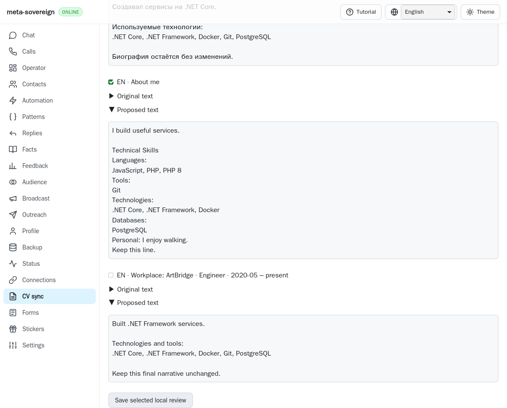
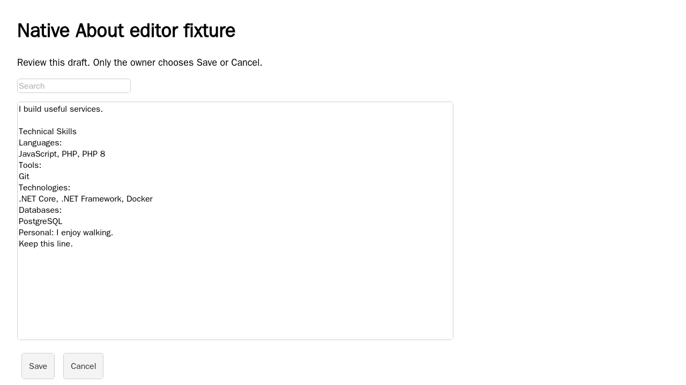
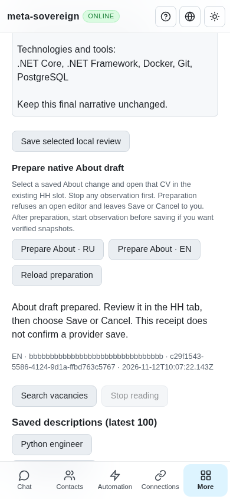

# Prepare a reviewed native About draft

The saved bilingual technology review can now prepare an explicitly selected
About change in the exact existing HH tab. CLI, text/binary Lino and the four
CV locales share the same operation. The owner reviews the native draft and
chooses Save or Cancel. A prepared receipt explicitly does not establish a
provider save. This advances HH14/HH16/HH19 in
[PR57](https://github.com/link-foundation/meta-sovereign/pull/57); their full
scope remains unfinished.

## Reproduction and source authority

On published parent `9d805e4fdb1fded3d408eb97fbe4db4da32d5c87`, generate a
bilingual technology plan from two verified exports and save a selection
containing an About change. The review has no native preparation action and
the vacancy service has no `cv-prepare` operation. The parent replay substitutes
the actual published service and UI bundle, captures the missing controls and
fails both focused regressions. It restores the working bytes in `finally`.

Preparation accepts a saved reviewed fingerprint and `ru:about` or `en:about`.
It revalidates the complete review, selected change, current catalog revision
and both private native export artifacts before attaching. Drafts, unselected
changes, altered evidence and stale reviews refuse. The browser receives the
review's exact proposed text, preserving the generated narrative and inventory;
callers cannot provide arbitrary replacement text through this operation.

The implementation studies the pinned HH editor and experience-site behavior
at `konard/hh-job-application-automation@fa0991b8c2d0896fb3b4be6c69947f0590094b15`.
Reference source snapshots and provenance are preserved with this evidence.
No reference implementation is copied.

## Existing tab and native keyboard ownership

Attachment reuses the existing browser-commander persistent-slot checks from
[Save observation](cv-save-watch.md). It requires the exact existing HH CV
target, never starts a browser or navigates, and disconnects without closing the
owner's page. Missing session metadata or a replaced target refuses.

Before opening About, preparation refuses any visible existing CV editor.
An ordinary header search field remains usable. The opener must be unique,
enabled and hydrated. The native About textarea must be unique, writable and
controlled by a hydrated React change handler. The saved baseline must agree
after horizontal-whitespace normalization, with React and DOM values in
agreement. A changed baseline leaves its text untouched.

Preparation pins the actual textarea node, settles focus and checks identity,
baseline, other editors and focus between keyboard steps. Bulk keyboard insertion
is followed by a native change to settle the controlled field. At maxlength,
removing and restoring the last complete code point avoids overflowing the
field. The final DOM and controlled value must exactly equal the reviewed text
after blur and settlement. No Save or Cancel is issued. Focus leaving About
causes an uncertain result before another field receives any text.

Readiness is bounded to twenty seconds, individual native clicks/keys to ten
seconds and settlement to 750 milliseconds. Existing bounded review/source
limits apply. Optional existing `CI_CV_WATCH_DEBUG` tracing records the prepared
phase without draft text; it defaults off.

## Durable receipts and recovery

The server flushes a request-specific receipt before browser work. Receipts
contain the UUID, slot, selected change, review fingerprint, language, target,
CV hash when known, timestamps and explicit state. They contain no draft text.
`providerSaved` stays false: this operation does not confirm a provider save.
Duplicate request IDs return status without another attachment; changed options
conflict. Restarted incomplete receipts report interruption without replay.

The shared workspace lease excludes active Save observation and other owned
vacancy work. Preparation detaches before releasing that lease. Stop aborts
and drains admitted work, rejects queued preparations before they write and
waits before store shutdown. Failure after opening leaves the native form for
owner inspection and reports uncertainty; it never automatically cancels or
repeats keyboard actions.

The browser persists its pending UUID before POST and disables another
preparation until a validated result or GET recovers that same request. Slot
generations and read revisions discard obsolete responses. Malformed or lost
POST replies cannot silently release the guard. A request that never reached the
server stays blocked after GET-null and page reload, so a delayed original POST
cannot race a replacement. There is not yet a cancellation/tombstone control for
that unreceived intent; that recovery limitation remains unfinished. Unavailable
local intent storage prevents a POST. Reload never prepares or saves a CV.

After preparation, start passive Save observation before choosing native Save
to obtain verified snapshots. Owner changes after preparation take precedence:
the observer captures and verifies the final native fields rather than the
proposed text.

## Interfaces and verification

- `vacancies-cv-prepare --fingerprint=<review-fingerprint>
--change-id=en:about --request-id=<uuid> --browser-slot=jobs` prepares the saved
  selected change. Optional `--target-id` identifies an existing tab. The command
  returns a nonzero exit status unless preparation is confirmed.
- `vacancies-cv-prepare-status --request-id=<uuid> --browser-slot=jobs` reads
  that durable receipt without browser work. Omitting the ID reads the latest
  receipt in the slot.
- Trusted POST `/api/vacancies/cv-prepare` and GET
  `/api/vacancies/cv-prepare-status` use both default Lino transports. Existing
  mutation-origin and body limits apply; JSON compatibility stays opt-in.
- The CV review displays only selected, saved About changes, localized native
  preparation/recovery states, request identity and explicit owner Save guidance.
  Dirty catalog edits and unresolved requests disable preparation.

Thirteen focused Node and thirteen Deno checks pass, alongside thirty-six
compatibility checks and one mandatory browser-registry contract. Scoped lint,
format, secrets and the unchanged duplication gate pass. Both actual-parent
regressions fail as expected.

Eight native Linux WebKit scenarios exercise the production service,
browser-commander and SSR/hydrated React editor: delayed hydration, existing
draft preservation, wrong CV/changed baseline refusal, maxlength, focus loss,
lost response and phone reload, final owner Save/readback and an unreceived
request. Eight attachments detach; preparation causes no provider navigation or
Save. The single native Save is the test owner action, and its revised text is
the verified snapshot. There are no page errors.

Four independent Playwright MCP UI cases cover a malformed acknowledgement,
GET recovery, phone/keyboard reload and an unreceived intent. Exactly one
preparation reaches the deterministic adapter, with one attachment/detachment,
zero provider reads and zero page errors. These MCP checks do not establish live
provider behavior. All owned browsers, servers and temporary artifacts close.
Mandatory `cv-prepare` coverage is registered in both hosted browser lanes with
existing limits. Hosted exact-head CI remains required after publication.

Run `python3 -B experiments/issue-56/verify-cv-prepare.py` for focused checks;
native, MCP and parent-replay scripts live beside it. The collector verifies
result counts and archives source, parent snapshots, logs, reference provenance,
screenshots and byte integrity in [`data/cv-prepare.tar.gz`](data/cv-prepare.tar.gz).

Complete shared-workplace identity, native workplace editing, copy/detach,
durable edit batches, bilingual save/readback, authenticated HH parity, explicit
unreceived-intent cancellation and every other unchecked issue criterion remain
unfinished. The technology provider-save capability remains false. PR57 stays
draft and unmerged while that work continues.
