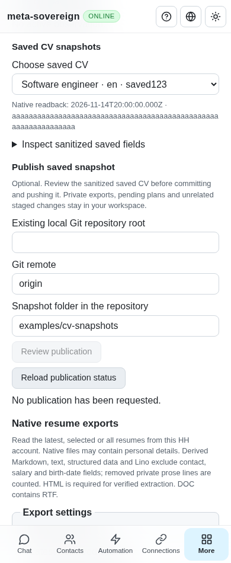
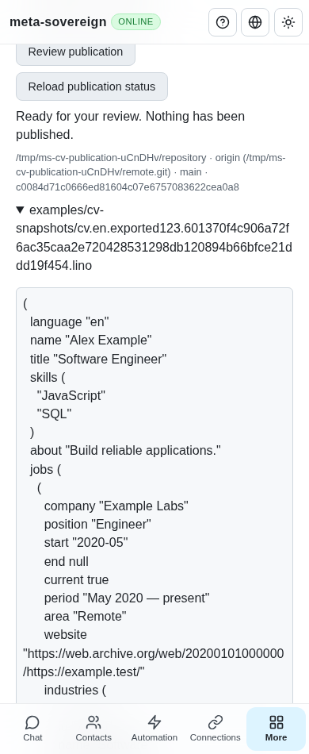
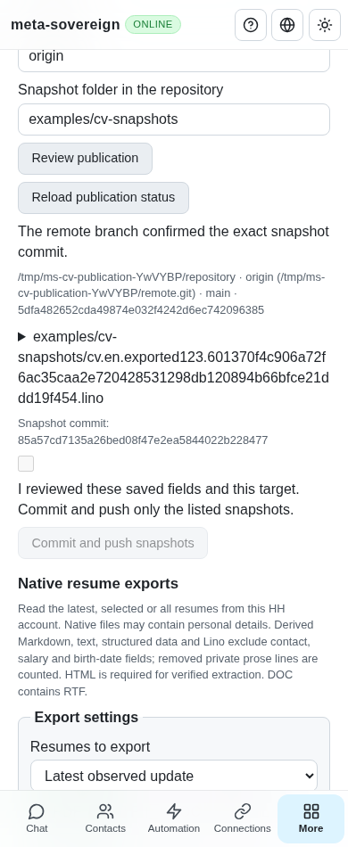

# Reviewed publication from native résumé exports

Published parent `9945c26685b9acc14dfba4a192cb2f11628077fc` publishes verified
owner-save snapshots but cannot choose an existing native export. Its service
rejects the native-export-only fixture before Git with
`jobs-cv-publication-unverified`. Run
`python3 -B experiments/issue-56/cv-publication-exports-before.py` to reproduce
the missing source; the driver restores the working source in `finally`.

An optional `exportId` now selects the existing native résumé artifact. The
shared export reader checks its receipt identity, private structured file,
size and SHA-256. The existing CV verifier also checks the selected browser
slot, title and language. Publication sanitizes the structured CV again and
freezes its canonical Lino, source digest, capture time and export identity.
Publish rechecks those inputs before Git effects. Missing, changed, invalid
or wrong-slot sources refuse; no browser session or export refresh occurs.
Omitting `exportId` preserves the existing owner-save record shape and digest.

Foreground CLI accepts `--export-id`; trusted text and binary Lino accept
`exportId`. The shared four-language controls offer same-slot native exports
and the verified owner Save as separate choices. Changing sources clears
consent and disables a mismatched review. Reload restores the reviewed source
without replaying publication, including when no owner-save cache exists.
The existing exact-file Git publication, uncertain outcome handling and
private artifact preservation remain in use. See the
[usage guide](../../CV-SNAPSHOT-PUBLICATION.md).

## Verification

- Exact-parent service regression: one intended failure and zero passes;
  current source restored afterward. The before browser has no export-source
  selector.
- Focused Node: 35 passes across source, service, boundaries, controls,
  lightweight CLI and browser registration contracts. Focused Deno: 25 passes
  across the four publication test files. Six source tests cover actual local
  pushes through service, foreground CLI and both trusted Lino encodings,
  changed private bytes/receipts, source identity and four-language controls.
- One native Chromium export scenario passes with one local push, four
  locales, phone fit, cleared source-change consent, private JSON preservation
  and read-only recovery after deleting the owner-save cache. The existing
  owner-save scenario also passes with two local pushes and an uncertain
  receipt. No provider session or external push is used; owned fixtures drain.
- Independent Playwright MCP confirms the native source, one explicit local
  push, cleared consent, disabled repeat publishing and recovered source after
  reload. The server and browser close. Its console contains only the fixture
  favicon's HTTP 404; no publication request fails.
- Strict scoped lint, format, secret scanning and diff checks pass. Duplication
  remains below the unchanged 6.5% gate. Hosted CI owns the full runtime and
  browser matrices.

Before, reviewed native export and confirmed publication on a phone:

## Published-parent CI correction

Checks run `43647096030` started at `2026-11-14T22:15:09Z` for exact parent
`9945c266`. Seven preserved runtime job logs identify the same assertion:
`vacancy-search.test.js` omitted the new browser-independent
`cvSnapshotPublication: true` capability from its exact expected object.
For example, Ubuntu Node job `132608195377` lines 7214–7240 and macOS Deno
job `132608195403` lines 11670–11701 show the mismatch. The focused expectation
fails before the correction and passes afterward on Node and Deno. The
separate correction retains the complete capability assertion, including
unavailable browser operations and `apply: false`; production behavior does
not change. Other unfinished parent jobs are not reported as passing.

The [checked source/log archive](data/cv-publication-exports.tar.gz) and
[per-file hashes](data/cv-publication-exports.tar.sha256.json) retain parent
sources, focused checks, complete failed-job logs, native/MCP observations and
screenshots.

Remaining import/edit publication pipelines, complete HH23 parity and all 81
original incomplete inventory rows remain required in
[PR #57](https://github.com/link-foundation/meta-sovereign/pull/57). It stays
draft and unmerged.
