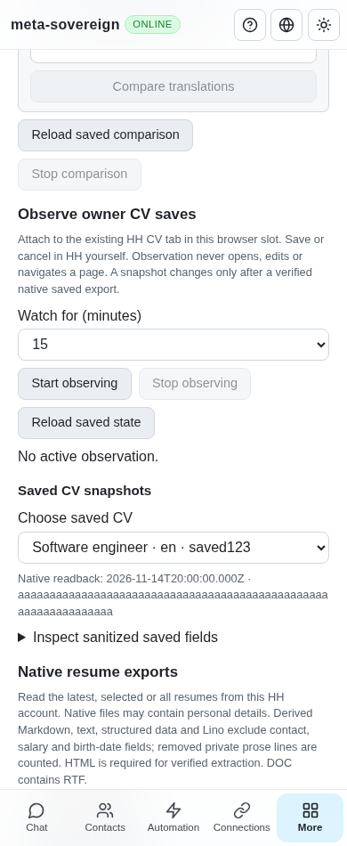
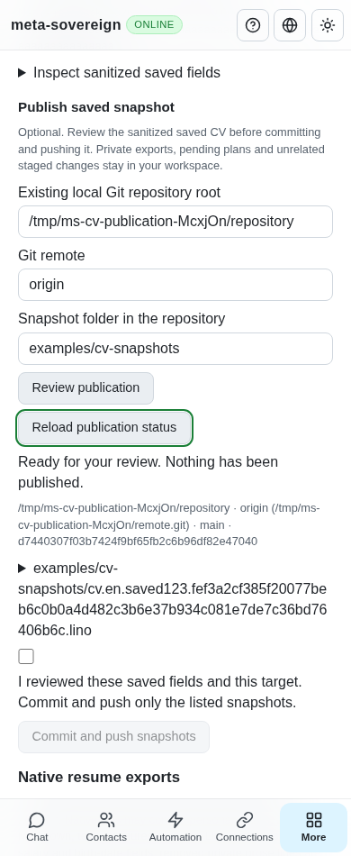
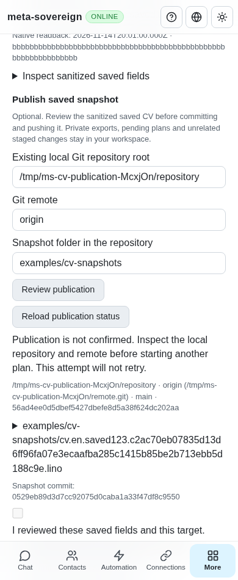

# Explicit publication of sanitized saved CV snapshots

Published parent `4c06685abbb553607b64677a84512ab19a66d732` has verified native
owner-save snapshots but no publication operation. The exact-parent probe
fails before Git with `f.service.cv-publish-plan is not a function`. Run
`python3 -B experiments/issue-56/cv-publication-before.py` to reproduce it;
the driver restores the working source in `finally`.

The [pinned HH reference](https://github.com/konard/hh-job-application-automation/blob/fa0991b8c2d0896fb3b4be6c69947f0590094b15/README.md) at `fa0991b8c2d0896fb3b4be6c69947f0590094b15`
describes opt-in publication of actual saved sanitized `.lino` snapshots while
retaining full private exports, PDFs, backups and pending plans. Its CV store
uses an explicit file list and `commit --only`. This implementation uses an
owned alternate Git index so unrelated staged files and clean filters cannot
change the reviewed bytes or enter the new commit. The reference README and
101-line CV store are preserved in the evidence archive.

Review freezes the same-slot verified owner-save snapshot, sanitizes and
round-trips its canonical Lino again, hashes each exact file and binds the
confirmation to the canonical repository root, branch, remote fingerprint and
base commit. Only generated content-addressed paths are admitted; symlinks,
existing different files, staged target paths, stale native evidence, invalid
inputs and expired plans refuse. Limits are 20 snapshots, 1 MiB per file,
4 MiB per record and a 24-hour review lifetime.

Publishing first acknowledges a durable attempt. Finite owned Git commands
build a one-parent commit from the frozen baseline, verify its changed paths
and exact file bytes, acknowledge the commit checkpoint and compare-and-swap
the local branch. Only the snapshot entries join the real index. An explicit
non-force refspec targets the reviewed branch; a final remote readback must
equal the new commit. Lost acknowledgements, interruption and unknown transport
outcomes stay uncertain. Read-only recovery and repeated request IDs never
replay commands. `CI_CV_PUBLICATION_DEBUG=1` enables value-free state/count
tracing; it is off by default.

Git documents that configured follow-tags can add unrelated annotated tags,
and that local hooks, submodule recursion and push options can affect a push.
The publisher explicitly disables those additions. See the
[Git push manual](https://git-scm.com/docs/git-push). Remote URL inspection
expands configured rewrites; the publisher checks the expanded single target
again immediately before pushing. See the
[Git remote manual](https://git-scm.com/docs/git-remote.html). These controls
preserve the reviewed scope within the owner's existing repository and Git
authentication; they do not certify its earlier history or remote contents.

Foreground CLI, trusted text/binary Lino routes and four-language CV controls
share plan, publish and status operations. The UI displays every planned file
and its content, clears consent when targets or snapshots change and refuses
publishing after uncertain recovery. The
[usage guide](../../CV-SNAPSHOT-PUBLICATION.md) documents their inputs and
recovery states.

## Verification

- Exact-parent regression: one intended failure, zero passes; current sources
  restored afterward.
- Focused Node: 29 passes across publication service/boundaries/controls,
  lightweight CLI admission, shared command input and mandatory browser
  partition contracts. Focused Deno: 19 passes across the three publication
  test files. All fixtures use tiny owned working/bare repositories, synthetic
  CVs and existing local Git; no provider account or external push is used.
- Git regressions retain unrelated staged/private content, pending plans and
  native evidence, bypass a configured clean filter, suppress follow-tags,
  ignore an ambient index, reject changed remote heads/URLs and preserve
  uncertain outcomes after lost push receipts or failed attempt/commit saves.
  Stop drains ownership; restart and repeated confirmation do not replay.
- One native Chromium scenario passes with two local snapshot pushes, four
  locales, phone fit, keyboard ordering and zero provider sessions. The before
  UI lacks publication controls. The final UI distinguishes reviewed,
  confirmed and uncertain receipts; reload never replays. Missing downloaded
  headless-shell refusal is retained separately; the passing local check uses
  existing `/usr/bin/google-chrome` without an installation.
- Independent Playwright MCP confirms one explicit local push, sanitized
  content, cleared consent, disabled repeat publishing, read-only receipt
  recovery and phone fit. The owned server and browser close. The final console
  log retains Chromium's `net::ERR_CACHE_WRITE_FAILURE` for `app.min.js`; the
  application executes and no publication request fails.

Before and after phone evidence:

The [checked source/log archive](data/cv-publication.tar.gz) and
[per-file hashes](data/cv-publication.tar.sha256.json) retain the parent source,
regression, final focused checks, native/MCP evidence and screenshots. Full
runtime/browser matrices stay in hosted CI.

This unit accepts only verified owner-save snapshots. Remaining import/edit
publication pipelines, complete HH23 parity and all 81 original incomplete
inventory rows remain required in
[PR #57](https://github.com/link-foundation/meta-sovereign/pull/57), which stays
draft and unmerged.
