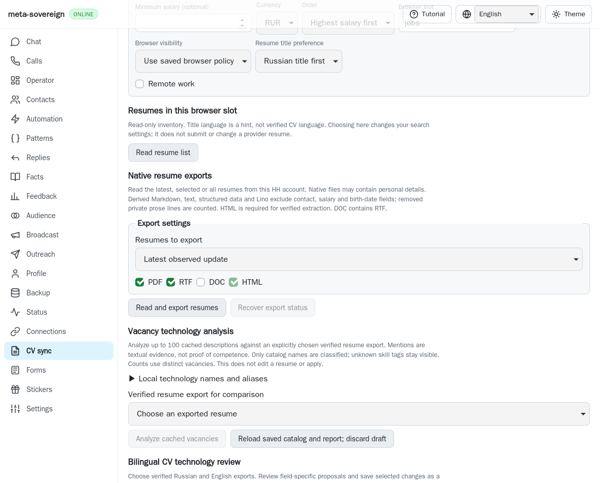
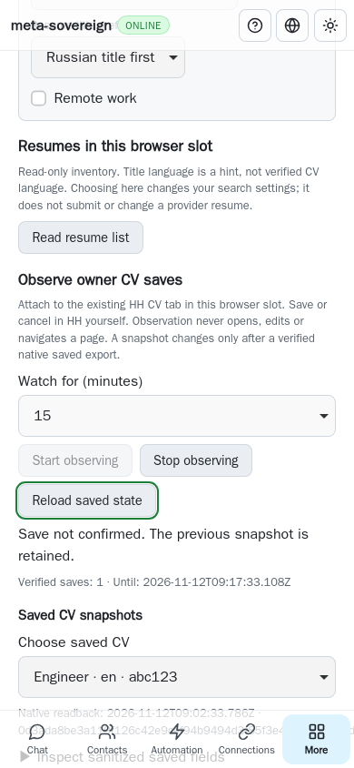
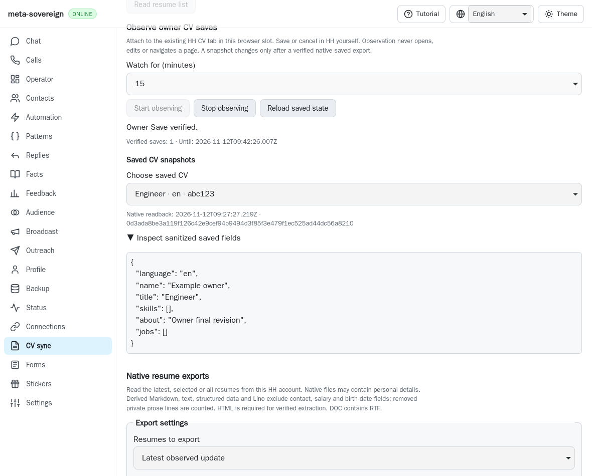
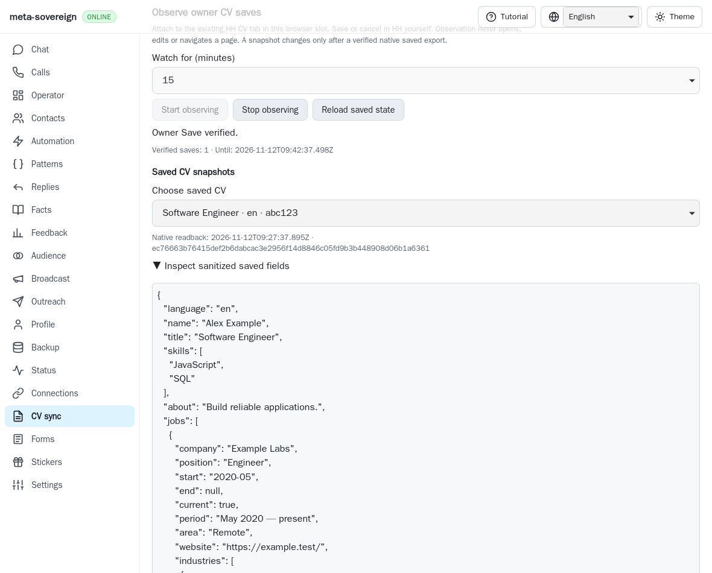
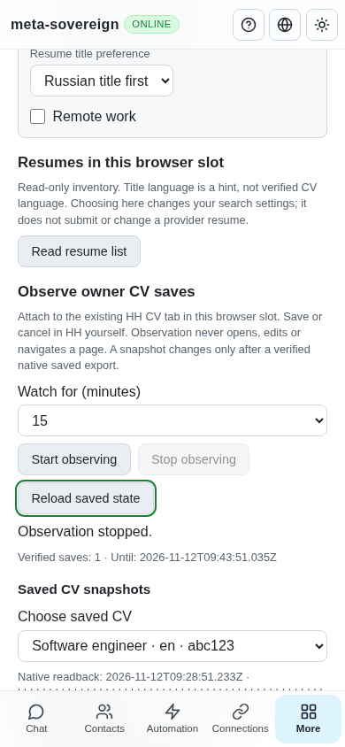

# Passive native CV Save observation

CLI, text/binary Lino and the four-language CV screen can now observe an
existing HH editor tab for a finite period. The owner operates HH Save and
Cancel. The watcher attaches through browser-commander, captures the final
fields at a trusted Save and changes sanitized snapshots only after native
saved exports confirm the fields. This is partial HH16–HH18 work in
[PR57](https://github.com/link-foundation/meta-sovereign/pull/57).

## Existing browser ownership

The selected `hh` browser slot must already contain browser-commander's
`.browser-commander-session.json`. Attachment checks its regular-file size,
profile directory, loopback WebSocket, debugging port, browser instance and
exact target. A missing or replaced browser/tab refuses. There is no launch,
fallback tab, navigation, pointer/keyboard action or browser close. Disconnect
removes this watch's listeners and commander, leaving the owner browser open.
The real CDP experiment verifies exact attachment and missing-target refusal
using one owned Chromium process and zero additional provider requests.

Starting from a server keeps the finite watch alive independently of the web
page. The CLI remains in the foreground. Neither implementation is a detached
daemon. This unit does not create a browser slot; the existing persistent
browser must have been opened separately. Missing session metadata produces a
failed watch rather than a replacement browser.

## Save authority and recovery

Passive listeners accept trusted native Save/Cancel controls in the existing
main frame. Industry-picker dialog saves and synthetic clicks have no capture
authority. Final About/workplace values are captured at Save, rather than at
prefill. Cancel, later input, Stop and shutdown invalidate and drain pending
readback. Oversized or ambiguous forms fail explicitly. Public durable attempt
state contains an ID and field digest, not unsaved draft text.

A closed form alone does not establish success. Readback fetches bounded native
exports with the owner browser's cookies, without navigation, then uses the
existing inert parser and sanitizer. About must match its exact CV hash and
normalized final text. Workplace checks include dates with month precision,
current employment, company/title/description, visible location/website and
stable industry IDs resolved against the appropriate localized dictionary.
Comma-bearing industry labels require one complete interpretation.

Native exports omit shared workplace record IDs. An unchecked CV with any work
history therefore cannot establish absence of an older record variant; such a
save remains unconfirmed. Hidden company metadata, ambiguous matches and
incomplete dictionaries also refuse verification. These limits deliberately
leave complete cross-CV editing and identity proof unfinished.

Readback retries only reads, at most five attempts within the existing 30-second
verification period. Individual native exports have a 15-second network bound.
A transient document replacement during the form probe is included in these
retries. The native trace records a destroyed context followed by successful
verification. No retry repeats Save. Loading documents do not count as closed
editors. A pending network read is drained before detachment.

Snapshots are sanitized, bounded, private store records with native export
SHA-256, attempt ID and verification time. Failed reads, mismatches, validation,
cancellation and failed durability retain the prior snapshot. Cancellation
during the snapshot flush rolls back publication before acknowledgement.
Limits include 100 CVs, 2 MiB per native export, 8 Mi UTF-16 units in aggregate
and bounded final prose. Polling fetches snapshots only when the verified count
changes or the owner explicitly reloads them.

The owner chooses a finite duration from one second to two hours; the default
is fifteen minutes. Durable request IDs cannot be reused with different
settings. Repeating an ID returns status without attachment. Process restart
reports interrupted state without replay. Lost Start/Stop acknowledgements
disable new Start until read-only recovery; reload never issues a mutation.
Initial recovery also completes before Start is enabled. Read revisions discard
older status/snapshot replies across mutations. Stop reads its exact request ID,
so a pending general status GET cannot supply a stale coalesced response. A
controlled delayed-response browser regression fails before this correction.

## Interfaces

- `vacancies-cv-watch --browser-slot=jobs --duration-ms=900000
--request-id=<uuid>` observes in the foreground. An optional `--target-id`
  selects an exact existing target. SIGINT/SIGTERM and expiry drain the watch.
- `vacancies-cv-watch-status`, `vacancies-cv-watch-stop` and
  `vacancies-cv-snapshots` use the same slot/request identity.
- POST `/api/vacancies/cv-watch` and `cv-watch-stop` require trusted mutations.
  GET `cv-watch-status` and `cv-snapshots` recover state through either Lino
  transport. Conflict settings return HTTP 409.
- The localized CV screen shows actual observation/verification states, Stop,
  expiry, verified counts and inspectable sanitized snapshots. It requires
  recovery after uncertain mutation replies and preserves native keyboard order.

## Verification and unfinished scope

The focused tests cover final fields, mismatches, still-open validation,
Cancel/edit invalidation, drained Stop, restart/no replay, failed durability,
wrong frames, changed CV identity, industry ambiguity, navigation races and
cancellation during flush. API/CLI/localized controls use the existing service.
Actual published parent `15f9c3e8` fails both the service and UI regressions;
the replay restores the original working files in `finally`.

Twenty-one Node and twenty-one Deno tests pass, together with twenty-four
compatibility checks and the focused browser-registry contract. Six native
Linux WebKit scenarios verify the existing provider DOM, untrusted
and picker clicks, final owner changes, sanitization, cancelled/invalid saves,
lost Start acknowledgement, read-only reload, phone width and drained Stop.
The workplace cases verify final prose, month-precise dates and visible company
metadata, then retain the previous snapshot when a saved website differs.
Two real Chromium CDP checks verify exact existing-target attachment and
missing-target refusal without additional provider requests.
The independent Playwright MCP run verifies four UI/recovery cases, exactly one
Start and one Stop POST, no replay and no page errors. Its provider adapter is
deterministic; it does not substitute for native provider or CDP checks. All
owned browsers and servers close after validation. Mandatory `cv-save-watch`
coverage is registered in both hosted browser lanes with existing budgets.

The phone regression captured a 453-pixel receipt inside a 350-pixel content
column. Wrapping its export digest removes the overflow. Optional diagnostics
`CI_CV_WATCH_DEBUG` and `CI_CV_WATCH_LAYOUT_DEBUG` default off and retain lifecycle,
error-category and geometry evidence without CV fields, URLs or draft text.

## Published-parent CI investigation

Checks [43183721390](https://github.com/link-foundation/meta-sovereign/actions/runs/43183721390)
started at `2026-11-12T08:32:01Z` for exact parent
`15f9c3e898805c91ca6f54a142fb279f89d598e2` and failed. All eleven failed
job logs, the complete workflow log and job metadata are preserved in the
evidence archive. Nine runtime jobs share the old capability expectation:
`cv-watch-parent-node-131069572053.log:6365–6395` shows
`vacancy-search.test.js:299` missing `technologyReview` and
`technologyProviderSave`. This change updates that assertion and includes the
new `cvSaveWatch` capability; the twenty-four focused compatibility checks pass.

WebKit shard 2 confirms the earlier macOS keyboard correction at
`cv-watch-parent-webkit2-131069572747.log:1393` (`focused: true`,
`enabled: true`). Its separate failure at lines 1521–1540 is a 30-second
Follow Backlinks input visibility timeout with a collapsed disclosure. The
downloaded valid PNG and full trace are preserved. That failure remains under
investigation; successful local CV checks do not establish hosted CI success.
The final pipeline job propagates those failures. The four other workflows for
that exact parent passed.

Reproduce focused checks with `python3 -B experiments/issue-56/verify-cv-watch.py`;
the browser, CDP, MCP, parent-replay and CI investigation scripts live beside it.
The collector verifies result counts before creating
[`data/cv-save-watch.tar.gz`](data/cv-save-watch.tar.gz), including source,
screenshots, raw logs, reference provenance and an integrity index.

Authenticated HH parity, complete record identity, provider editor/preparation,
safe shared-record copy/detach, durable edit batches, bilingual provider writes,
post-save technology coverage and all other unchecked issue requirements remain
unfinished. The new watcher does not enable technology provider saves. PR57
stays draft and unmerged.
