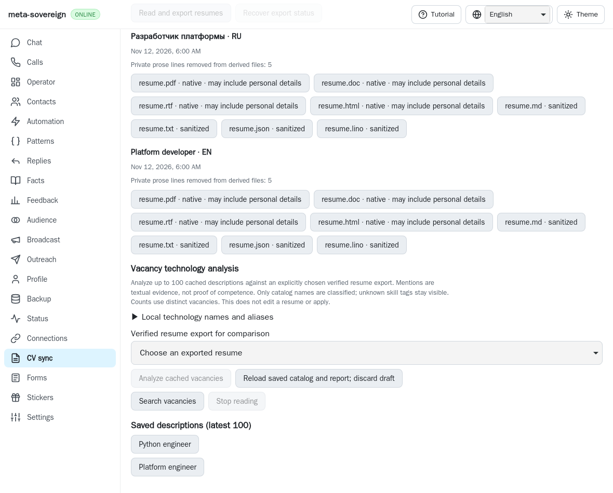
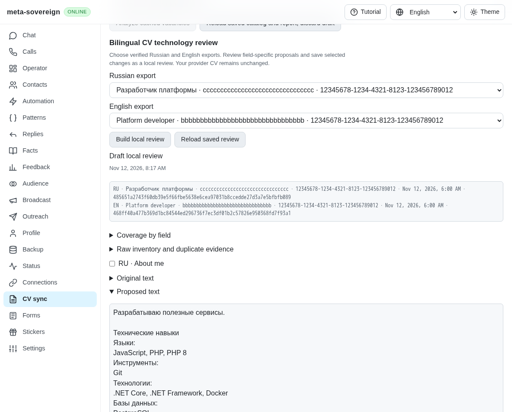
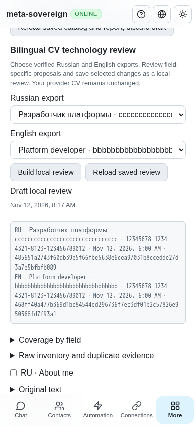

# Bilingual CV technology review

Two explicitly chosen verified Russian/English exports now produce field-specific
technology proposals through CLI, text/binary Lino and the four-language CV
screen. Selecting changes saves a **local reviewed plan**. It does not edit a
provider CV. Provider editing, authenticated save/readback, independent post-save
coverage and the remaining HH19/HH20 requirements stay unfinished in
[PR57](https://github.com/link-foundation/meta-sovereign/pull/57).

## Reproduction and behavior

Published parent `8c4bfc6c` has vacancy technology analysis but no bilingual
review service or controls. `cv-technology-before.py` restores its actual service
and browser bundle separately, runs the service/UI regressions and restores
working files in `finally`. Both checks fail for the missing feature. The before
screenshot shows that actual parent.

Choose two language-proven exports, then generate proposals. Each source retains
its export UUID, résumé hash, slot, title, capture time and artifact SHA-256.
The service verifies receipt identity and private file integrity before reading
the sanitized CV. Existing cached vacancy analysis supplies observed equivalent
spellings only when it uses the current catalog and slot. It never supplies new
claims of experience.

About, skills and each workplace retain raw lists, duplicates and field-local
mention evidence. Proposed About lists union the existing CV evidence, inherit
the first observed category and sort within categories. Biography and personal
prose remain verbatim. Recognized legacy alias footers move into inline labels;
unknown footer terms survive. Unrecognized About layouts block review and leave
the original About text intact.

Workplace proposals combine only their own evidence and a uniquely paired
counterpart. Pairing requires matching dates and company identity, including
bounded Cyrillic transliteration/brand words; dates alone never match. Missing
or ambiguous counterparts remain blockers with candidates. This is a review
heuristic, not provider identity proof. Unrelated workplace narrative is retained.
Only changed fields appear as proposals; applying the fixture proposals in memory
and independently auditing again produces no changes.

Whole-name normalization preserves products, versions, Linux qualifiers and
unknown terms. C/C++ and C# with named .NET variants expand into distinct terms.
S3-compatible storage never implies AWS competence. The default catalog now has
36 entries, including Cutter/Cuter and Telerik/Teleric corrections; misspellings
are not reintroduced as ATS aliases. An alias appearing in About cannot hide its
absence from a workplace. Ambiguous aliases block review.

## Persistence and interfaces

Generation and selected local saves share the existing owned-operation boundary.
Reads wait for durability, concurrent writes refuse and failed flushes restore
the previous acknowledged record. Stop drains issued writes. Save rechecks the
catalog revision, current review fingerprint and both exact source files.
Acknowledgements must contain the requested prior fingerprint and exact selected
field set. Corrupt reports are rebuilt and rejected before rendering.

Lost replies preserve the old screen. Explicit reload recovers through GET,
without replaying POST or reading a provider. Offline cached review remains
available. Browser-slot changes clear choices and ignore late responses. New
generation and saves require a connected server; unsaved catalog changes block
them. The interface labels every saved result as local and shows blockers,
before/after prose, coverage and duplicate evidence with bounded disclosure.

Limits include two sources, 4 MiB of source text, 2,048 observed spellings,
10,000 normalized terms/mentions, 1,000 registry names, 24,000 characters per
proposed field, 402 selected fields and a 12 MiB serialized review. String limits
use JavaScript UTF-16 code units. Excess input refuses without replacing the old
review. Visible changes and raw fields paginate ten at a time.

- `vacancies-technology-review --ru-export-id=<uuid> --ru-resume=<hash>
--en-export-id=<uuid> --en-resume=<hash> --revision=<catalog-revision>` generates
  a draft. `--browser-slot=jobs` is the default.
- `vacancies-technology-review-save --fingerprint=<sha256>
--selected=ru:about,en:jobs.0.description` saves selected local changes.
- `vacancies-technology-review-stored --browser-slot=jobs` recovers the review.
- Corresponding routes under `/api/vacancies/` are POST `technology-review`,
  POST `technology-review-save` and GET `technology-review-stored`, retaining
  trusted mutations and default text/binary Lino transport.

## Verification and current CI limits

Twenty focused Node and twenty Deno checks pass, along with sixty compatibility
checks and the focused Deno mandatory-browser registry contract. Cases cover raw
duplicates, narrative preservation, whole products, typo correction, ambiguous
aliases/counterparts, observed spellings per field, idempotence, source/catalog
changes, exact acknowledgements, rollback and drained shutdown.

Four native Linux WebKit scenarios verify explicit source selection, keyboard
checkboxes, durable local saves, reload, lost replies and phone width. Four
independent Playwright MCP cases verify the rendered desktop/phone controls and
malformed generation acknowledgement recovery. MCP records two generation POSTs,
one save POST, no page errors and **zero provider reads**. All fixture browsers,
servers and private artifacts close. Mandatory `cv-technologies` browser coverage
has its own existing per-group budget in both CI browser lanes.

Exact parent `8c4bfc6c` Checks run `43177885613`, created
2026-11-12T07:47:40Z, finished with only WebKit shard 2 failing. Its raw job log
`cv-technology-base-webkit2-131048574094.log` records a technology Tab-focus
assertion at lines 1354–1390 and a Follow disclosure visibility timeout at lines
1444–1464. Neither failure is presented as fixed by this feature. All other
runtime/browser jobs and Links, Pages, Security and Desktop workflows passed.
Exact new-head CI and those separate investigations remain required.

The [evidence archive](data/cv-technologies.tar.gz) and its
[SHA-256 index](data/cv-technologies.tar.sha256.json) preserve source snapshots,
actual-parent files, logs, pinned reference research and screenshot hashes.

## Rendered evidence

Actual parent:

Independent desktop:

Independent phone:

