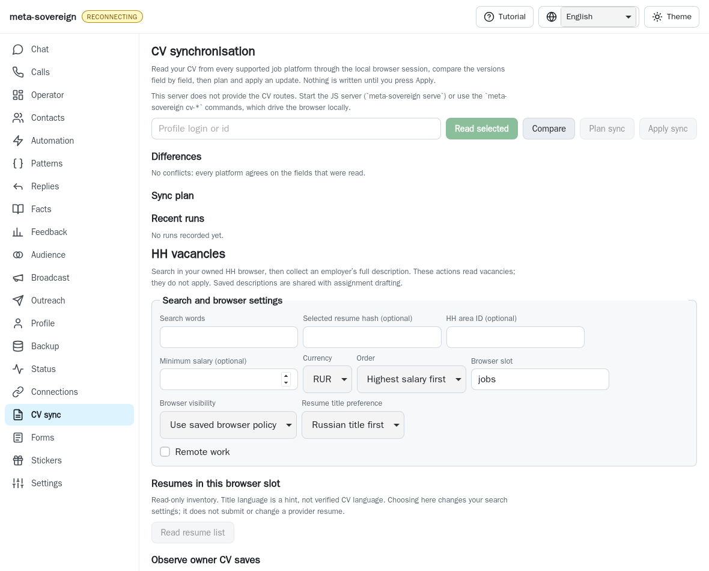
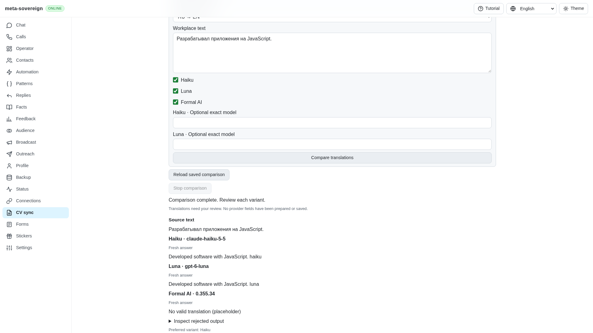
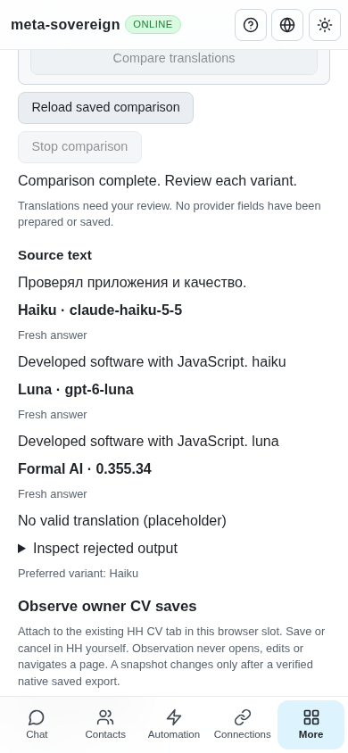

# Private workplace translation comparisons

This is bounded HH22 work in [PR #57](https://github.com/link-foundation/meta-sovereign/pull/57).
It supplies reusable comparison, provenance, private caching and recovery for
RU/EN workplace text. Full HH/LinkedIn export, matching, reviewed synchronization,
live translator verification and Formal AI failure publication remain unfinished.

The pinned reference is `konard/hh-job-application-automation` at
`fa0991b8c2d0896fb3b4be6c69947f0590094b15`, requirements C1–C4 in
`docs/requirements/experience-sync.md`. Its prose specifies Haiku, Luna, then
Formal AI as preference order, while its implementation lists Formal AI first.
The default here follows the prose; explicit API/CLI provider order is retained.

## Reproduction and behavior

On published parent `2389fc8e2e3c8ae72277d0becc720dd56c6b06f5`, the vacancy service
has no `cv-translate` operation and CV has no comparison controls. Two bounded
actual-parent replays fail with those assertions and restore the replaced file
unconditionally. The new regression cases exercise production service, routes,
CLI, browser client validation and the actual rendered UI.

A comparison admits 1–50 source texts, each at most 12,000 characters and together
at most 64,000 UTF-8 bytes. Haiku/Luna use sequential JSON batches of five; Formal
AI runs sequentially for each text. The UI offers one workplace text at a time,
direction, opt-in providers, optional exact Haiku/Luna models, and every variant
with actual model/version, rejection reason and cache state. All four locales
disclose that review is required and no provider field was prepared or saved.
An all-invalid comparison never presents the source as a translated result; CLI
returns a nonzero exit when any row has no valid choice.

The child-process runner uses argument arrays without a shell, private temporary
working directories and stdin for Haiku/Luna prompts. Each invocation has a
two-minute bound, 128 KiB stdout and 32 KiB stderr limits. Stop terminates the
owned child, escalates after 500 ms if necessary, and waits for close. Temporary
answer files are removed on success and failure. Probe children have a 64 MiB
heap and finite output; no full source build or stress probe was run locally.

Haiku defaults to its current alias and records the concrete `modelUsage`
identity. Alias runs deliberately bypass persistent cache because their next
model version is unknown; an exact Haiku model enables versioned reuse. Luna
defaults to a fresh `codex debug models` catalog and selects only the newest
Luna family, never substituting another model. Codex runs ephemerally in a private
read-only directory with user configuration ignored. Formal AI records its
installed CLI version and enables `FORMAL_AI_LIVE_API=1`. This does not install or
upgrade an owner's CLI and does not establish that the installed version is the
latest release. No live model calls were made during this verification.

Source inspection used Formal AI's latest release at the time,
[v0.355.34](https://github.com/link-assistant/formal-ai/releases/tag/v0.355.34).
Its [quote extractor](https://github.com/link-assistant/formal-ai/blob/v0.355.34/rust/src/solver_helpers/mod.rs#L414)
does not unescape JSON strings. JSON-encoding a multiline source would change the
text; embedded quotes can truncate it. The adapter uses a literal recognized
quote form only when extraction preserves the exact source, and refuses
ambiguous input before invoking Formal AI. This is an invocation limitation,
not a verified Formal AI translation failure to publish upstream. The other
selected providers still run. Tests retain literal quotes and paragraph breaks.

Only valid translations enter the private cache, keyed by exact provider,
resolved model/version, language direction and source fingerprint. Each new
explicit request retries invalid/failed variants. A later batch failure retains
earlier successful or cached rows. Complete receipts bind input, row order,
chosen provider, actual model and output to a fingerprint and recheck verdicts
after transport. Corrupt or mismatched acknowledgements never become success.

The browser persists only a caller-generated request ID before POST, after
validating the input. The server flushes admission before model I/O. GET and
repeated IDs never restart a translator; changed input under an existing ID is
refused. Lost replies recover through GET; orphaned running receipts become
interrupted. An unreceived request remains pending through GET-null and reload
until a durable cancellation tombstone blocks late copies. Stop remains available
when a received running comparison is recovered after page reload.

Example with a private selected file containing `{"texts":["Программист"]}`:

```sh
meta-sovereign vacancies-cv-translate --file=/private/texts.json --from=ru --to=en --request-id=example-translation --haiku-model=claude-haiku-5-5 --luna-model=gpt-6-luna
meta-sovereign vacancies-cv-translation-status --request-id=example-translation
meta-sovereign vacancies-cv-translation-cancel --request-id=unreceived-translation
```

Model names above illustrate configuration; availability must be verified in the
owner's current CLI catalog. Cancellation does not undo received results.

## Verification and visible evidence

```sh
python3 -B experiments/issue-56/cv-translation-before.py
NODE_OPTIONS=--max-old-space-size=384 node --test --test-concurrency=1 js/tests/cv-translation.test.js js/tests/cv-translation-adapters.test.js js/tests/cv-translation-controls.test.js js/tests/ci-browser-shards.test.js
deno test --allow-all --v8-flags=--max-old-space-size=384 js/tests/cv-translation.test.js js/tests/cv-translation-adapters.test.js js/tests/cv-translation-controls.test.js
RUN_BROWSER_E2E=1 E2E_BROWSER=webkit NODE_OPTIONS=--max-old-space-size=384 node experiments/issue-56/cv-translation-browser.mjs
```

The focused checks pass 23 Node and 19 Deno tests. Six native WebKit scenarios
cover opt-in admission, invalid configuration, versioned cache, independent
failure, lost replies, durable cancellation, Stop and reload. They make eleven
synthetic translator calls, drain one interrupted call, open no provider session
and record no page errors. The browser entry is registered in the existing
mandatory Chromium/WebKit CI shards without changing their deadlines.

An independent Playwright MCP browser operates an isolated memory-store server
with synthetic translators. Five scenarios repeat visible comparison, cache,
failure, phone recovery and Stop. It records eleven model-fixture calls, one
drain, one intercepted comparison POST, no unhandled page errors and matching
350 px phone content/scroll widths. Its initial control URL accidentally included
a double slash and a later loader included a trailing expression semicolon;
both fixture corrections are retained as investigation evidence.

Before, on the actual published parent:



Independent desktop review:



Independent phone recovery:



The [checksummed archive](data/cv-translation.tar.gz) retains source snapshots,
actual-parent failures, process/runtime/browser/MCP checks and screenshots. Hosted
CI for the final published commit remains required. These fixtures establish no
authenticated HH/LinkedIn operation, real model quality or complete HH22 parity.
