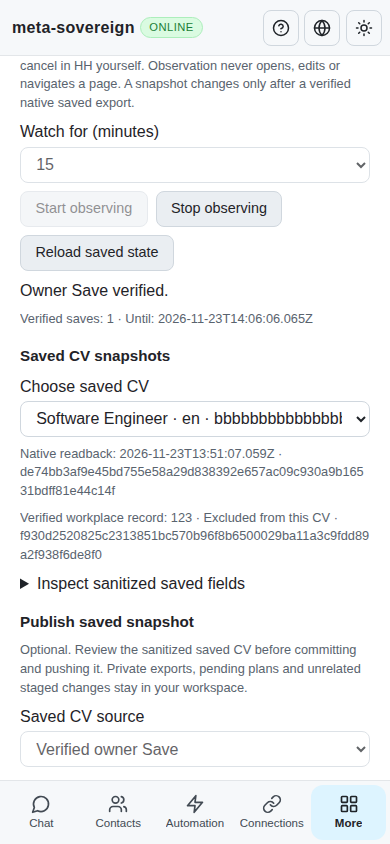
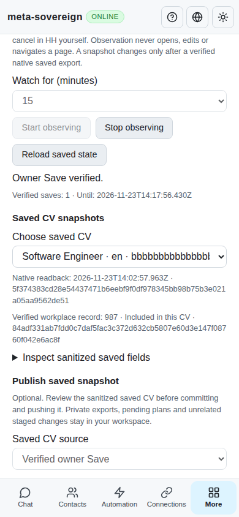
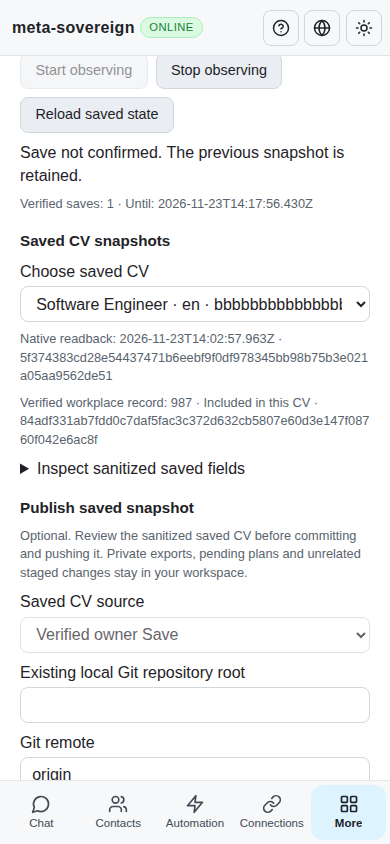

# Verify native workplace Saves after opening the form

## Reproduction

Start CV Save observation while the existing HeadHunter tab shows a CV overview.
In that same tab, open the complete workplaces list and edit record `123`.
Clear the target CV selection and click the native Save. Let the exact record
save while the target CV export still includes the original workplace.

On the published parent `c0fbd85cc20ce5d28d29c5dbab68d9b7afb2debd`, this
shows **Owner Save verified** and publishes a snapshot reporting that the
workplace was excluded. The exact saved membership and the still-cached export
disagree. The pre-Save export was only captured when observation started, before
the owner opened the form.

## Verification

- Opening a complete workplace form now starts a bounded read of its saved
  record and CV exports. Opening **Add new workplace** without a URL change
  reads the existing IDs and exports. The watcher completes those reads before
  the native page can associate their evidence with a trusted owner Save.
- The browser regression starts on the overview, opens the list, creates
  record `987` from the in-page Add form and confirms the new snapshot. It
  later refuses the stale export for record `123`. Phone reload recovers the
  refusal and the previous snapshot. Native Save count is two and the watcher
  makes zero browser navigations.
- Forty-three focused checks passed on Node, Deno and Bun. They cover pending
  evidence, a different form at the same URL, owner Cancel, and Stop while a
  read is in flight. The production CV Save browser entry passed on Chromium.
- Playwright MCP independently restored the stale-export refusal on a phone.
  It confirmed one native Save, zero verified Saves, and one closed watcher
  attachment after Stop.

The [evidence archive](data/cv-watch-transitions.tar.gz) contains the focused
checks, source hashes and browser receipts. The provider was an owned fixture.
Authenticated HeadHunter, client-only record IDs and hidden metadata remain
open under HH18. [PR #57](https://github.com/link-foundation/meta-sovereign/pull/57)
