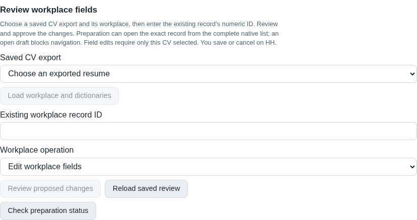
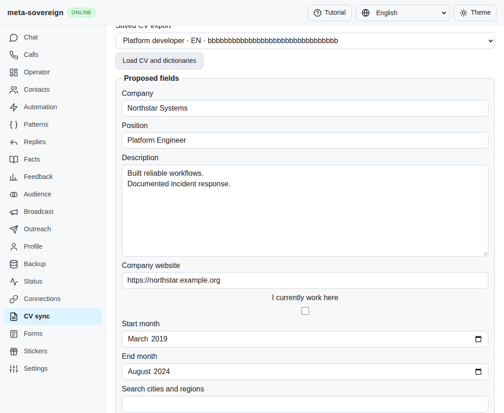
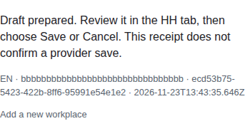
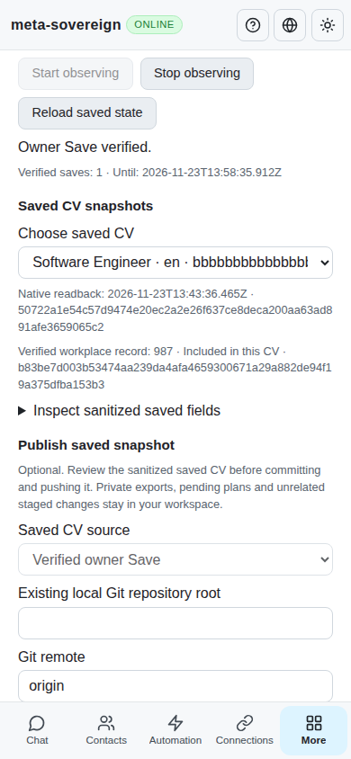

# Add a workplace to a HeadHunter CV without copying an existing record

## Reproduction

Save an export of the exact target CV. In the published parent
`23103a0c9851ad123a26ba5acbf29568fbcff681`, CV workplace review only offered
operations that required an existing workplace and its native record ID. A CV
with zero workplaces had no path to prepare a new one.

Select **Add workplace** and the empty target CV export. Load the CV and
dictionaries, enter the new fields and approve the review. It shows the target
CV membership and the field changes. Prepare the native draft and start Save
observation on the open form. The preparation receipt recovers on reload as
awaiting the owner. HeadHunter's own Save creates record `987`. The fresh
target export contains that workplace and the other CV retains its two jobs.

## Verification

- The approved plan binds the exact export ID, hash and bytes, a blank baseline
  and nine typed fields. It resolves selected area and industries in both
  HeadHunter export languages. CLI and both Lino encodings use the same plan
  and preparation receipt.
- Preparation opens the exact CV's Add control. It refuses a native draft that
  preselects another CV before entering fields. It verifies the resulting draft
  and target-only membership and leaves Save and Cancel to the owner.
- The browser regression recovers a saved preparation on the phone and confirms
  the owner Save with the new native ID, exact values and saved exports. The
  mandatory CV preparation browser entry includes the regression. Playwright
  MCP independently observed zero Saves at preparation, one owner Save, and two
  closed browser attachments after Stop.

The [evidence archive](data/cv-workplace-add.tar.gz) contains the checks, source
hashes and browser receipts. Both browser runs used an owned provider fixture.
Authenticated HeadHunter parity for HH14 remains open. [PR #57](https://github.com/link-foundation/meta-sovereign/pull/57)
