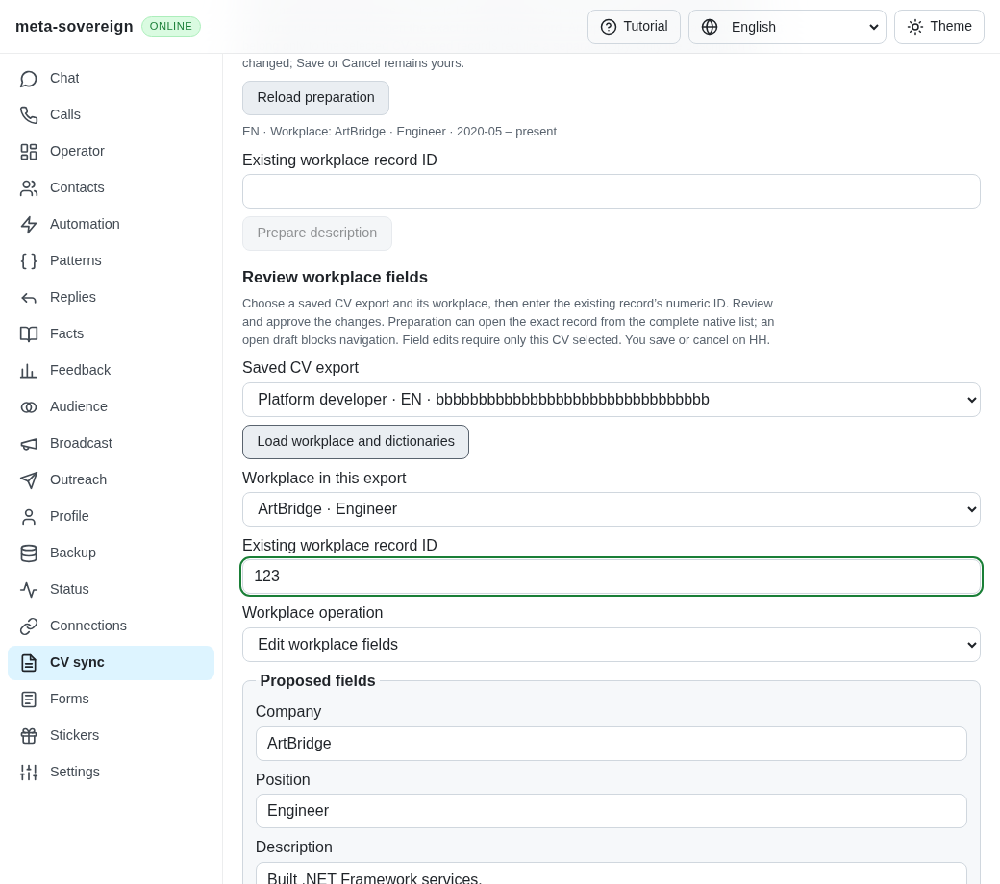
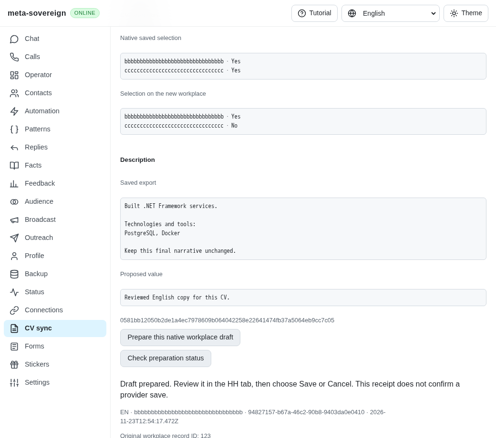
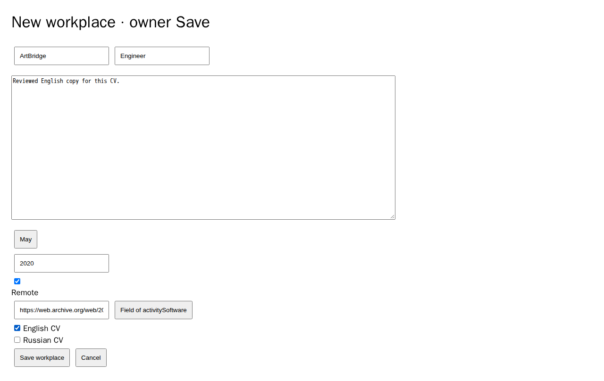
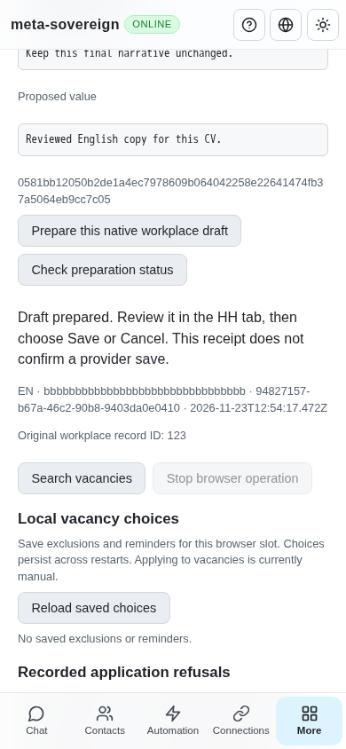

# Reviewed copy of a shared HeadHunter workplace

An owner can review and prepare a new workplace draft for one CV using a saved
workplace shared by multiple CVs. The original stays attached to all its CVs.
Saving the copy and reviewing any later deselection of the original are separate
owner actions. This covers part of HH14–HH16 in
[PR #57](https://github.com/link-foundation/meta-sovereign/pull/57).

## Reproduction and reference

In the published parent `e0ad3a5b369a5addf8fe789e435123d4987c1b0c`, select an
exact saved CV export and job in CV, then enter the numeric native workplace ID.
The action menu offers field updates and target-only deselection. A copy request
for a shared record fails with `jobs-cv-options`, including HTTP 400 over trusted
Lino. Three focused regressions reproduced this against the parent. The before
image uses its actual bundle.

The pinned HeadHunter editor proposes a copy for a shared workplace and reviews
detaching the original separately. Its browser adapter follows the native Add
control from the selected CV. Both flows informed the existing Meta Sovereign
review, preparation and browser model. [Shared workplace editor](https://github.com/konard/hh-job-application-automation/blob/fa0991b8c2d0896fb3b4be6c69947f0590094b15/src/hh-cv-editor.mjs#L262-L335), [native Add navigation](https://github.com/konard/hh-job-application-automation/blob/fa0991b8c2d0896fb3b4be6c69947f0590094b15/src/experience-sites.mjs#L719-L747).

## Review and preparation

The copy plan ties the reviewed fields and target-only membership to the
original numeric record, the exact verified CV export and job, and the complete
saved membership from a fixed authenticated read. The panel displays both
memberships and lets the owner review a copy with either changed or identical
fields. CLI uses `vacancies-cv-workplace-plan --operation=copy` with the same
identity arguments as Update and a JSON, text Lino or binary Lino file containing
`fields` and `resumes`. The two trusted Lino routes share the same receipt and
approval logic with the four localized CV panels.

Preparation refuses an open owner draft before navigation. The browser follows
the matching CV to its experience list and requires a unique, active native Add
control and a matching new-form URL. It reads back the original record again
and checks that the new form stayed blank during that read. Existing controlled
keyboard and picker helpers prepare the approved fields. Only the selected CV
is enabled in the new form. The final draft has an unassigned native record ID.
The phone receipt restores the original record ID and `providerSaved: false`
without issuing another native action.

## Verification

- Four focused copy checks cover immutable review, unchanged fields, stale or
  forged membership, durable no-replay preparation, three CLI input formats and
  both trusted wire encodings. Existing preparation, source membership and field
  cases are included in the focused runtime logs.
- The mandatory browser entry includes three Chromium scenarios. They verify
  the original description and both saved selections, the target-only draft and
  no native Save or Cancel. An open owner draft, duplicate Add, stale membership
  and owner typing during source readback all block further preparation.
- Playwright MCP exercised the parent and latest browser UI, including a 390px
  phone reload of the prepared receipt. The isolated provider fixture recorded
  two attachments, two detachments, two saved reads, zero Saves and zero page
  errors. Native field and membership compatibility have a separate focused run.

The [evidence archive](data/cv-workplace-copy.tar.gz) includes parent refusal,
focused runtime and browser logs, screenshot hashes and changed sources. The
native exercises use an isolated HH-shaped fixture. Subsequent
[owner Save verification](cv-copy-save.md) covers identical copies and rejects
stale exports. Independent workplace Add, verified copy/Save/detach as a
complete sequence and authenticated provider parity remain open.
