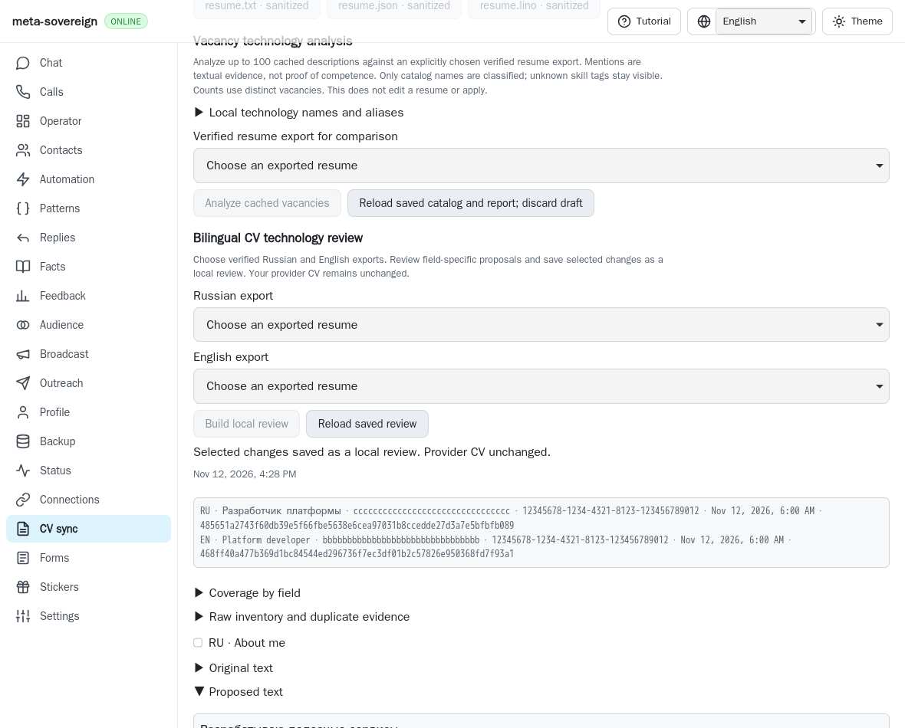
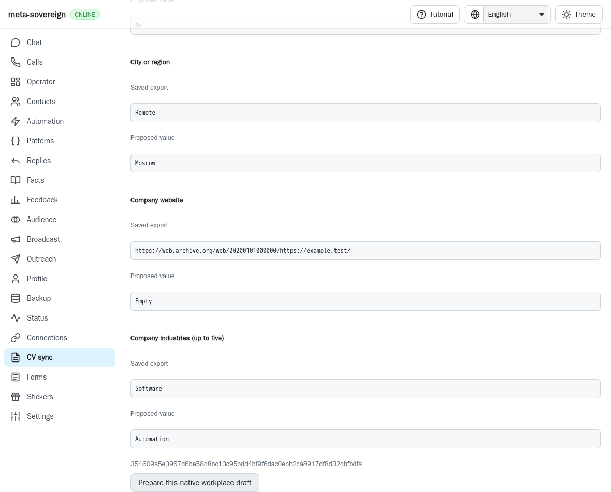
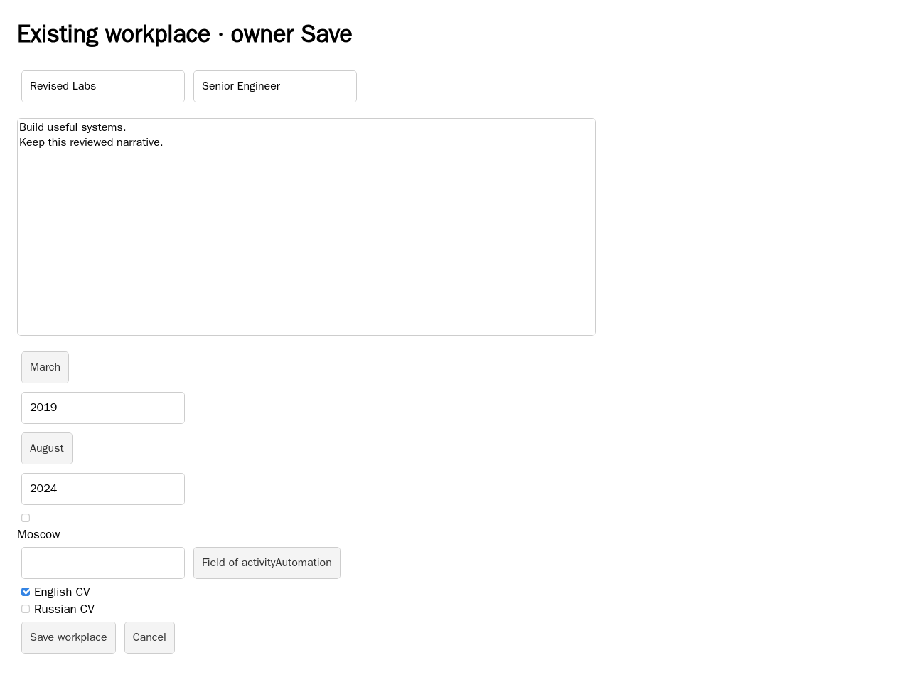
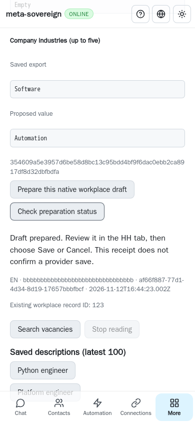

# Existing workplace field review and native preparation

An owner can propose company, position, description, month-precise start/end,
current status, website, city and industries for one existing single-CV HH
workplace. The CV screen, CLI and both Lino encodings share an immutable
export/job/record-bound plan, explicit approval and durable draft-only preparation.
This is partial HH14/HH16 work in [PR #57](https://github.com/link-foundation/meta-sovereign/pull/57).

## Reproduction and cause

Published `2389fc8e2e3c8ae72277d0becc720dd56c6b06f5` supports reviewed workplace
descriptions but has no full-field proposal service, preparation kind or panel.
Select an existing verified CV export, its job and native record ID, then request
`cv-workplace-plan` or `cv-prepare` with `reviewKind: workplace`: the old service
and validator refuse them. Three finite replays independently substitute actual
parent service, option validator and web bundle, record the expected failures,
and restore each file unconditionally. The before image uses that published bundle.

Pinned primary reference
[`hh-cv-editor.mjs`](https://github.com/konard/hh-job-application-automation/blob/fa0991b8c2d0896fb3b4be6c69947f0590094b15/src/hh-cv-editor.mjs)
provides the behavior reference for native React controls and localized identities;
its area/industry source snapshots are preserved. Existing preparation admission,
source privacy validation, durable writes, cancellation, exact native record reads
and controlled keyboard helpers are reused. No reference code is copied.

## Contract and implementation

A draft binds the original verified export ID/hash, job index, existing numeric
record ID, browser slot, original job, complete desired fields, localized metadata
and recomputed differences. Validation rejects invalid months, inconsistent
current/end dates, unknown/duplicate identities, malformed website, unknown fields,
private contact additions and forged differences. Industry identity is unordered;
response verification canonicalizes the requested set without accepting duplicates.

Area trees and existing industry dictionaries are loaded explicitly in RU/EN.
Public requests omit credentials, refuse redirects, bound response size/deadline,
and use validated 24-hour caches. Duplicate or ambiguous IDs/names refuse approval.
UI rendering bounds search results; API response validation rejects malformed or
oversized dictionaries. Approval rechecks exact original artifact bytes and job,
stores a new immutable reviewed fingerprint, and has idempotent recovery.

Preparation accepts only that stored reviewed plan. The exact query-free existing
HH workplace must already be open, hydrated, writable and bound to one matching CV.
A fresh bounded authenticated native GET proves its full saved fields and checkbox
membership. Missing/ambiguous controls, wrong record, shared memberships, stale
saved values, provider challenges or owner drafts refuse typing.

Native keyboard events update text and year controls; native month, localized city
and industry pickers update identity fields. Empty website uses native Backspace;
maxlength insertion preserves the final code point. The industry dialog's own Save
only confirms that picker selection; the workplace Save is never pressed. Every
step checks other fields/memberships and owner focus. Owner edits detected during
readback or typing are preserved without restoration. Final raw and parsed fields
must match the approved plan. Default-off content-free preparation tracing remains
available. The receipt explicitly reports `providerSaved: false`.

The panel shares the existing preparation state/cancellation authority. A lost
POST reply reloads the same reviewed plan and durable request on a 390px phone;
status performs no additional attachment or typing. Compatibility testing exposed
a cancellation with no admitted CV language: the shared receipt called uppercase
on null and crashed. A four-locale rendering regression fails before the fix;
identity rendering now includes only fields actually present.

CLI operations are `vacancies-cv-workplace-source`, `-dictionaries`, `-plan`,
`-plan-stored` and `-review` (each after the common `vacancies-cv-workplace` prefix).
Plan input uses a bounded `--file` with JSON, text Lino or binary Lino fields;
`--export-id`, `--resume`, `--job-index`, `--record-id` and `--browser-slot` bind it.
Preparation uses `vacancies-cv-prepare --review-kind=workplace` with its reviewed
fingerprint, `en:workplace` or `ru:workplace`, and the same record. Trusted API
routes under `/api/vacancies/cv-workplace-*` share the service. UI controls and
receipts are localized in English, Russian, Chinese and Hindi.

## Verification and evidence

```sh
node --test --test-concurrency=1 js/tests/cv-workplace-fields.test.js
deno test --parallel=1 --allow-all --no-check js/tests/cv-workplace-fields.test.js
python3 -B experiments/issue-56/cv-workplace-fields-before.py
RUN_BROWSER_E2E=1 E2E_BROWSER=webkit node experiments/issue-56/cv-workplace-fields-browser.mjs
RUN_BROWSER_E2E=1 E2E_BROWSER=webkit node js/tests/e2e-cv-prepare-browser.mjs
```

Nine new checks pass per Node/Deno, including immutable approval, source drift,
invalid/forged plans, public dictionaries, both trusted Lino encodings, bounded
CLI formats, four locales and null-identity cancellation. Before the final receipt
case was added, 61 focused compatibility checks passed per runtime. Scoped lint,
formatting, secret scanning and the unchanged 6.5% duplication gate pass.

Four new native WebKit cases cover all nine fields, date/current controls, website
clearing, localized picker identities, concurrent owner edits, shared/wrong/stale
forms and lost-reply phone recovery. Seven attachments drain, five fresh reads
complete, zero workplace Saves and no page errors occur. The mandatory preparation
entry passes all 21 new/existing scenarios (About, cancellation, description and
full fields). All fixtures own isolated servers; the user's application is untouched.
Playwright MCP is unavailable here; native Playwright WebKit is the fallback.
This evidence is not authenticated live-provider parity or a full local matrix.

Before, actual published bundle:



After:







`data/cv-workplace-fields.tar.gz` and its hash manifest retain changed sources,
actual parent bytes/failures, full focused logs, reference sources and screenshots.
Parent hosted Checks `43254148533` at `2389fc8e` has a separate WebKit shard-4
failure: log lines 1163–1170 show an initially offline sync peer rediscovering the
server, reloading and being read before its API exists. The complete 1,233-line
job log and timestamps are preserved. Other completed jobs pass, but this is not
a passing whole matrix. Exact new-head hosted validation remains required.

Area removal is refused before typing because its native clear semantics remain
unverified. Shared record copy/detach, cross-CV jobs, new records/identities, durable
batches, hidden metadata, bilingual provider Save/readback, authenticated parity
and every other unchecked issue criterion remain unfinished. This unit does not
complete HH14–HH20 or issue #56; keep the PR draft and unmerged.

Later pinned-source inspection confirms that empty area changes are explicitly refused by the reference editor as well. Separately reviewed existing shared-record deselection is now verified in [membership evidence](cv-workplace-membership.md); shared copy/new identities and the remaining broad criteria stay unfinished. The original frozen archive retains the earlier investigation state.
