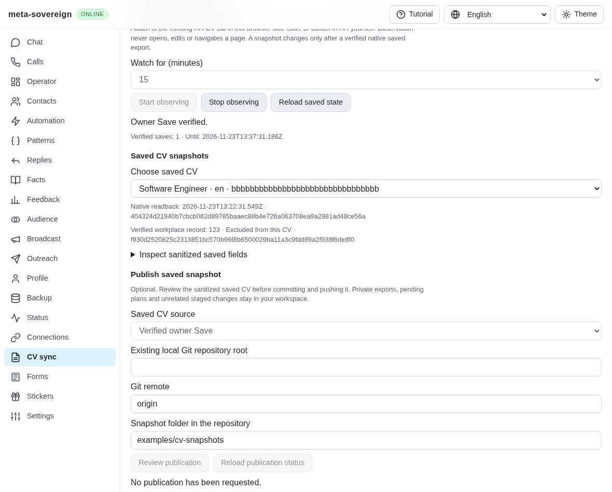
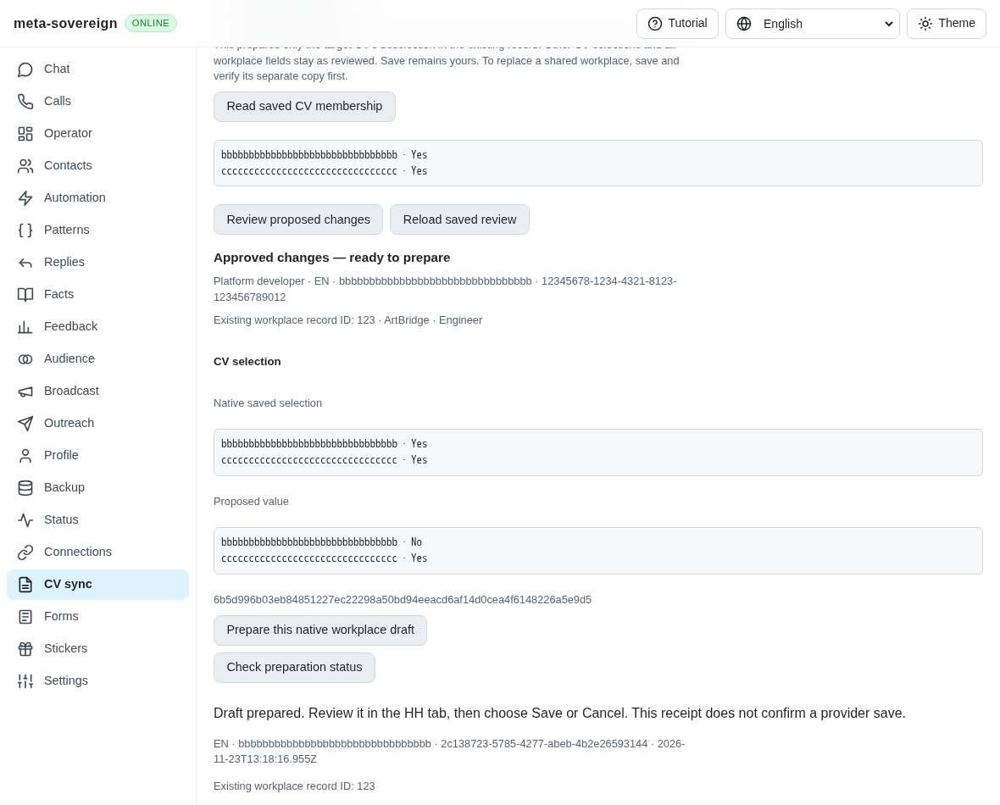
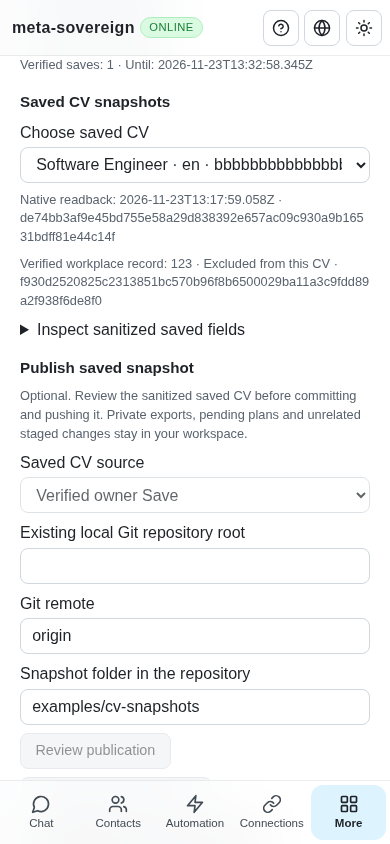
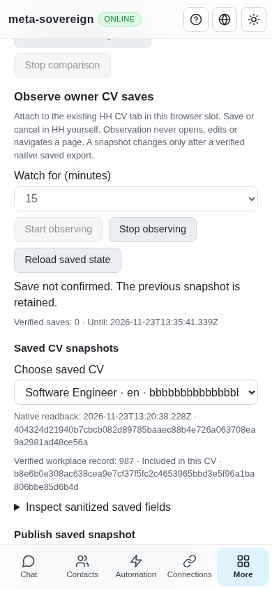

# Verify both owner Saves when replacing a shared HeadHunter workplace

## Reproduction

Select the exact export and shared workplace `123`. Review a copy for the
English CV without changing any job fields. Prepare it, start observation with
the new native form open and use HeadHunter's Save. The confirmed copy `987`
appears alongside the original on the target CV.

Stop observation, open the original native form and load its current saved
membership. Prepare a separately approved detach for the English CV. Start
observation on that form and use HeadHunter's Save. In published parent
`8d367c3491dfde6322fe0441e33dc9b69419a63b`, fresh native membership and a stale
target export containing both identical jobs produced a verified Save and
replaced the previous snapshot. The browser regression checks both the visible
receipt and the durable snapshot.

## Verification

At watch start on the existing workplace form, read the exact original record
without context-dependent checkbox defaults. Read the exports of all CVs in its
membership list. Keep the confirmed membership and job fingerprints in memory.

When final membership changes, require all previously selected exports to
identify the original by its full field fingerprint. Remove exactly one such
job per prior selection when comparing the two exports. Require exactly one
matching final job for every selected CV and preserve the other entries as a
multiset. Identical copies and reordered jobs work with this comparison. Final
owner edits on the CVs keeping the record must also appear in their fresh
exports. The exact native record and complete saved membership still need to
confirm separately.

The normal flow accepts both separately reviewed owner Saves. Stale exports
leave the prior copy receipt intact; an unverified state survives phone reload.
The watcher uses the existing bounded GETs and issues no native mutations.

## Evidence

- Chromium runs the full UI and native Save flow with an owned React fixture
  through the production prepare APIs, passive observer and HTML export parser.
  The original remains on the Russian CV, the copy remains on the English CV,
  and unrelated history stays in each export. Each run records two owner Saves.
- The stale-export scenario verifies that the exact native membership can
  change while the export is stale. Playwright MCP recovers the unverified
  outcome and earlier snapshots at phone width. All six attachments close.
- Four focused tests cover stale exports, duplicate and reordered jobs, other
  history changes, and the final owner wording. Node, Deno and Bun each pass 62
  relevant checks. The regression is part of the mandatory Save-watch browser
  entry.

The [evidence archive](data/cv-workplace-followup.tar.gz) records the
reproduction, checks and screenshot hashes. This is synthetic provider evidence
for HH14–HH16 and HH18. [Independent Add](cv-workplace-add.md) has separate fixture
evidence. Wider passive observation across form transitions and authenticated
verification remain open. [PR #57](https://github.com/link-foundation/meta-sovereign/pull/57)
