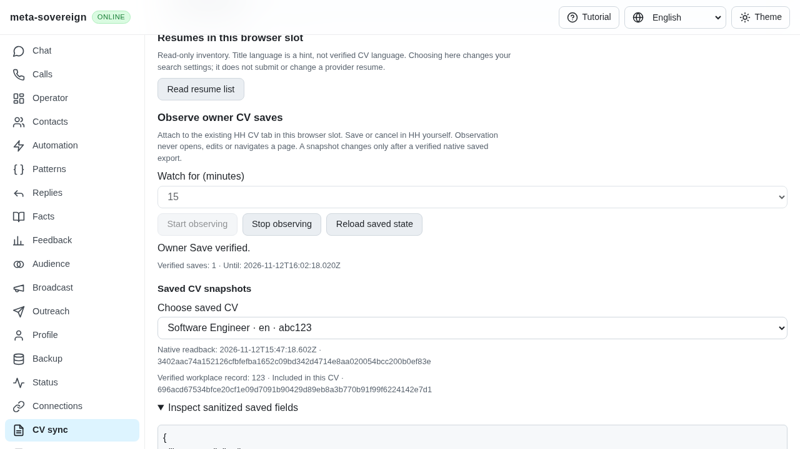
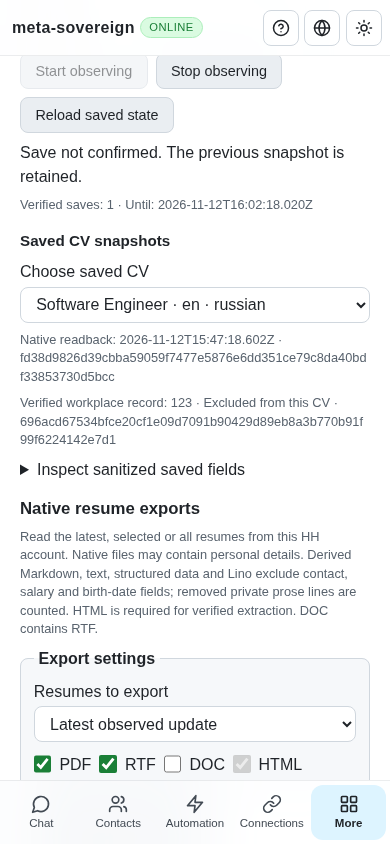

# Independent workplace verification and readback guards

This follow-up to [exact workplace identity](cv-workplace-identity.md) in
[PR #57](https://github.com/link-foundation/meta-sovereign/pull/57) verifies the
published implementation through independent Playwright MCP and closes four
specific validation/resource gaps. The historical workplace archive stays
unchanged. This is partial HH16/HH18 evidence; it does not finish issue #56.

## Reproduction and correction

The actual published parent is `ee7a74e466c49498ee47ece193a30e55559a65ec`.
Four bounded replays replace only the relevant production module with that
parent and restore the current module in `finally`:

1. An extra CV export outside the captured native membership passes verification.
   This also permits a later missing-membership lookup during publication.
   Require exactly the complete captured export set.
2. When every CV is unchecked, unobserved attempt metadata and a null industry
   label can compare as an empty saved label. Require observed metadata on both
   sides, including when no export contains the workplace. A completely observed
   all-unchecked record remains supported.
3. Numeric record IDs are coerced by regular-expression validation. Require a
   string before issuing any read. The browser fetch likewise refuses malformed
   supplied record IDs instead of silently falling back to a supplied CV hash;
   hashes must also be strings.
4. Rejected HTTP statuses, changed URLs and oversized Content-Length responses
   throw before acquiring a reader but leave the response body open. Cancel
   these bodies before refusing the response. Existing streamed size/UTF-8 checks
   still cancel and release their reader.

All four actual-parent regressions fail with the expected assertions. No native
write, extra retry, timeout increase or navigation was added to verification.
The query-free record URL and published `{recordId, sha256, checked}` evidence
schema remain intact.

## Independent browser evidence

The MCP browser operates the real web UI and Lino server. A separate owned
WebKit fixture runs the production observer, browser-commander and bounded native
readback. A loopback-only test control triggers trusted owner edits/Saves on that
fixture; its provider routes block external traffic. This is not an authenticated
HH account or a live-provider parity claim.

Six cases cover a verified owner Save, saved metadata mismatch, saved membership
mismatch, challenged record, phone reload/CV selection and Stop/reload. The run
records one Start, one Stop, one attachment, one detachment, four owner Saves,
four owner record navigations and sixteen record reads. Failures preserve both
verified CV snapshots; reload, CV selection and Stop/reload add no provider read.
The included and excluded snapshots share the exact native record digest. Both
browser error lists are empty and the phone has no horizontal overflow.

The first MCP draft incorrectly waited for `edited` before the first Save. The
passive observer intentionally reports later edits only after a Save attempt.
That finite timeout is retained as investigation evidence; the corrected case
uses the original first-Save lifecycle. A first fixture shutdown also exposed
Playwright's automatic SIGTERM closure racing the explicit cleanup. The owned
fixture now leaves signal handling to its explicit drained shutdown, which exits
successfully. Neither correction changes product behavior.

Independent desktop evidence:



Independent phone recovery after failed later Saves:



The earlier [actual-parent before screenshot](../../screenshots/issue-56-cv-workplace-identity/before/cv-workplace-identity-before.png)
shows the legitimate detach refusing confirmation before identity verification.

## Focused checks and limits

```sh
python3 -B experiments/issue-56/cv-workplace-hardening-before.py
NODE_OPTIONS=--max-old-space-size=384 node --test --test-concurrency=1 js/tests/cv-workplace-identity.test.js js/tests/cv-save-watch.test.js js/tests/cv-save-watch-recovery.test.js js/tests/cv-save-watch-controls.test.js
deno test --allow-all --v8-flags=--max-old-space-size=384 js/tests/cv-workplace-identity.test.js js/tests/cv-save-watch.test.js js/tests/cv-save-watch-recovery.test.js js/tests/cv-save-watch-controls.test.js
RUN_BROWSER_E2E=1 E2E_BROWSER=webkit NODE_OPTIONS=--max-old-space-size=384 node js/tests/e2e-cv-save-watch-browser.mjs
```

The focused modules pass 32 Node and 32 Deno checks. The mandatory native browser
entry passes eight About/workplace scenarios, including six malformed inert
record documents. Scoped ESLint has no warnings; duplication stays below the
unchanged 6.5% gate. The [checksummed archive](data/cv-workplace-hardening.tar.gz)
retains raw replays, runtime/browser/MCP results, sources and screenshots.
Hosted matrices remain required for the final published commit. Existing record
verification does not supply new-record identity discovery, native workplace
preparation/copy/detach, durable edit batches, bilingual provider writes or the
other unchecked issue requirements. They remain active and PR #57 stays unmerged.
