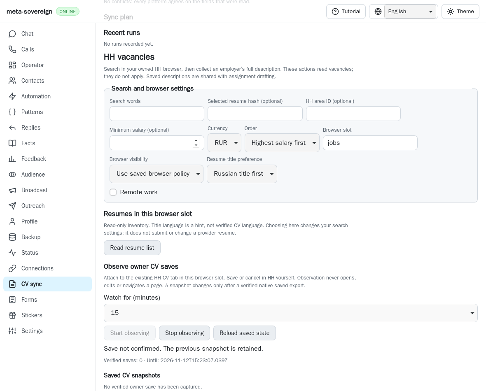
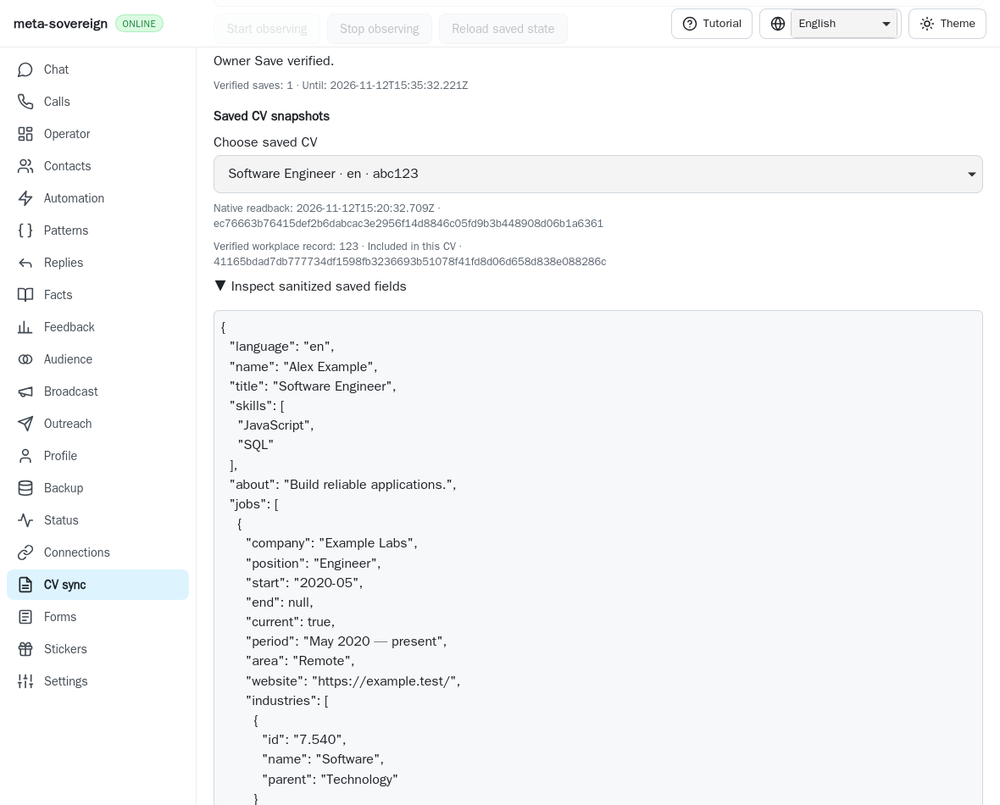
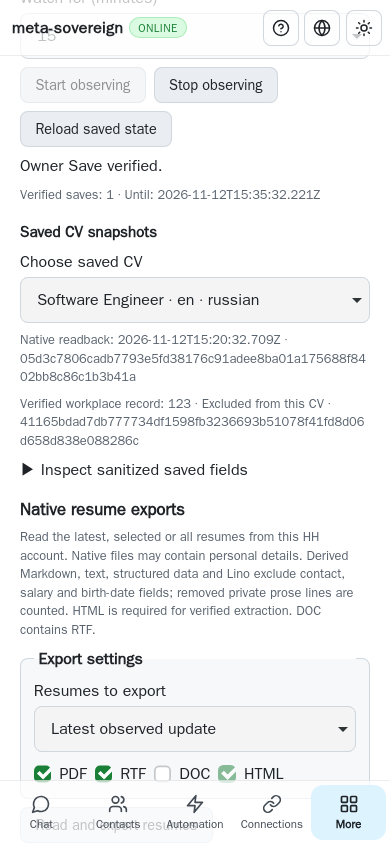

# Exact saved workplace identity

The passive HH watcher now confirms an existing shared workplace against its
own fresh native record and every selected CV export. Unchecking that record
from another CV preserves that CV's unrelated work history. This is partial
HH16/HH18 work in [PR #57](https://github.com/link-foundation/meta-sovereign/pull/57).

## Reproduction and cause

The verifier at `d76215a10034df559103f3d5e2604158eba174a1` uses only native
text exports, which omit shared workplace IDs. It refuses a legitimate detach
when the unchecked CV contains any work history. Conversely, matching exported
text and an empty unchecked CV can be accepted without proving which shared
record was saved. The two focused regressions fail against that actual parent.

In the native fixture, open existing record `123`, leave the English CV checked
and Russian CV unchecked, revise the description and click HH Save yourself.
The Russian CV already contains an unrelated employer. Replaying the actual
parent verifier reports `not-saved` with zero verified snapshots. The replay
keeps the new read-only plumbing in place and substitutes only the actual
parent verification module; its script restores the working file in `finally`.

## Readback contract

After the trusted owner Save and closed-form checks, the watcher reads each
affected CV export and then GETs exactly
`https://hh.ru/profile/edit/experience/<recordId>`. There is no `resumeFrom`
query that could preselect a CV checkbox. The existing authenticated page makes
the request with cache disabled, redirects refused, a 15-second network bound
and a 2 MiB streamed UTF-8 bound. Verification neither navigates nor operates
an editor. Existing read retry, owner-edit, Cancel, Stop and shutdown guards
remain in force, including draining issued reads before detachment.

The same production field reader parses the fetched HTML as an inert document.
It requires unique complete native fields and an unambiguous bounded set of
actual CV checkboxes. The record ID, final prose, company, title, month-precise
dates, current-employment state, location, website, industry labels and the
entire CV checkbox selection must match the trusted Save attempt. Checked CVs
must additionally have one complete matching exported job, including resolved
industry IDs. An unchecked CV can retain other jobs, including independent
text-identical records: exclusion is established by this record's checkbox.

Sanitized snapshots retain the export digest and an additional record ID,
record HTML SHA-256 and per-CV included/excluded flag. Existing snapshots without
that optional evidence remain readable. CLI, both Lino formats, local API and
all four UI languages expose the same persisted evidence. Reloading or choosing
another saved CV performs no provider read. The UI reuses its existing muted
provenance, disclosure and responsive controls, following the pinned T3 Code
review/recovery direction in [Chat References](../../CHAT-REFERENCES.md).

Missing identities on newly created records, hidden company metadata,
client-only/incomplete HTML, conflicting fields, challenges, changed membership,
export mismatches and interrupted reads remain unconfirmed. Prior snapshots
survive. A successful fixture does not establish authenticated live HH behavior.

## Focused verification

```sh
node --test --test-concurrency=1 js/tests/cv-workplace-identity.test.js js/tests/cv-save-watch.test.js js/tests/cv-save-watch-recovery.test.js js/tests/cv-save-watch-controls.test.js
deno test --allow-all --v8-flags=--max-old-space-size=384 js/tests/cv-workplace-identity.test.js js/tests/cv-save-watch.test.js js/tests/cv-save-watch-recovery.test.js js/tests/cv-save-watch-controls.test.js
python3 experiments/issue-56/cv-workplace-identity-before.py
RUN_BROWSER_E2E=1 E2E_BROWSER=webkit node experiments/issue-56/cv-workplace-identity-browser.mjs
RUN_BROWSER_E2E=1 E2E_BROWSER=webkit node js/tests/e2e-cv-save-watch-browser.mjs
```

Thirty Node and thirty Deno checks pass. They include exact identity/membership
comparisons, bounded GET behavior, redirects, invalid UTF-8, missing/challenged
records, persisted interface evidence, cancellation during readback and drained
Stop. The native WebKit fixture checks successful owner Save, saved metadata
mismatch, saved checkbox mismatch and a challenged record; later failures retain
the previous snapshot. It records four owner Saves, four owner navigations,
sixteen native record reads, no executed inert scripts and zero page errors.
The mandatory existing browser entry includes these four cases plus the About
compatibility scenarios. The new inert-reader checks also refuse six malformed
or challenged documents. Browser coverage remains mandatory in hosted CI.

These are real local WebKit fixture checks, not authenticated provider tests or
independent MCP checks. Playwright MCP was unavailable during that original run.
The later [independent browser verification and stricter guards](cv-workplace-hardening.md)
retain six passing MCP cases against the owned native fixture. Hosted
runtime/browser matrices and their exact published head results remain required.

Before, with the actual parent verifier:



After, with final fields and exact identity:



Phone recovery, selecting the CV from which the record was excluded:



The [checksummed evidence archive](data/cv-workplace-identity.tar.gz) retains raw
before/after logs, source snapshots, parent verification/reader modules and
screenshots. Native workplace preparation/copy/detach controls, durable edit
batches, newly created identity recovery, bilingual provider save/readback,
authenticated parity and every other unchecked issue criterion stay unfinished.
