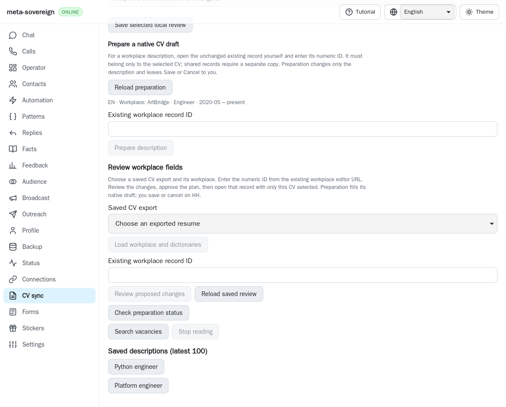
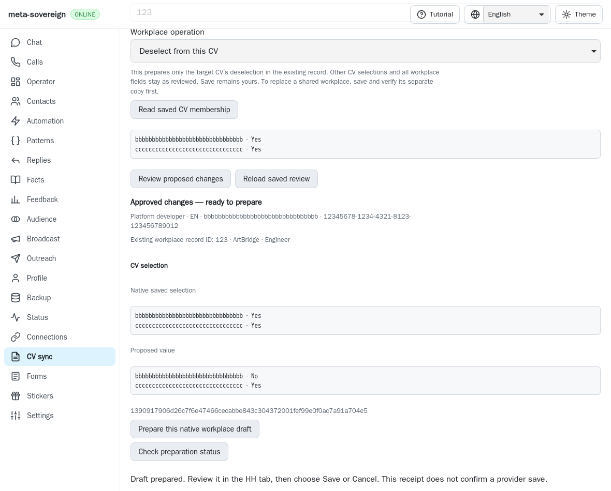
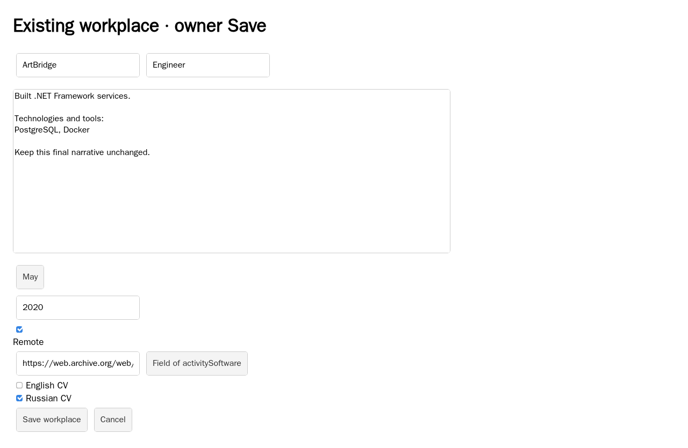
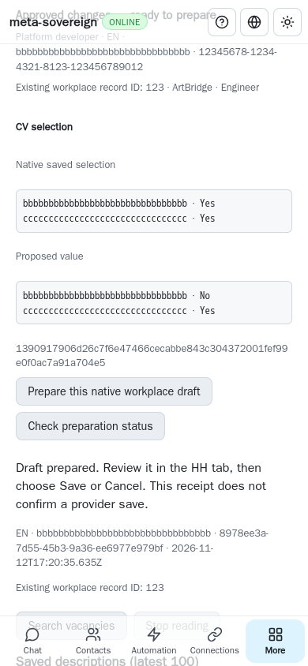

# Separately reviewed workplace deselection

The owner can remove the target CV's selection from one existing shared HH
workplace without changing the workplace or any other CV selection. The CV
screen, CLI and both Lino encodings share the same explicit review and durable
draft preparation. This is partial HH14–HH16 work in
[PR #57](https://github.com/link-foundation/meta-sovereign/pull/57).

## Reproduction and reference

Published `3483c8b1f623a8220bdb8adaa83de372da2b8c7d` supports existing single-CV
field edits but has no membership review. Its service refuses a membership-only
plan with no changed fields; its CV panel has no deselection operation. The
finite parent replay substitutes each actual published file independently,
preserves the expected failures and restores both files unconditionally.

The pinned primary reference
[HH editor](https://github.com/konard/hh-job-application-automation/blob/fa0991b8c2d0896fb3b4be6c69947f0590094b15/src/hh-cv-editor.mjs)
requires copying a shared record for the target CV and separately reviewing
deselection of its original. Its complete 477-line source is preserved for
behavioral comparison; no source is copied or executed. This unit supplies the
separate deselection operation. Automatic copy/new-record identity and proof of
the complete copy workflow remain unfinished. The panel explicitly instructs
the owner to save and verify any intended copy first.

That source also explicitly refuses empty city/region updates. Our native area
removal refusal follows this reference; it is not an additional parity gap.
Earlier field-review evidence recorded this conservatively before this source
inspection. Existing field edits continue refusing shared records.

## Contract

An explicit native membership read attaches to the chosen existing browser slot
and exact query-free workplace record. It waits for native controlled fields,
reads the complete CV checkbox list and performs a fresh authenticated bounded
saved-record read. Original export/job, all workplace fields and complete
membership must agree, with no owner change during reading. The read detaches
on success or failure and performs no navigation or edits.

A proposed `operation: detach` plan binds that complete list, including unchecked
CVs, to the original verified export/job, exact record and slot. Only the target
CV changes from checked to unchecked; at least one other CV must remain checked.
Duplicate, missing, coerced or oversized rows, forged differences, field edits,
orphaning and changed request bindings refuse approval. The approved plan is a
new immutable fingerprint. Preparation revalidates the original source artifact,
fresh saved native fields and membership before native checkbox interaction.

The controlled checkbox must still belong to the exact current form. Guards
check all fields and all selections before and after changing only that box.
Owner changes during native reading or the checkbox event are preserved without
restoration. Failed preconditions remain failed; a dispatched change with an
owner conflict remains uncertain. The code never deletes the record or presses
workplace Save/Cancel. A prepared receipt reports `providerSaved: false`.

Lost POST replies recover the same request and reviewed plan by GET, including
on a 390px phone; no repeat attachment or provider action occurs. Reload restores
the deselection operation. Failed membership refreshes clear the stale displayed
list while retaining the immutable review and provider draft.

CLI: `vacancies-cv-workplace-membership` reads the exact record with `--export-id`,
`--resume`, `--job-index`, `--record-id`, optional `--target-id` and
`--browser-slot`. `vacancies-cv-workplace-plan --operation=detach --file=...`
accepts the complete checkbox array as bounded JSON, text Lino or binary Lino.
Existing `-review`, `-plan-stored` and `vacancies-cv-prepare --review-kind=workplace`
share approval and durable request recovery. Trusted API routes use the same
services. CV controls and owner-Save guidance support English, Russian, Chinese
and Hindi. Review labels identify the native saved selection accurately.

## Verification

```sh
node --test --test-concurrency=1 js/tests/cv-workplace-membership.test.js
deno test --parallel=1 --allow-all --no-check js/tests/cv-workplace-membership.test.js
python3 -B experiments/issue-56/cv-workplace-membership-before.py
RUN_BROWSER_E2E=1 E2E_BROWSER=webkit node experiments/issue-56/cv-workplace-membership-browser.mjs
RUN_BROWSER_E2E=1 E2E_BROWSER=webkit node js/tests/e2e-cv-prepare-browser.mjs
```

Eight new service/CLI/API/four-locale checks pass. The combined focused run
passes 39 Node and 20 Deno checks covering field review, native preparation
admission, controls and the independently published translation controls. The
existing mandatory preparation browser group passes all 27 scenarios. Six new native WebKit scenarios verify complete
membership reading/review, target-only preparation, stale/wrong/saved form
refusals, owner edits during reading, concurrent field/selection changes,
unhydrated checkboxes and lost-reply phone recovery. Twelve attachments drain;
nine fresh native reads, zero provider Saves and no page errors occur. The new
cases are mandatory in the existing preparation browser group. Only relevant
tests and one browser engine run locally against isolated fixture servers.
Playwright MCP is unavailable; installed Playwright WebKit is the fallback.
Scoped formatting and secret scanning pass. ESLint reports zero errors and six
existing-style complexity/length warnings in the changed modules and fixture.
Authenticated live-provider parity is not established.

Before, actual published bundle:



After:







The checksummed `data/cv-workplace-membership.tar.gz` archive retains changed
sources, actual parent files/failures, focused logs, reference source and images.
Full shared copy/new identities, durable edit batches, complete bilingual and
cross-provider writes, authenticated parity and every other unchecked original
criterion remain unfinished. Exact published-head hosted checks remain required.

## Concurrent parent release failure

Checks run `43266303454`, created 2026-11-12 17:08:50 UTC for exact parent
`3483c8b1`, fails Changesets job `131351156787`. Raw log lines 403–417 show two
added changesets where the unchanged gate requires exactly one:
`cv-translation-comparison.md` and `visible-browser-defaults.md`.
Commit `e2968a55` combines their release notes under the existing minor release
trigger without changing the gate or dropping either description. The exact
parent fails the local gate; the new commit passes the same base/head comparison
with exactly one added changeset. Raw hosted and local logs are retained.
