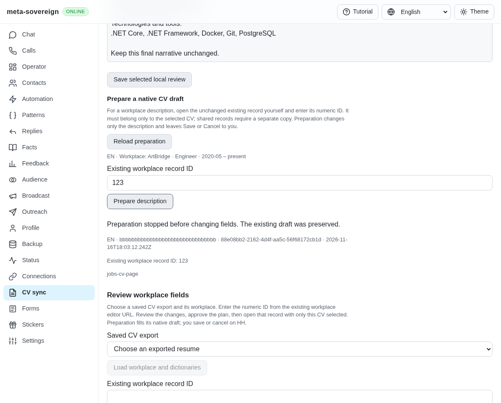
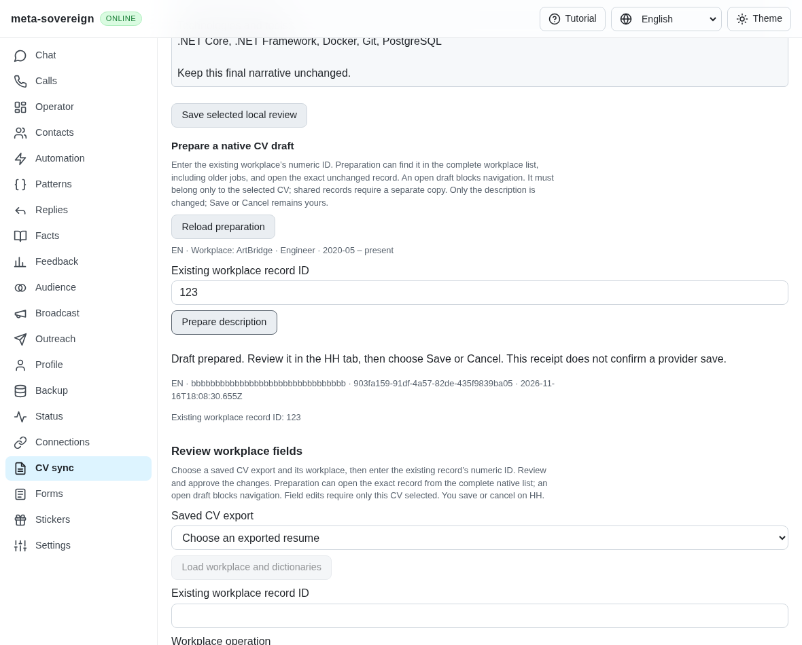
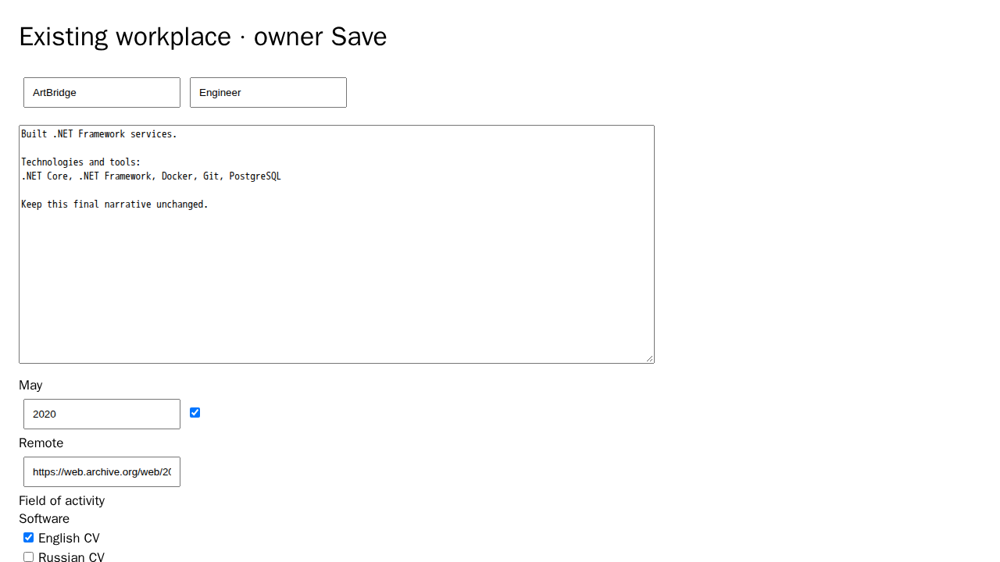
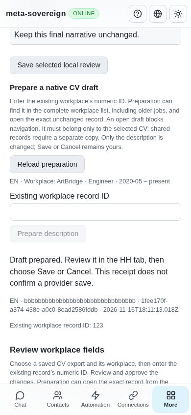

# Opening an exact reviewed native workplace

Reviewed preparation can now find an older HH workplace through the full native
workplace list instead of requiring the owner to open its editor first. The
existing CLI, both Lino encodings and four-language CV controls use the same
preparation service. This is incremental HH14/HH16 work in
[PR #57](https://github.com/link-foundation/meta-sovereign/pull/57); shared copying,
new records and edit queues remain unfinished.

At published `0e50881450121bedb200a85e0bb7e4fff0eacc9f`, select and save a
workplace-description review, leave the existing HH tab on the CV overview,
and request preparation with its exact numeric record ID. Preparation fails
with `jobs-cv-page` before opening the workplace. The actual-parent browser
replay substitutes both native preparation modules and retains the parent web
bundle. Its isolated older job is absent from the compact overview. The before
screenshot and expected failure preserve that behavior.

Explicit preparation now checks that there is no open workplace or About draft,
provider challenge or dialog before navigating to the complete native list.
It matches company, role and the complete description, requires exactly one
visible enabled Edit control, and waits for its native link or hydrated handler.
The list, selected node and absence of drafts are checked again before clicking.
The opened numeric record ID and optional resume context must match the review.
The existing bounded saved-form read, unchanged-field and membership comparison
still run before any keyboard insertion. No direct Save, Cancel or draft
clearing is introduced. The passive Save observer remains passive.

Query context is restricted to the selected `resumeFrom` and native
`hhtmFrom=resume`, with duplicate or unknown keys and fragments refused. Full-field
preparation and read-only membership inspection retain that context as well.
The existing durable opening phase is written before navigation, interrupted
requests do not replay, cancellation is checked before native actions, and
content-free diagnostics remain off by default.

The pinned reference's native full-list behavior was studied in
[`experience-sites.mjs`](https://github.com/konard/hh-job-application-automation/blob/fa0991b8c2d0896fb3b4be6c69947f0590094b15/src/experience-sites.mjs)
and [`hh-cv-editor.mjs`](https://github.com/konard/hh-job-application-automation/blob/fa0991b8c2d0896fb3b4be6c69947f0590094b15/src/hh-cv-editor.mjs).
No reference implementation was copied.

Focused reproduction and verification:

```sh
node --test --test-concurrency=1 js/tests/cv-workplace-open.test.js js/tests/cv-workplace-prepare.test.js js/tests/cv-workplace-fields.test.js js/tests/cv-workplace-membership.test.js js/tests/cv-workplace-identity.test.js
RUN_BROWSER_E2E=1 E2E_EXECUTABLE_PATH=/usr/bin/google-chrome node experiments/issue-56/cv-workplace-open-browser.mjs
RUN_BROWSER_E2E=1 E2E_EXECUTABLE_PATH=/usr/bin/google-chrome node experiments/issue-56/cv-workplace-open-compat-browser.mjs
```

Ten new finite portable checks cover exact URL context, an already open exact
record, native list navigation, draft/dialog/challenge refusal, an owner opening
a draft during the durable phase, ambiguous or unready controls, list hydration,
changed nodes, wrong records and cancellation. All 44 focused portable checks pass. The compatibility run
includes source verification, immutable reviews, both authenticated Lino
encodings, CLI and localized receipts. The mandatory browser entry now includes
three real native-list scenarios. They verify one native Edit click, one saved
readback, all other fields preserved, six attachments drained, zero Save/Cancel
requests, durable phone recovery and refusal of duplicate, hidden, challenged or
wrong-record targets. Ten separate native full-field and membership compatibility
checks retain their existing assertions and now cover the selected resume URL
context. Only focused Chromium runs locally; full matrices belong to CI.

An independent Playwright MCP browser operates the isolated real UI/server. It
verifies one preparation POST, draft-only messaging, phone reload without replay
or overflow, one native Edit click/readback, no Save/Cancel and closed owned
resources. These are synthetic native provider fixtures, not an authenticated
live-account claim.

Before:



After:







The checksummed `data/cv-workplace-opening.tar.gz` preserves parent sources,
working sources, focused logs, native/MCP receipts and screenshot hashes.
Exact published-head CI remains required. No original acceptance row or issue
#56 is marked complete by this incremental change.
