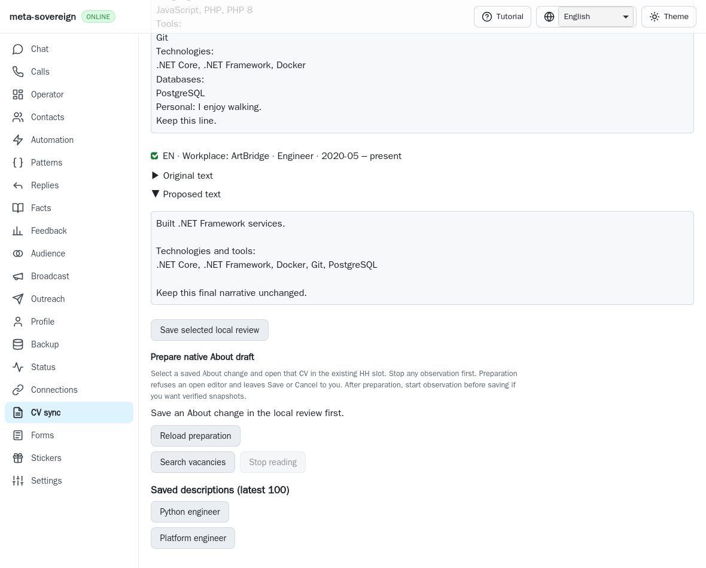
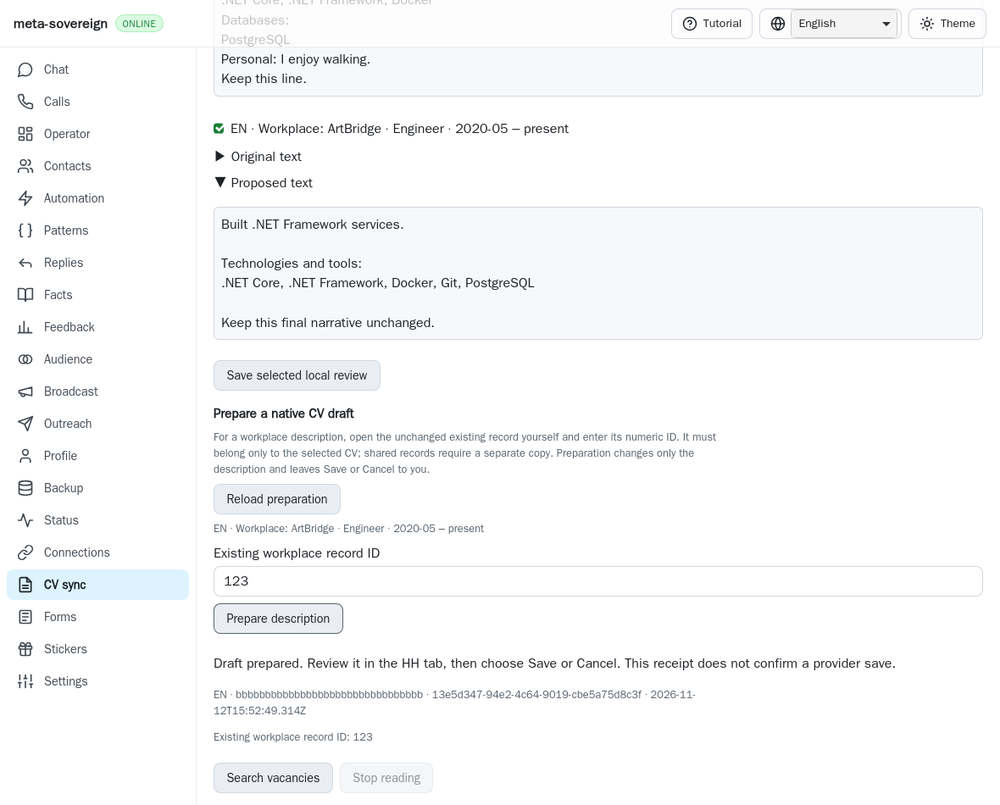
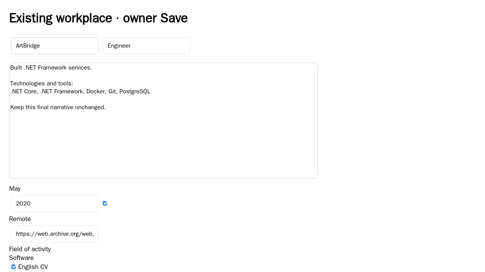
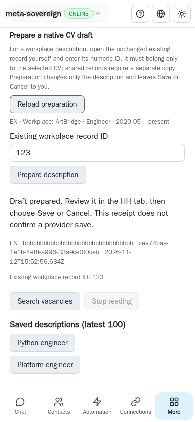

# Reviewed native workplace description preparation

An explicitly selected, saved bilingual review can now prepare a description
in the owner's already open existing HH workplace. CLI, both Lino encodings
and four-language CV controls share the same exact record identity, immutable
review and durable preparation receipt. This is partial HH14/HH16/HH19 work in
[PR #57](https://github.com/link-foundation/meta-sovereign/pull/57).

## Reproduction and cause

At published `ee7a74e466c49498ee47ece193a30e55559a65ec`, save a local review
selecting `en:jobs.0.description`, open its existing native workplace and request
`vacancies-cv-prepare` with that change and `--record-id=123`. Option validation
permits only About; source resolution independently rejects workplace fields,
and the CV panel exposes no workplace preparation control. Actual-parent replays
replace each of those three files separately, retain all three expected failures
and restore working bytes unconditionally. The before screenshot uses the actual
published web bundle.

The pinned HH reference at
`fa0991b8c2d0896fb3b4be6c69947f0590094b15`,
[`src/hh-cv-editor.mjs`](https://github.com/konard/hh-job-application-automation/blob/fa0991b8c2d0896fb3b4be6c69947f0590094b15/src/hh-cv-editor.mjs), demonstrates controlled native text insertion, exact
workplace checks and language-specific copies for shared records. The source
snapshot is retained with this evidence. The implementation here reuses this
repository's preparation admission, cancellation, record reader and Save
verification. It requires an owner-opened record and refuses shared records
until the separate reviewed copy workflow exists. No reference code was copied.

## Preparation contract

The request names an exact saved review fingerprint, selected description change,
existing numeric record ID and existing browser slot/tab. About requests retain
their previous behavior and do not accept an irrelevant workplace ID. Resolution
checks both private source artifacts byte for byte and the current technology
catalog revision before attachment. A workplace change must refer to the actual
saved job and its original description.

Preparation never navigates or opens a workplace editor. It requires exactly
`https://hh.ru/profile/edit/experience/<recordId>`, unique complete native fields,
a hydrated controlled writable textarea, and exactly one checked CV matching the
review. A fresh authenticated bounded native GET, without `resumeFrom`, must prove
the complete unchanged field and CV-checkbox baseline. Company, title,
month-precise dates, current state, area, website, industries and description
must also match the selected saved job. Missing metadata, changed owner drafts,
shared memberships, wrong identities and provider challenges refuse typing.

Only the reviewed description is inserted through keyboard events. The shared
About/workplace helper checks the original DOM node, active field, controlled
value and every other field and checkbox between operations. It waits for
hydration, respects maxlength including its exact boundary, blurs and checks the
settled result. Save and Cancel remain the owner's controls. The existing default-off
content-free CV phase diagnostics remain available.

The durable receipt contains the record ID, never the CV prose, and explicitly
reports `providerSaved: false`. Reusing its request with another record conflicts.
Lost responses recover through read-only status without replay. Existing
ID-specific cancellation, shared-store serialization and drained Stop remain in
force. The UI labels each selected workplace and requires its explicit ID; long
reviews reveal ten workplace actions at a time. Preparation and provider Save
remain distinct states.

## Verification and evidence

```sh
node --test --test-concurrency=1 js/tests/cv-workplace-prepare.test.js
python3 experiments/issue-56/cv-workplace-prepare-before.py
RUN_BROWSER_E2E=1 E2E_BROWSER=webkit node experiments/issue-56/cv-workplace-prepare-browser.mjs
RUN_BROWSER_E2E=1 E2E_BROWSER=webkit node js/tests/e2e-cv-prepare-browser.mjs
RUN_BROWSER_E2E=1 E2E_BROWSER=webkit node js/tests/e2e-cv-save-watch-browser.mjs
```

Six new Node/Deno checks cover exact source/record resolution, invalid inputs,
immutable idempotency, record conflicts, both authenticated Lino encodings,
untrusted-origin refusal, CLI/UI receipt validation and four localized controls.
Forty-six focused preparation/cancellation/identity checks per runtime and the
separate twenty-one Save-observation compatibility checks retain existing behavior.

Five new native WebKit scenarios cover delayed hydration, exact insertion with
all other fields preserved, owner drafts, shared CV membership, wrong identity,
changed saved metadata, challenges, owner company/checkbox edits during the GET,
maxlength and lost-reply recovery. Nine owned attachments are drained, seven
native GETs complete, and zero Save requests or page errors occur. The mandatory
preparation entry includes these scenarios alongside About and cancellation;
the existing mandatory Save-observation entry verifies the shared comparison
refactor. Full runtime/browser matrices belong to hosted CI. Playwright MCP is
not available in this continuation; these are real native fixtures, not an
independent MCP or authenticated live-provider claim.

Before, using the actual parent bundle:



After, with explicit identity and a draft-only receipt:







The checksummed archive `data/cv-workplace-prepare.tar.gz` retains source snapshots,
actual-parent bytes/failures, complete focused logs, pinned reference source and
screenshots. Exact published-head hosted results remain required.

During validation, parent Checks `43249023631` at `ee7a74e4` passed lint,
formatting, workflow contracts, Rust, CodeQL and the completed runtime/browser
jobs. Its macOS native-helper job `131289825440` never started a step and was
cancelled when independently published `16a73620` queued the same concurrency
group. The preserved annotation explicitly reports the higher-priority waiting
request and macOS capacity constraints. The log endpoint returns `BlobNotFound`;
that response and job/annotation metadata are retained. This cancellation is not
a test failure or a passing whole-matrix result. Integrate that published work
and require the combined head's hosted checks.

Complete workplace field/add/copy/detach workflows, new native identities, edit
batches, bilingual provider Save/readback, authenticated live parity and every
other unchecked issue requirement remain unfinished. This unit does not mark
HH14–HH20 or issue #56 complete.
