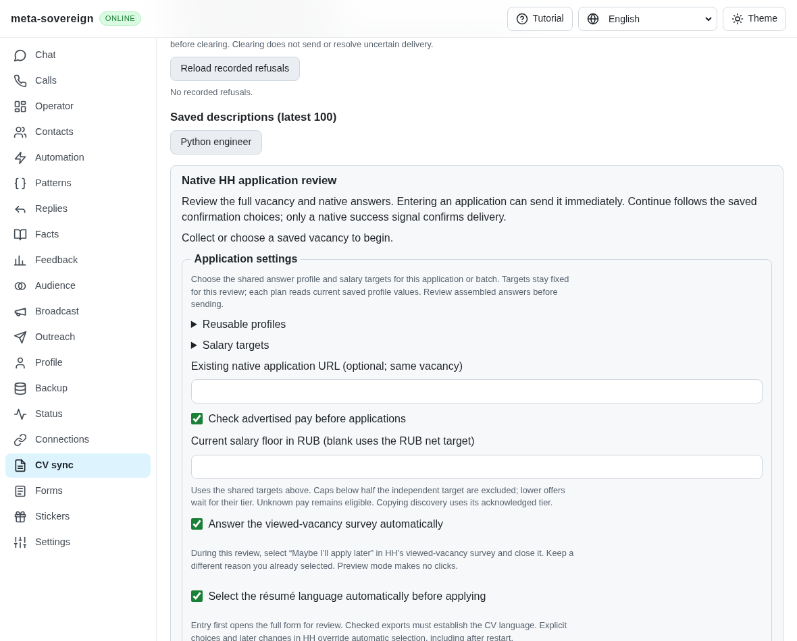
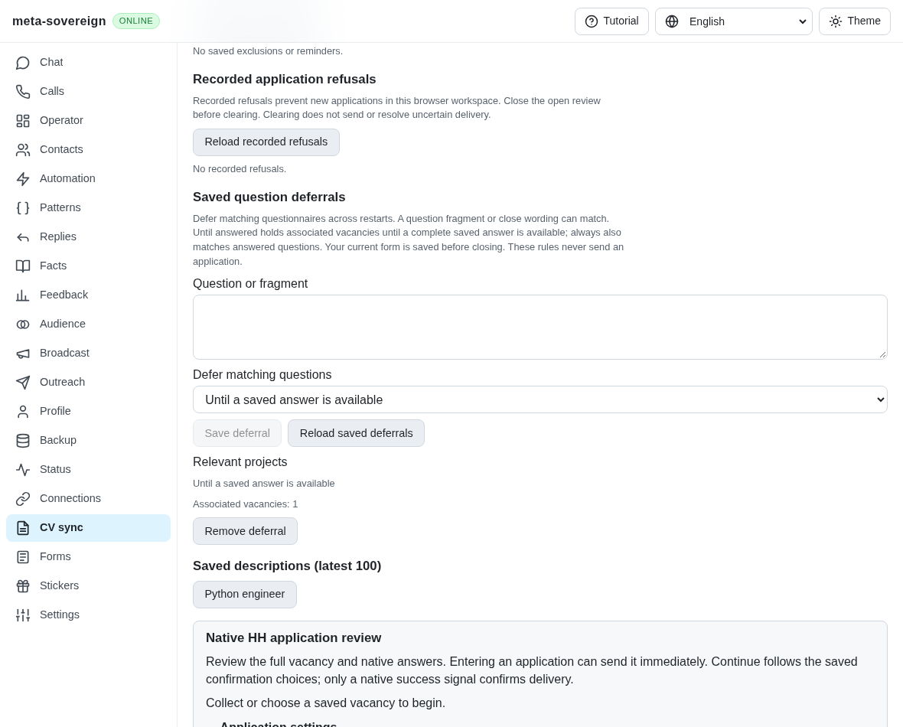
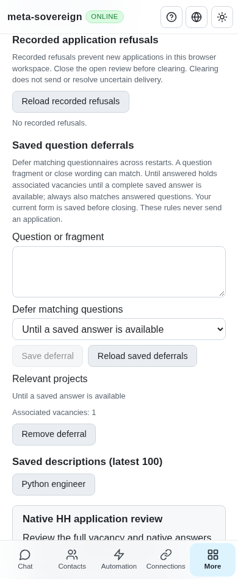
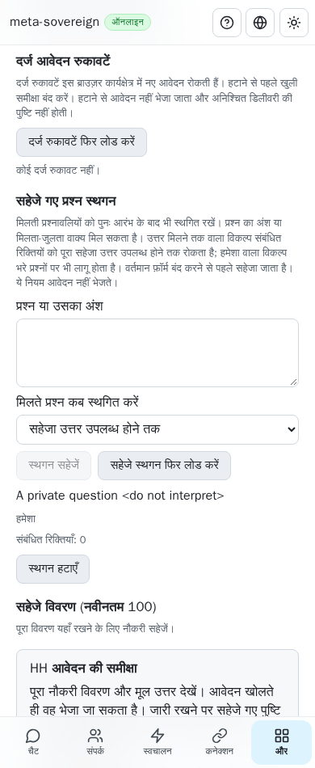

# Durable question deferrals

[PR #57](https://github.com/link-foundation/meta-sovereign/pull/57) remains draft
and unmerged. This HH05 unit does not accept the complete criterion or change
the 88/118 inventory count.

The pinned [deferred-question implementation](https://github.com/konard/hh-job-application-automation/blob/fa0991b8c2d0896fb3b4be6c69947f0590094b15/src/deferred-questions.mjs)
keeps question-to-vacancy associations across restarts, watches a waiting form,
and supports both unanswered-only deferrals and unconditional question patterns.
The existing worker questionnaire queue deliberately lives in memory. Reusing
that queue could not implement the persistent policy and would change its
existing lifetime and retry semantics.

## Reproduction and correction

At published parent `4363ddd95d2fb9b9c74ee0cdf0a785a30afc4bc3`, open an HH
questionnaire with an unanswered question and actual owner letter. There is no
durable question policy or explicit unanswered-question deferral operation.
The two new service regressions fail with missing operations, and the native
browser regression times out waiting for the absent policy controls. The parent
probe restores every production source byte after collecting this evidence.

The correction stores a bounded private policy per browser slot using the
existing acknowledged Links storage. Until-answered policies release associated
vacancies for fresh review when an eligible shared answer exists; always policies
also match answered questions. Matching uses normalized fragments or the shared
0.7 similarity threshold. A checkbox is unanswered until an actual option is
selected. Consent, pause, preview, CAPTCHA, late native edits, acknowledgement
failures and uncertain delivery keep their existing protections.

Explicit deferral and matching policy changes save the full recovery draft,
actual Q&A observations and eligible unapproved knowledge before closing the
owned form. Failed saves retain the form. A two-second revision watcher refreshes
waiting forms under the acknowledged writer. Search, discovery, batch admission
and final dispatch consult the same policy; discovery does not collect descriptions
for pending associated vacancies. A new matching batch form is preserved and
counted as skipped without sending. Only native-confirmed delivery forgets its
vacancy associations. Recovery/status never restore, reopen or send automatically.

`vacancies-questions-stored`, `vacancies-question-change` and foreground
`defer-questions` share these operations with both text and binary Lino routes
and four-language CV controls. Changes require the observed revision. Uncertain
web receipts retain owner input and require a reload, with no write replay or
offline mutation fallback. The separate worker queue remains independent.

The policy permits 128 entries, 1,000 total associations and 6,000 characters per
question. Answer planning and matching reuse bounded shared mechanisms. It
preserves ordinary approval, source/chat scope, template completeness and native
dispatch checks; making a vacancy eligible does not authorize an application.

## Verification

- `deferred-questions-before.log`: two published-parent failures; the native
  parent log confirms the absent controls.
- `deferred-questions-final-tests.log`: 110 focused tests pass with one worker,
  covering service persistence, acknowledgements, scope, delivery, batches,
  selection, discovery, CLI, both encodings, browser state and translations.
- `deferred-questions-browser-final.log`: actual native form, one browser open,
  preserved actual letter, durable association, empty worker queue, zero sends,
  no page exceptions and all owned browsers closed. Desktop and phone fit.
- `deferred-questions-mcp-final.json`: independent real-browser save, reload,
  literal private wording, four translated phone layouts, removal and reload.
  No scenario exceptions or provider effects; its fixture was closed and awaited.
- Scoped lint, formatting, secret scanning, source/document limits and the
  unchanged duplication threshold are checked separately. Full runtime/platform
  matrices and final acceptance require exact-source hosted workflows.

The source snapshots, pinned reference, raw logs and screenshot hashes are in
`data/deferred-questions.tar.gz` and its independently verified SHA-256 manifest.
The native and MCP fixtures use synthetic provider pages, not authenticated HH;
complete HH05 parity and every unchecked inventory row remain required.

## Browser comparison

Published parent without durable question controls:

Saved policy after preserving the native form:

Phone layout and independent translated verification:

