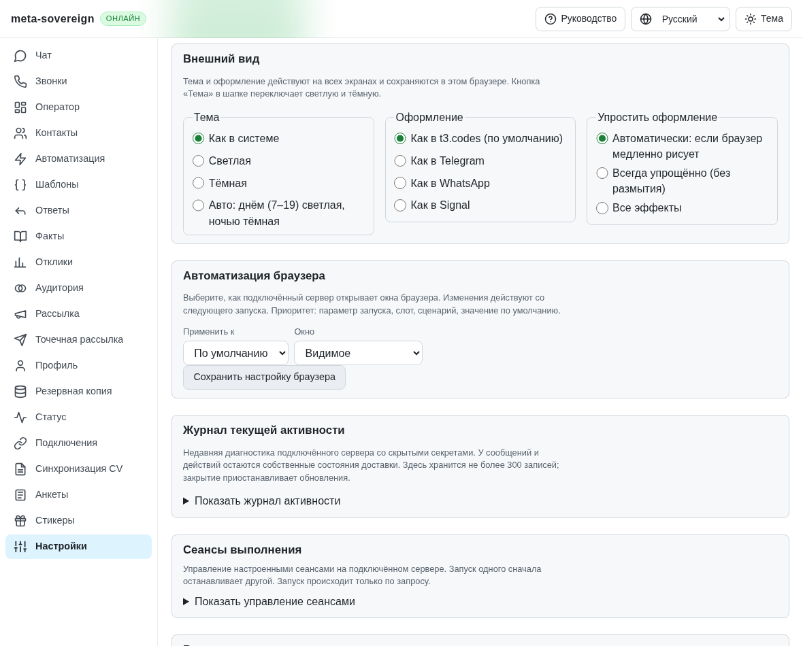
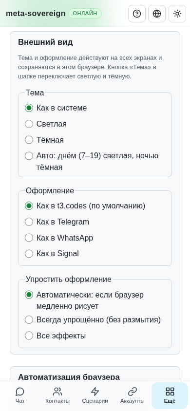

# Shared desktop appearance verification

The pinned desktop contract at `8fbf3b7` requires one window with execution-mode
switching, Start/Stop, light/dark/system themes and automatically detected Russian
and English. This check adds native browser coverage for the existing shared
appearance controls. It changes no product behavior and does not accept VD06.

| Contract                              | Implementation and evidence                                                                                                                                                                                                                                                                               |
| ------------------------------------- | --------------------------------------------------------------------------------------------------------------------------------------------------------------------------------------------------------------------------------------------------------------------------------------------------------- |
| One window and owned shutdown         | `js/electron/lifecycle.js` deduplicates pending creation, focuses the existing window and drains the owned server before Quit. [Lifecycle evidence](desktop-lifecycle.md) includes concurrent activation and startup refusal.                                                                             |
| Execution modes and Start/Stop        | Shared `settings-runner.js`, `runner-view-state.js` and the existing runner session/feedback browser checks cover both mode-switch directions, acknowledged stops, failed outcomes and recovery without replay. [Runner evidence](runner-session-controls.md) retains their actual scope.                 |
| Light, dark and automatic system mode | `appearance.js` resolves the stored choice and subscribes to system changes. The new native check selects the actual controls, reloads, changes the OS preference and reads the root theme attributes after each transition. Explicit dark survives an OS change; system follows both subsequent changes. |
| Automatic Russian and English         | Separate fresh contexts expose actual `ru-RU` and `en-US` navigator settings. `i18n.js` detects each language. The native language selector changes the choice, retains it after reload and clears the override when system detection is restored.                                                        |
| Shared desktop and phone layout       | The same appearance panel is captured at 1180 and 390 CSS pixels; the fixture checks that it fits. Both images are inspected. No owner profile, running application server or provider account is used.                                                                                                   |

Run the one added group with an already available Chromium executable:

```sh
E2E_EXECUTABLE_PATH=/usr/bin/google-chrome RUN_BROWSER_E2E=1 DESKTOP_APPEARANCE_SCREENSHOTS=1 node --max-old-space-size=384 js/tests/e2e-desktop-appearance-browser.mjs
```

The successful 11.530-second receipt records two detected locales, retained
explicit language/theme choices, locale reset, three theme modes, two live
system changes, zero runner calls and zero page exceptions. The mandatory
browser registry includes this group for hosted Chromium/WebKit coverage;
only the focused Chromium group ran locally. Native Electron platform results
are separate from this shared-renderer check.

The first fixture initializer ran on an opaque blank document and produced two
`SecurityError` exceptions when accessing local storage. The final assertion
caught them. Moving initialization to the existing page-scoped pattern fixes
the harness; both outputs are retained. No exception filter, application change,
deadline increase or assertion removal was used.

Current appearance and language choices are per-browser local-storage settings.
The server's readable startup configuration and runner profile APIs cover other
controls, not global appearance defaults. The original CLI/API/UI and layered
configuration requirements remain active; this check supplies no evidence that
those preferences can already be edited through every requested interface.
Complete VD06 mapping and exact-source hosted verification remain required.
All **40 unchecked criteria** retain their original scope, and
[PR #57](https://github.com/link-foundation/meta-sovereign/pull/57) stays draft
and unmerged.





[Checked source and log archive](data/desktop-appearance.tar.gz) ·
[Hash manifest](data/desktop-appearance.tar.sha256.json)
