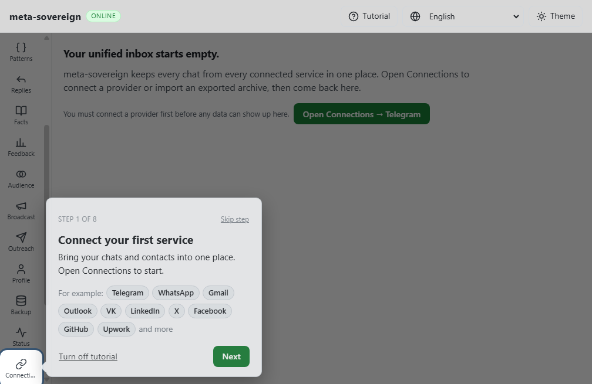
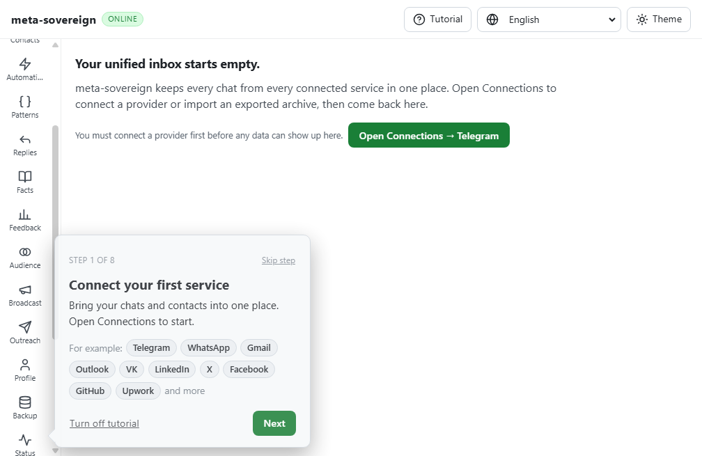

# Desktop notification translations in a clean installation

The Windows x64 and arm64 installers for `72d5a02c` completed silently. When the smoke test opened each installed executable from a temporary directory outside the checkout, Electron's main debugger attached but the browser endpoint never appeared. The 30-second launch check failed before any window or screenshot. Both Windows architectures on earlier `8646590a` show the same phase. [Windows x64 log](https://github.com/link-foundation/meta-sovereign/actions/runs/45152457003/job/137617589363#step:14:1) · [Windows arm64 log](https://github.com/link-foundation/meta-sovereign/actions/runs/45152457003/job/137617589360#step:14:1) · [Earlier x64 and arm64 jobs](https://github.com/link-foundation/meta-sovereign/actions/runs/45148243707).

An isolated import reproduces the missing dependency on the published source. The Electron main process imports the notification controller, which imported the browser's React locale hooks. React is a web build dependency and the renderer bundle already includes it. The staged desktop application omits it, while an extracted package in the checkout can resolve it from the surrounding development installation. Node reports `ERR_MODULE_NOT_FOUND` for `react` when the controller is imported in a clean temporary directory.

The desktop controller now imports translation and locale metadata directly. The browser's React hooks re-export and use the same translation function. The catalog, interpolation and plural rules continue to serve both clients. The release smoke deadline and native window, backend, storage and shutdown assertions remain in place.

## Reproduction and verification

Use the [packaging regression](../../../js/tests/desktop-runtime-packaging.test.js) with the two source files from `72d5a02c` to reproduce the missing React import. The corrected isolated copy loads the notification controller and returns translated browser actions. Node and Deno each pass 44 focused packaging, native attention and browser translation checks. The production web bundle builds successfully. [Evidence archive](data/desktop-attention-packaging.tar.gz) · [Entry hashes](data/desktop-attention-packaging.tar.sha256.json).

The release workflow for `053663392ae9e0e0ac31885851e89bbe08671207` passed the clean installed-application launch on Windows x64 and arm64. Both jobs reached the local backend, captured the native window and shut down. The runners uploaded their screenshots as artifacts `14810238373` and `14809199349`, respectively. Signed interactive notifications and operating-system Focus behavior still require separate verification. [Windows x64 job](https://github.com/link-foundation/meta-sovereign/actions/runs/45156539879/job/137635093856) · [Windows arm64 job](https://github.com/link-foundation/meta-sovereign/actions/runs/45156539879/job/137635093979).

