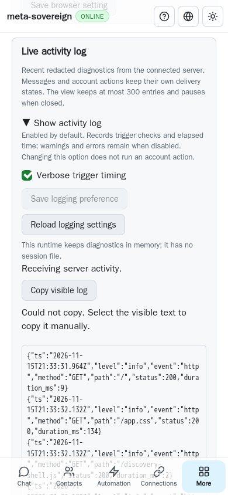
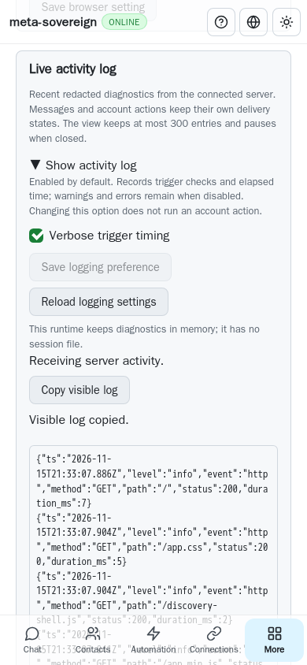

# Desktop log clipboard capability

VD08 explicitly requests a desktop clipboard bridge. The existing live log
panel used only `navigator.clipboard.writeText`; a desktop renderer without
browser clipboard permission therefore refused even when native copying was
available. Reproduce with
`node experiments/issue-56/desktop-clipboard-native.mjs --before`: the exact
`6af537ec` renderer never calls the provided desktop capability and shows the
manual-copy recovery text. Remove `--before` to verify the correction using
one owned WebKit fixture. No provider account or user server is involved.

The sandboxed preload now exposes one write-only invocation. Main accepts
bounded text only from its live owned main frame at the app's exact loopback
origin. Another window, subframe, origin, invalid input or closed window gets
`{ok:false}`. Main returns success after the synchronous native write and
removes its handler when the window closes or loading fails. The renderer
requires an explicit successful receipt; refusal keeps the existing translated
manual-copy instruction. The browser path remains available when a desktop
bridge is absent. A native failure does not silently try browser copying.

Five new finite regressions cover ownership, invalid inputs, disposal, native
refusal, actual preload invocation, strict renderer receipts and window load
failure. Together with existing lifecycle, window and authorization-entry
checks, 14 focused Node checks pass. Run:

```sh
node --test --test-concurrency=1 js/tests/desktop-clipboard.test.js js/tests/desktop-lifecycle.test.js js/tests/desktop-window.test.js js/tests/vk-token-electron-entry.test.js
```

The browser scenario checks exact visible text, acknowledgement, native refusal
and zero browser calls when that bridge is available. It is registered in the
existing hosted `vk-friends` Chromium/WebKit group. One screenshot refresh
timed out waiting for a synthetic event created before page startup; that raw
log is retained. The case now creates its event after navigation, keeping the
copy subject inside the bounded live tail. The focused rerun passes without
increasing its deadline. This does not establish a root cause for unrelated
historical browser timeouts.

Independent Playwright MCP inspection passes English, Russian, Chinese and
Hindi at desktop and phone sizes, with no JavaScript exceptions. It uses a
mock receipt, so it does not prove native IPC. Raw console records retain
disabled Telegram endpoint/favicon 404s and aborted owned requests during
navigation. An initial inspection also recorded a Chromium cache-write error;
the final inspection disables that browser cache and retains both raw logs.
All owned browser/server resources are closed.

The hosted real-Electron authorization fixture now additionally verifies
the actual sandboxed preload, native clipboard contents, owned-origin
acceptance and foreign-navigation refusal. It restores the previous clipboard
and drains its private window/server. This new native check is pending CI;
the previous `6af537ec` desktop workflow passed its authorization check but did
not yet contain clipboard verification. Cross-platform runtime/browser checks
remain in hosted CI. VD08 and the full issue remain unchecked until all their
acceptance evidence is established; PR57 stays draft and unmerged.

Before:



After:



Evidence: [archive](data/desktop-clipboard.tar.gz),
[hash manifest](data/desktop-clipboard.tar.sha256.json).
