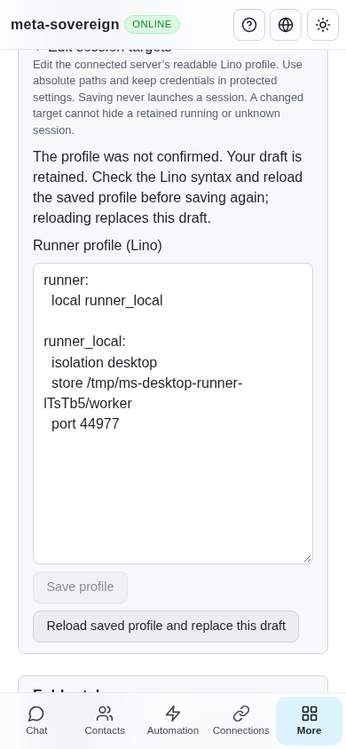
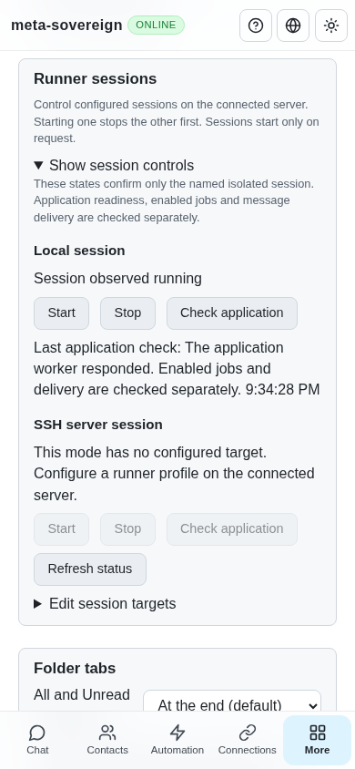

# Bundled local runner in Electron

The pinned VK Bot Desktop reference launches its local service with Electron's bundled runtime and offers isolated SSH runners separately. The Electron adapter now preloads the existing application server in a utility process. Its local target uses a loopback port and a separate store. Screen and Docker remain available through their existing profiles. [Issue 56](https://github.com/link-foundation/meta-sovereign/issues/56) · [Pinned donor](https://github.com/konard/vk-bot-desktop/tree/8fbf3b7c42fd8e995ef137cab9b9653a7dc9b1a1) · [Electron utility process](https://www.electronjs.org/docs/latest/api/utility-process)

On parent `27490251`, open Settings → Runner sessions → Edit session targets. Enter a local target with `isolation desktop`, a separate absolute store and a loopback port. Saving returns HTTP 400 and retains the draft. The fixture loads the parent profile validator from Git and uses the same production Settings assets for both captures. [Local profile example](../../DESKTOP-RUNNER.md)

On the current branch, save the profile and choose **Start**. The desktop waits for the selected port to open before reporting the session running. **Check application** reads the worker's passcode and store state. **Stop** waits for worker exit. An owned process lease keeps another controller from assuming an unowned worker is stopped. If a remote peer refuses to stop, the prepared worker closes before it opens the configured listener. If the peer reappears while the local runner starts, the desktop attempts to drain the new worker before reporting the refusal.

## Verification

- The [Electron reproduction](../../../experiments/issue-56/desktop-local-runner-electron.mjs) uses the actual worker server in Electron 45.3.2 with bundled Node 24.22.2. It starts and stops through the CLI and both Lino encodings, checks the listener after each Stop, and verifies release of both storage and process leases on explicit Stop and application shutdown.
- The [browser reproduction](../../../experiments/issue-56/desktop-local-runner-browser.mjs) captures both profile outcomes on desktop and phone. Independent Playwright MCP reopens the saved profile, starts the real worker, observes a successful health response and stops it at 390 pixels with no overflow. Both checks use private fixtures. The independent console also logged the fixture favicon 404, existing Telegram settings warnings and a browser cache write error. Runner calls and page-script checks passed.
- The [ASAR probe](../../../experiments/issue-56/desktop-utility-process-probe.mjs) imports a sibling module and reads an asset from a small archive. The hosted installer smoke opens the real build, starts and inspects the same backend and verifies the listener and store close when the app quits. [Electron archive documentation](https://www.electronjs.org/docs/latest/tutorial/asar-archives)
- Extract the [source and result archive](data/desktop-local-runner.tar.gz) to replay the checks. The [SHA-256 manifest](data/desktop-local-runner.tar.sha256.json) records the snapshots and evidence.

VD01 remains open for exact-source hosted installer results, preparation of the reviewed application and its dependencies on a clean remote host, and other operating-system prerequisites. The fixture exercises runner readiness and drain. Provider jobs and delivery have separate receipts.
