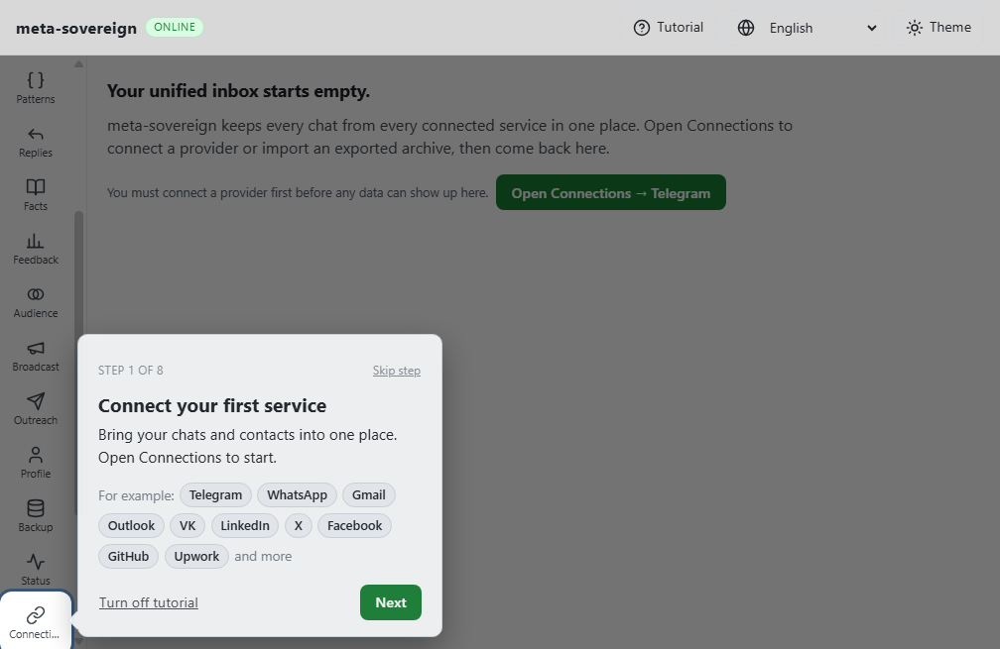
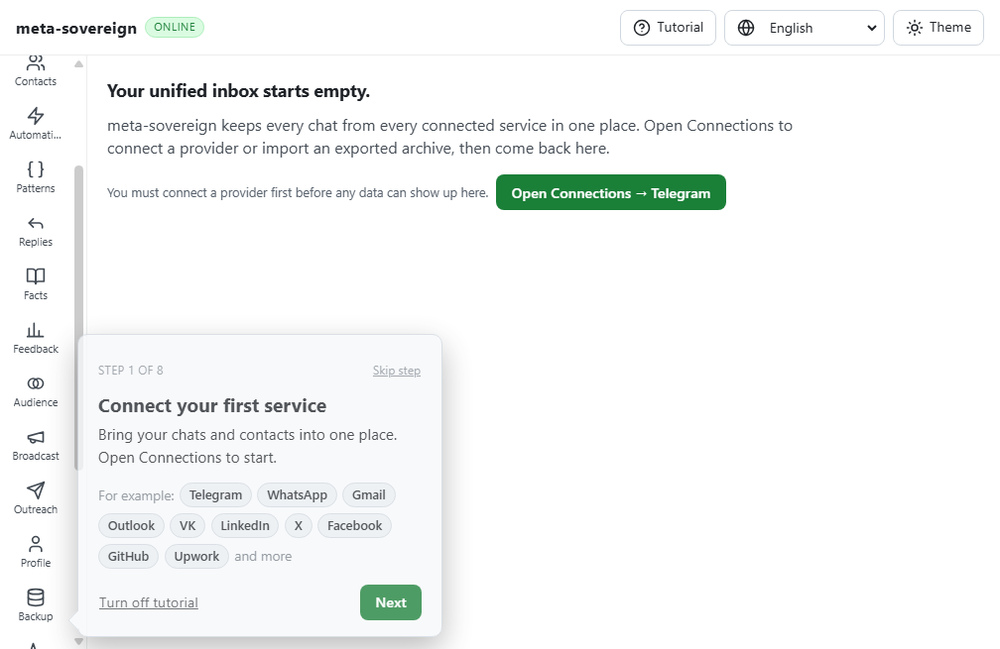
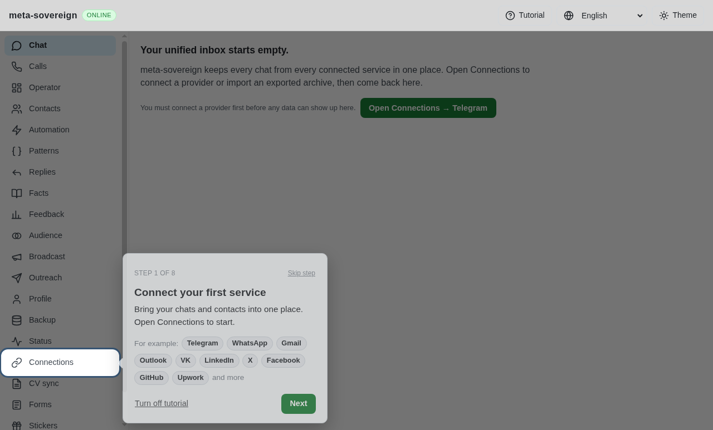
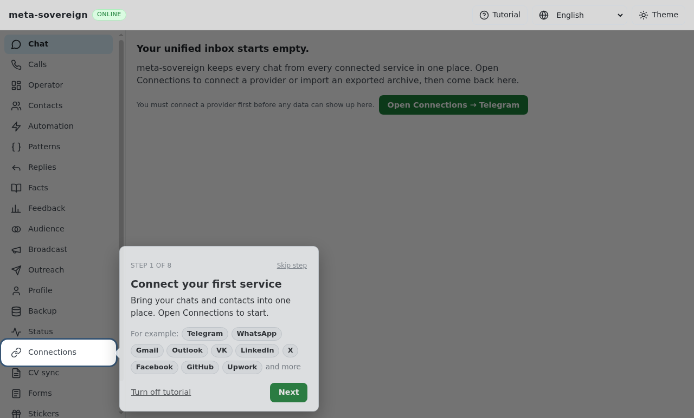
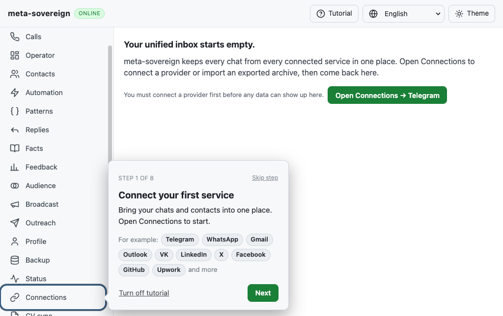

# Hosted native desktop verification

All five desktop jobs for `93271feed9d0a6105c087b0918600d7fb3db521f` pass in
[run 44042469209](https://github.com/link-foundation/meta-sovereign/actions/runs/44042469209).
Each receipt confirms an actual visible packaged window, context isolation,
disabled Node integration, healthy Lino backend, clean exit and drained runtime.
Windows also completes silent installation without an automatic launch and
finishes owned uninstall cleanup. This verifies the correction described in the
[uninstall investigation](ci-windows-uninstall.md).

| Platform      | Job                                                                                                         | Native receipt line | Rendered window                                                                 |
| ------------- | ----------------------------------------------------------------------------------------------------------- | ------------------- | ------------------------------------------------------------------------------- |
| Windows x64   | [133900492571](https://github.com/link-foundation/meta-sovereign/actions/runs/44042469209/job/133900492571) | 764                 |      |
| Windows ARM64 | [133900492367](https://github.com/link-foundation/meta-sovereign/actions/runs/44042469209/job/133900492367) | 782                 |  |
| Linux x64     | [133900492653](https://github.com/link-foundation/meta-sovereign/actions/runs/44042469209/job/133900492653) | 746                 |          |
| Linux ARM64   | [133900492685](https://github.com/link-foundation/meta-sovereign/actions/runs/44042469209/job/133900492685) | 813                 |      |
| macOS ARM64   | [133900492429](https://github.com/link-foundation/meta-sovereign/actions/runs/44042469209/job/133900492429) | 1240                |            |

The macOS job packages both architectures but launches only its native ARM64
application. Its ad hoc signature is not a Developer ID notarization. The four
guides retain checksum-first per-application Gatekeeper instructions. The
screenshots are actual hosted artifacts, validated as PNG files and visually
inspected. They show the empty local workspace without a live provider account.

Both finite PowerShell cleanup regressions pass on Windows Node, Deno and Bun.
The preserved Node log records them at lines 1130–1131, Bun at 3401–3402 and
Deno at 4640–4641. These are real filesystem/subprocess checks; Linux skips do
not substitute for them.

The main workflow for that source was superseded. Its 37 completed checks pass;
16 jobs are cancelled and three release steps intentionally skip. The aggregate
job consequently fails, explicitly reporting `test: cancelled` and
`e2e-browser: cancelled` at lines 372–373. It is not a passing complete matrix.
The CLI refuses a full combined log fetch because it would require too many API
requests; that refusal, the complete aggregate log and selected Windows logs are
retained. Fresh complete checks remain required for current source `94efd84b`.

The [checked archive](data/desktop-native-hosted.tar.gz) retains the five full
desktop logs, job/artifact identities, native receipts, all five screenshots and
three Windows runtime logs. Its collector verifies that the desktop workflow,
launch/uninstall scripts and all four installation guides are byte-identical
between the hosted source and selected source `94efd84b`. Earlier checksum and
provenance metadata validation remains in the
[installation report](desktop-installation-verification.md).

This evidence does not by itself accept VD09 or complete any other unchecked
criterion. Full original contract mapping and current hosted checks remain
required in [PR #57](https://github.com/link-foundation/meta-sovereign/pull/57).
