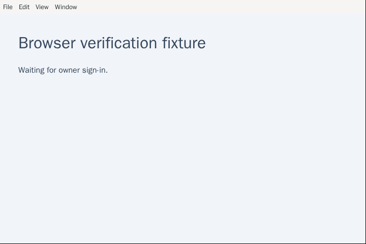
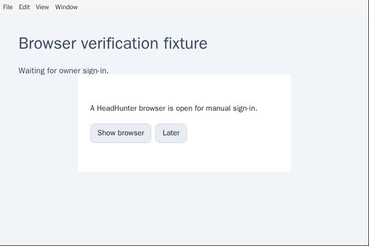

# Desktop actions for a live browser wait

The pinned [HeadHunter notifier](https://github.com/konard/hh-job-application-automation/tree/fa0991b8c2d0896fb3b4be6c69947f0590094b15) can return an owner to the browser while the workflow waits. It defers reminders for five minutes without a response and for fifteen minutes after acknowledgement. The desktop app now connects these actions to its existing Forms verification, HeadHunter application verification and HeadHunter sign-in waits.

## Reproduction

Configure notifications from the owned desktop window, close that window while leaving the desktop runtime alive, and open a synthetic headed owner wait. Then select **Show browser**. Open a second wait and select **Later**. On the published parent `ba06f306`, the real Electron preload exposes no attention configuration and the private Linux notification daemon receives zero alerts. The revised fixture receives two alerts after the renderer is destroyed. **Show browser** brings the first owning browser window forward once. **Later** acknowledges the second without focusing it. Both alerts close and both wait past the five-minute reminder cutoff.

The focused tests also cover inactive, closed, replaced and headless targets, partial source failure, permission preferences, stale IPC, lock during validation, and removal on shutdown. Notifications contain localized generic text. The review identity stays inside the desktop process. The owning server rechecks the case, request and slot before attempting focus. A successful focus acknowledges the reminder and preserves the original verification or sign-in state.

The desktop shell uses the system beep when sound is enabled, including when the notification preference is off. The existing browser chime and in-page notice still handle web clients and remote or unavailable desktop routes. A click without a focusable browser can reopen the shell to the in-page notice. Electron keeps the runtime available when its only window closes on macOS. On Linux and Windows, closing the final application window exits the runtime. [Electron notification actions](https://www.electronjs.org/docs/latest/api/structures/notification-action) · [Electron system beep](https://www.electronjs.org/docs/latest/api/shell/#shellbeep).

## Verification

Use the focused `desktop-owner-attention`, `desktop-clipboard`, `desktop-lifecycle` and `desktop-configuration` tests. Node and Deno each passed 26 tests. The [Linux native experiment](../../../experiments/issue-56/desktop-owner-attention-electron.mjs) and its [isolated Freedesktop service](../../../experiments/issue-56/desktop-owner-attention-bus.py) require Electron 45.3.2, Xvfb, libnotify, a session D-Bus and Python 3.12 with `dbus-next` 0.2.3. No external desktop daemon, user profile or provider account is used.

```sh
dbus-run-session -- python3.12 experiments/issue-56/desktop-owner-attention-bus.py \
  xvfb-run -a npm exec --yes --package=electron@45.3.2 -- \
  electron --no-sandbox experiments/issue-56/desktop-owner-attention-electron.mjs
```

Set `META_SOVEREIGN_ATTENTION_PARENT_PRELOAD` to a file containing `git show ba06f306:js/electron/preload.cjs` to reproduce the missing bridge with the same native fixture. The native run verifies real Electron and D-Bus action delivery with synthetic local windows. It records no live authentication or provider mutation. [Evidence archive](data/desktop-owner-attention.tar.gz) · [Entry hashes](data/desktop-owner-attention.tar.sha256.json).

Both HeadHunter sign-in scenarios pass in Chromium with a freshly built production bundle. A separate 390-pixel Playwright MCP run supplies a synthetic desktop bridge to the production page. It observes one exact Later acknowledgement, zero duplicate browser notifications, independent sound changes and zero page exceptions. Seven expected 404s belong to the fixture favicon and optional Telegram features. The fixture records zero credential or challenge reads, writes, submissions or clicks.


## When the system cannot display the alert

The desktop shell opens a small local prompt if system notifications are unavailable, report a failure, or provide no display receipt within two seconds. It rechecks the case, request, browser slot and expiry before replacing a failed alert. The prompt carries the same localized text, **Show browser** when focus is available, and **Later**. The optional chime is issued once per reminder. On desktop environments that support inactive windows, the prompt appears without taking focus. [Electron notification events](https://www.electronjs.org/docs/latest/api/notification) · [Electron inactive window behavior](https://www.electronjs.org/docs/latest/api/browser-window#winshowinactive).

Run the same private D-Bus service with `--reject` so Electron receives a real delivery error. This experiment compares the published `8646590a` controller with the updated one. The parent receives the error and displays zero prompts. The updated controller receives two real errors, displays two prompts, and produces one chime per wait. Show browser focuses only the active sign-in window. Later closes the second prompt and defers the reminder through the five-minute cutoff. The normal notification-delivery experiment still passes.

```sh
dbus-run-session -- python3.12 experiments/issue-56/desktop-owner-attention-bus.py --reject \
  xvfb-run -a -s '-screen 0 720x480x24' npm exec --yes --package=electron@45.3.2 -- \
  electron --no-sandbox experiments/issue-56/desktop-attention-prompt-electron.mjs
```

Set `META_SOVEREIGN_ATTENTION_SCREENSHOT` to save the private Xvfb screen. To run the parent controller, save `git show 8646590a:js/electron/owner-attention.js` in an isolated copy at `js/electron/owner-attention.js`, supply the shared `js/src` and root `package.json`, and set `META_SOVEREIGN_ATTENTION_PARENT_CONTROLLER` to its absolute path. A separate Playwright MCP run renders the same HTML and preload with fixture IPC in dark mode. It verifies keyboard focus for both buttons, activation with Enter, dismissal with Escape, and zero page exceptions. [Fallback evidence archive](data/desktop-attention-prompt.tar.gz) · [Entry hashes](data/desktop-attention-prompt.tar.sha256.json).





## While the owner is at the waiting browser

The desktop runtime checks the exact waiting page when a reminder is due. A visible, focused page defers its alert and chime until the next five-minute check. An unrelated tab or window leaves the original wait eligible. The runtime repeats the check before presenting a fallback for a failed desktop notification.

The server binds the current browser page to its local attention receipt. The public receipt fields stay the same across CLI and both Lino formats. Chromium normally receives an emulated focus override from Playwright. The probe disables that override and reads visibility and focus in an isolated browser world with a 750 ms deadline. It reads two browser state values and keeps the page reference in-process. The server revalidates the live case, request, slot and lock before acting on the result. When Chromium cannot confirm focus, the live wait remains eligible for its reminder. [Chromium focus emulation](https://chromedevtools.github.io/devtools-protocol/tot/Emulation/#method-setFocusEmulationEnabled) · [Chromium isolated worlds](https://chromedevtools.github.io/devtools-protocol/tot/Page/#method-createIsolatedWorld).

Run the [headed regression](../../../experiments/issue-56/desktop-attention-foreground-probe.mjs) against Chromium with an isolated Xvfb display. Set `META_SOVEREIGN_TEST_CHROMIUM` to use an installed Chromium executable. The fixture uses the production Forms attention receipt, server owner and desktop controller, with counters for the system alert and chime. Its two tabs and separate window use local pages. The published parent `17a346f8` produces one notification and one sound with the exact page focused. The updated controller produces zero, then issues one of each at the next cutoff after focus moves to another window. A page script supplies misleading focus readings as a control.

```sh
META_SOVEREIGN_TEST_CHROMIUM=/opt/google/chrome/chrome \
  xvfb-run -a node --max-old-space-size=384 experiments/issue-56/desktop-attention-foreground-probe.mjs
```

Use `META_SOVEREIGN_ATTENTION_PARENT_CONTROLLER` with `git show 17a346f8:js/electron/owner-attention.js` in the isolated checkout described above to observe the regression on the published parent. [Evidence archive](data/desktop-attention-foreground.tar.gz) · [Entry hashes](data/desktop-attention-foreground.tar.sha256.json).

QA24 and HH01 remain unfinished. Signed macOS and Windows delivery, Wayland display, silent suppression by Focus after an OS display receipt, and authenticated provider acceptance still require evidence. Foreground behavior is verified for focused browser content in headed Linux Chromium. [Electron notification platform behavior](https://www.electronjs.org/docs/latest/tutorial/notifications).
