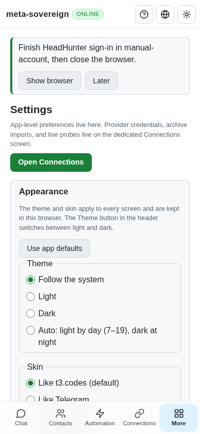

# Desktop actions for a live browser wait

The pinned [HeadHunter notifier](https://github.com/konard/hh-job-application-automation/tree/fa0991b8c2d0896fb3b4be6c69947f0590094b15) can return an owner to the browser while the workflow waits. It defers reminders for five minutes without a response and for fifteen minutes after acknowledgement. The desktop app now connects these actions to its existing Forms verification, HeadHunter application verification and HeadHunter sign-in waits.

## Reproduction

Configure notifications from the owned desktop window, close that window while leaving the desktop runtime alive, and open a synthetic headed owner wait. Then select **Show browser**. Open a second wait and select **Later**. On the published parent `ba06f306`, the real Electron preload exposes no attention configuration and the private Linux notification daemon receives zero alerts. The revised fixture receives two alerts after the renderer is destroyed. **Show browser** brings the first owning browser window forward once. **Later** acknowledges the second without focusing it. Both alerts close and both wait past the five-minute reminder cutoff.

The focused tests also cover inactive, closed, replaced and headless targets, partial source failure, permission preferences, stale IPC, lock during validation, and removal on shutdown. Notifications contain localized generic text. The review identity stays inside the desktop process. The owning server rechecks the case, request and slot before attempting focus. A successful focus acknowledges the reminder and preserves the original verification or sign-in state.

The desktop shell uses the system beep when sound is enabled, including when the notification preference is off. The existing browser chime and in-page notice still handle web clients and remote or unavailable desktop routes. A click without a focusable browser can reopen the shell to the in-page notice. Electron keeps the runtime available when its only window closes on macOS. On Linux and Windows, closing the final application window exits the runtime. [Electron notification actions](https://www.electronjs.org/docs/latest/api/structures/notification-action) · [Electron system beep](https://www.electronjs.org/docs/latest/api/shell/#shellbeep).

## Verification

Use the focused `desktop-owner-attention`, `desktop-clipboard`, `desktop-lifecycle` and `desktop-configuration` tests. Node and Deno each passed 26 tests. The [Linux native experiment](../../../experiments/issue-56/desktop-owner-attention-electron.mjs) and its [isolated Freedesktop service](../../../experiments/issue-56/desktop-owner-attention-bus.py) require Electron 45.3.2, Xvfb, libnotify, a session D-Bus and Python 3.12 with `dbus-next` 0.2.3. No external desktop daemon, user profile or provider account is used.

```sh
dbus-run-session -- python3.12 experiments/issue-56/desktop-owner-attention-bus.py \
  xvfb-run -a npm exec --yes --package=electron@45.3.2 -- \
  electron --no-sandbox experiments/issue-56/desktop-owner-attention-electron.mjs
```

Set `META_SOVEREIGN_ATTENTION_PARENT_PRELOAD` to a file containing `git show ba06f306:js/electron/preload.cjs` to reproduce the missing bridge with the same native fixture. The native run verifies real Electron and D-Bus action delivery with synthetic local windows. It records no live authentication or provider mutation. [Evidence archive](data/desktop-owner-attention.tar.gz) · [Entry hashes](data/desktop-owner-attention.tar.sha256.json).

Both HeadHunter sign-in scenarios pass in Chromium with a freshly built production bundle. A separate 390-pixel Playwright MCP run supplies a synthetic desktop bridge to the production page. It observes one exact Later acknowledgement, zero duplicate browser notifications, independent sound changes and zero page exceptions. Seven expected 404s belong to the fixture favicon and optional Telegram features. The fixture records zero credential or challenge reads, writes, submissions or clicks.



QA24 and HH01 remain unfinished. Signed macOS and Windows notification delivery, behavior under Focus or unavailable system alerts, suppression when the exact browser is already frontmost, and authenticated provider acceptance still require evidence. [Electron notification platform behavior](https://www.electronjs.org/docs/latest/tutorial/notifications).
