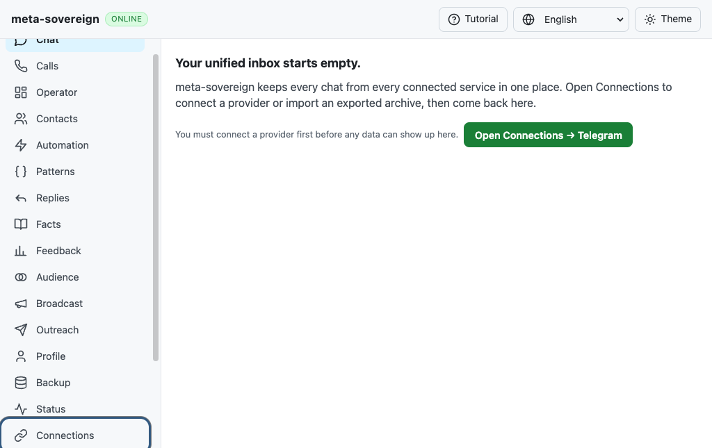

# Packaged macOS boot check

The existing desktop workflow builds both macOS architectures and validates
the signed application bundles and mounted DMGs. Those inspections do not
prove that the packaged application starts. VD09 remains unfinished in
[PR #57](https://github.com/link-foundation/meta-sovereign/pull/57).

The workflow now launches the actual packaged binary matching the hosted
runner's architecture. The finite probe follows the earlier issue 37 launch
experiment, with a temporary store/profile, ephemeral server port and local
404 updater feed. It refuses a checkout, requires exactly one visible window
with context isolation and no Node integration, waits for the rendered shared
app and checks a successful Lino health response with non-degraded storage.
It captures `desktop-launch-macos.png` as a hosted artifact, then requires
the runtime's completed-drain trace and a clean process exit. A ten-second
cleanup fallback kills a stuck owned process and cannot count as success.

The validator's small refusal/positive test and scoped static checks pass
locally. No local package build or application launch was run. The
[plan](desktop-packaged-launch-plan.md) requires the exact-head native hosted
receipt and screenshot before acceptance. This does not prove a Gatekeeper
dialog, macOS 15 manual interaction, native boot on the other CPU or live
provider authorization. The [first-launch instructions](macos-first-launch.md)
separately explain the documented per-application approval path.

Review caught an initial probe race: shared navigation normalizes the root
URL to `/#/chat` during rendering. A focused positive-window fixture reproduces
the old root-only matcher rejecting that valid URL. The corrected matcher
accepts the root and its application hash while still refusing a foreign host;
the same refusal/positive test now passes. Each refusal also checks its own
reason, so a navigation failure cannot masquerade as a healthy refusal check.
The [before log](evidence/local/desktop-packaged-route-before.txt) and
[after log](evidence/local/desktop-packaged-route-after.txt) preserve this
check against the initial `fc9907a4` probe and its correction.

Hosted macOS job [133374773400](https://github.com/link-foundation/meta-sovereign/actions/runs/43888804975/job/133374773400)
passes on `b558bd74`. Its log line 1264 reports the actual packaged ARM64
application, one visible protected window, healthy backend, completed runtime
drain and clean exit. The updater's local 404 is the deliberately unavailable
fixture feed; it does not prevent boot or shutdown. The screenshot below comes
from that native application, using its throwaway empty store.

The same revision fails Deno type checking before the tests run: the newly
imported validator statically loads the optional Node Playwright package.
Six downloaded Linux/Windows shard logs retain `TS2307`; the Linux shard 3
error is at line 3002. A single focused Deno test reproduces it locally.
The native launcher now loads Playwright through Node's `createRequire` only
after the isolated-CI guard. The portable validator passes type checking and
its refusal/positive test on Deno and Node without loading Playwright. Type
checking and the native launch gate remain enabled. Hosted verification of
the correction is still required; no inventory criterion is accepted here.

Evidence: [archive](data/desktop-packaged-launch.tar.gz) and
[manifest](data/desktop-packaged-launch.tar.sha256.json).
