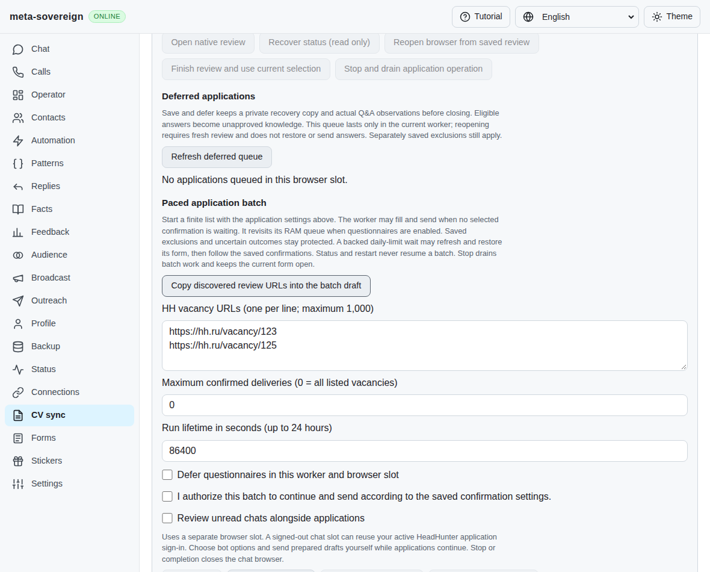
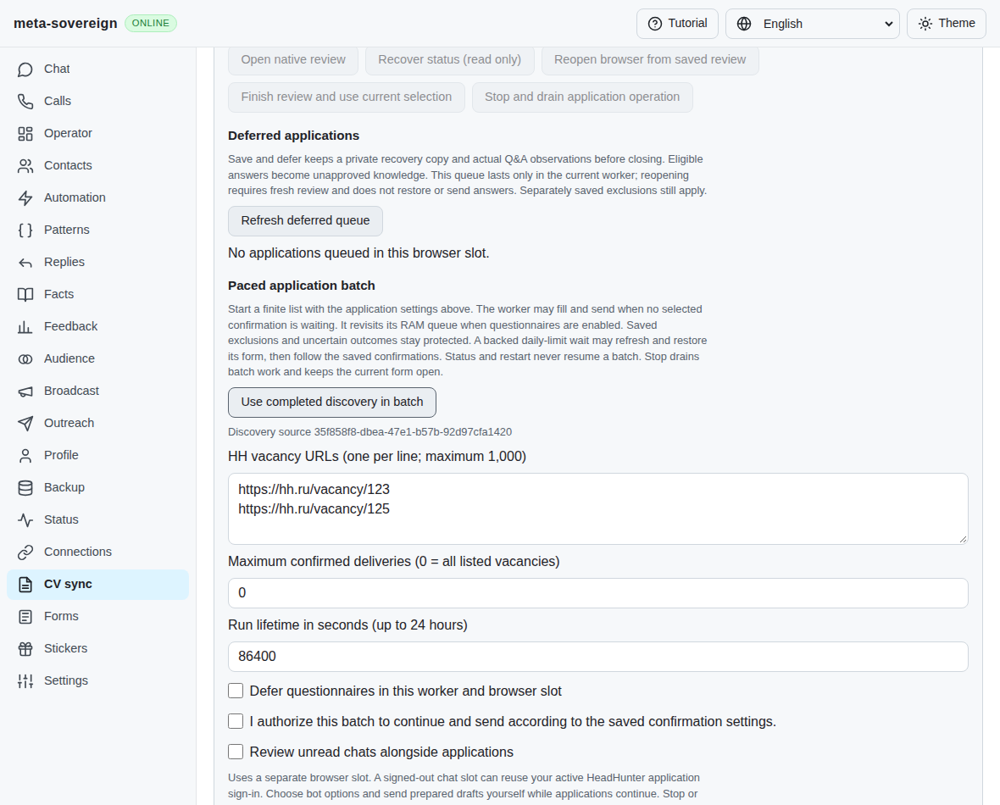
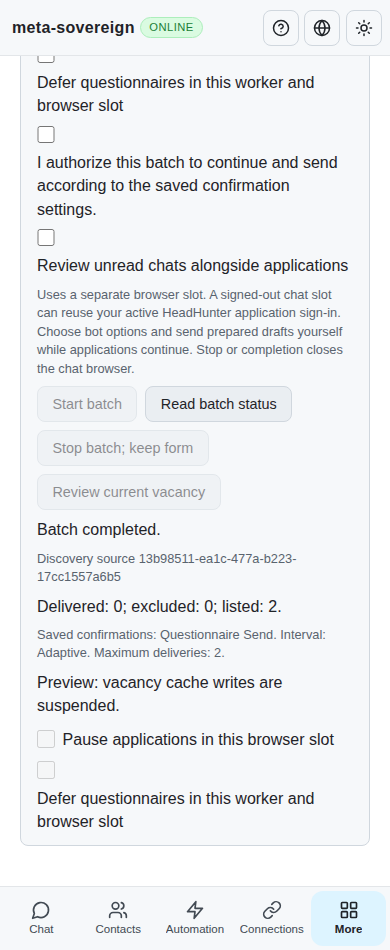

# Start a batch from completed HeadHunter discovery

After a finite discovery completes in CV Sync, select **Use completed discovery
in batch**. The draft shows the receipt ID, the eligible vacancy URLs and the
existing batch settings. Confirm the batch and select **Start**. Editing the
URL list clears the source selection and requires confirmation again. The
completed batch receipt retains the source ID after reload.

With the same workspace store and browser slot, the foreground CLI accepts the
completed discovery's exact ID. Test mode records the finite list without
opening an application or contacting the provider.

```sh
meta-sovereign vacancies-application-batch \
  --discovery-request-id=reviewed-search --request-id=preview-batch \
  --browser-slot=jobs --test-mode=true
```

Admission validates the durable same-slot discovery receipt. Only review decisions
with eligible pay enter the batch in their saved order. The batch inherits the
search route, collection and salary settings where the owner supplies no override.
A newer discovery cannot change the selected source. The batch worker rechecks
current owner exclusions before opening a vacancy. Repeated admission with the
same batch identity reads its frozen receipt. Changed batch settings or source
identity conflict. Missing, interrupted, corrupt and empty discovery sources
refuse new admission. Existing manually supplied batches remain readable.

## Verification

The service regression on parent `670364d7` returned `jobs-application-batch-input`
because admission required a URL list. Parent Chromium populated the textarea
and failed to identify a saved discovery source. The corrected Chromium scenario
recorded four native discovery reads, two eligible candidates, a single batch
Start and zero native reads or provider clicks for the test-mode batch. Reload
restored the same source. CLI and text/binary Lino tests verified the saved
identity. A named-slot worker honored an exclusion saved after discovery, with
zero deliveries.

Independent Playwright MCP confirmed one Start, retained the same source across
reload and fit the receipt within a 390-pixel viewport. The fixture closed all
four native readers and observed zero provider clicks and zero page exceptions.
Chromium logged a favicon 404 and a cache-write error during the MCP reload.
The receipt restored successfully. The [checks archive](data/discovery-batch-handoff.tar.gz)
and [hash manifest](data/discovery-batch-handoff.tar.sha256.json) retain the logs.

Run the focused service regression with `node --test --test-concurrency=1
js/tests/job-vacancy-discovery.test.js`. The existing bounded Chromium CI entry
`js/tests/e2e-vacancy-discovery-browser.mjs` exercises the browser regression.

| Parent draft                                                                                       | Discovery-backed draft                                                                                |
| -------------------------------------------------------------------------------------------------- | ----------------------------------------------------------------------------------------------------- |
|  |  |



The authenticated account, live delivery and full automatic search-to-application
flow remain part of the open acceptance criteria.
