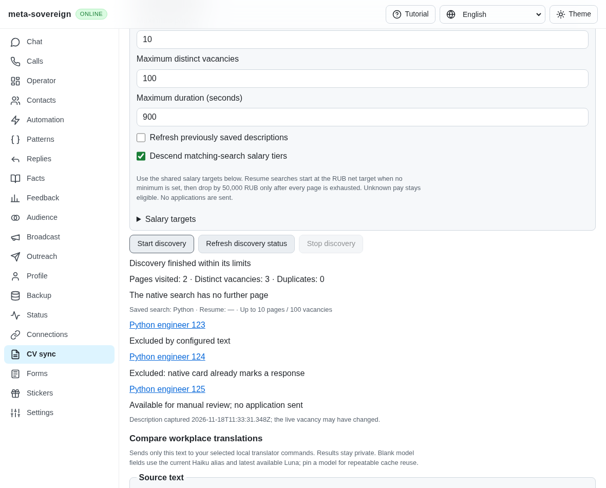
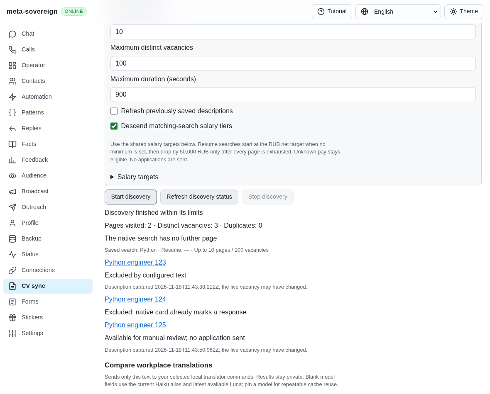
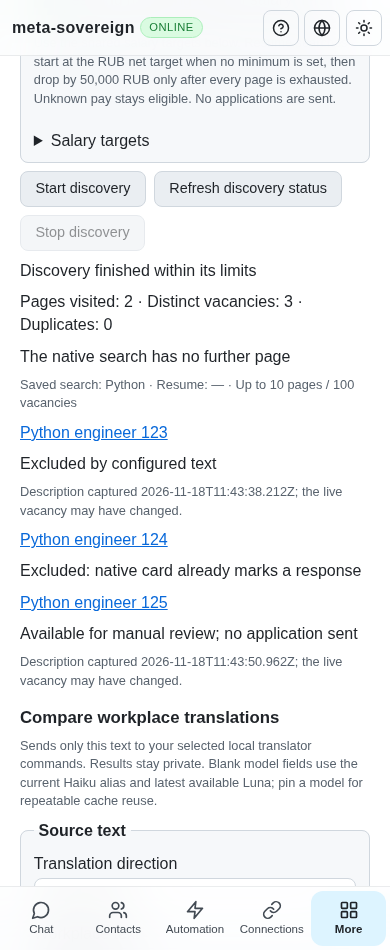

# Collect selected vacancies before local exclusions

The pinned reference [README](https://github.com/konard/hh-job-application-automation/blob/fa0991b8c2d0896fb3b4be6c69947f0590094b15/README.md) requires collection of selected full vacancies before subsequent application exclusions. Its vacancy loop collects after selecting an unprocessed card and before evaluating salary and configured text. Previously responded or held cards are not selected.

At published parent `9da8b847644b0daf07da6475e6ad9bb2f7d81e3e`, discovery skipped full descriptions when title/company filters or salary decisions already excluded/deferred the card. This silently omitted those vacancies from the private corpus and its technology statistics.

Discovery now reads and acknowledges those selected descriptions before publishing the final local decision. Exclusions still prevent application handoff. Previously responded cards, owner skips/deferrals and retry holds still avoid extra provider reads. An unreadable selected description fails the finite run without publishing completed progress. Successful descriptions retain existing cache reuse; refreshing remains explicit.

Reproduce and verify with bounded checks:

```sh
node --test --test-concurrency=1 experiments/issue-56/discovery-collection-parent.mjs
node --test --test-concurrency=1 js/tests/discovery-collection.test.js js/tests/job-vacancy-discovery.test.js js/tests/salary-ladder-discovery.test.js js/tests/job-deferred-questions-selection.test.js
node experiments/issue-56/discovery-collection-browser.mjs
```

The parent has five expected failures and five hold controls passing, including an excluded card with a pending owner question. The corrected code passes 32 focused checks plus 16 discovery-control/mandatory-registration checks. The mandatory native scenario collects both selected descriptions, including the title-excluded card, verifies actual cache identities, reloads without provider rereads, checks four languages and a 390-pixel phone view, and hands only the eligible URL to an unarmed batch. All four provider pages close with zero clicks. Its actual parent fails with only three opened pages and no excluded description. A separate changed salary scenario verifies that salary exclusions also retain complete descriptions.

Before: the excluded card lacks a captured-description receipt.



After: the excluded card retains its exclusion and gains the saved receipt.





Source snapshots, exact-parent failures, focused/native results and reviewed screenshots are in [the hashed evidence archive](data/discovery-collection.tar.gz) with its [manifest](data/discovery-collection.tar.sha256.json). These are synthetic native pages, without provider credentials or submissions. Existing salary-card decisions remain unchanged; this unit does not establish complete HH03/HH05 parity. The inventory remains **88 verified / 30 unfinished**, and PR57 remains draft and unmerged.
