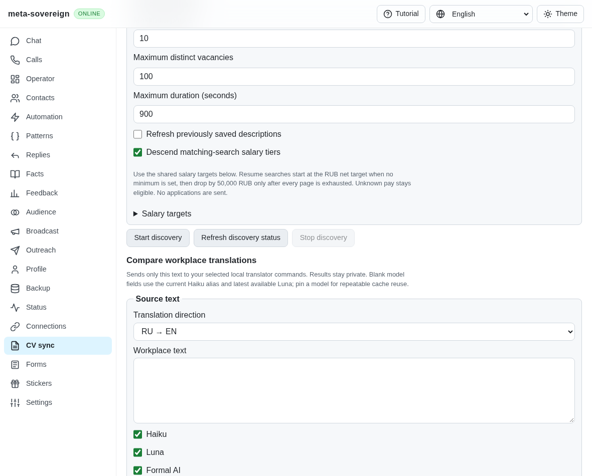
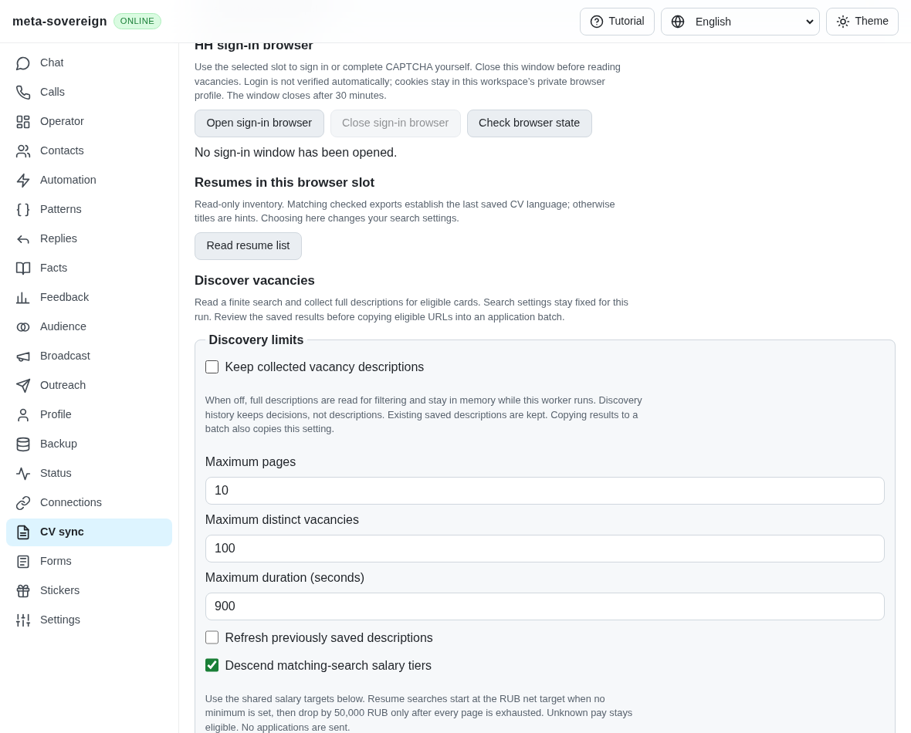
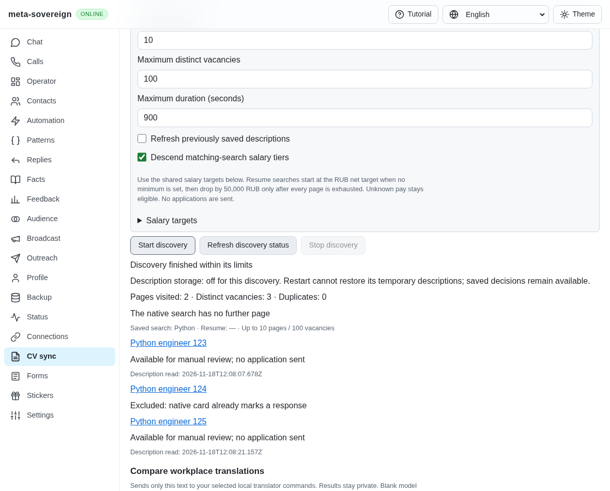
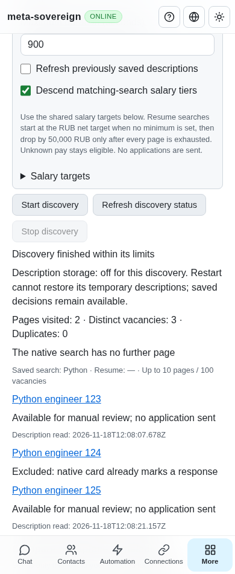

# Discovery without persistent descriptions

The pinned reference [collection contract](https://github.com/konard/hh-job-application-automation/blob/fa0991b8c2d0896fb3b4be6c69947f0590094b15/README.md) exposes an independent `--no-collect-vacancies` setting. Full descriptions are still needed for filtering and subsequent application planning. At published parent `5f63c49f74d38e2d9885314c734a764e9dc2f656`, the application executor honored this setting, but discovery dropped it and always saved selected descriptions.

Discovery now freezes an explicitly supplied boolean in its request receipt and stores disabled-collection descriptions only in the existing bounded, workspace-owned RAM context. Later assignment/application planners reuse that context. Complete descriptions still determine local exclusions. Existing saved descriptions and their application metadata remain intact, including during an explicitly refreshed temporary read. Workspace shutdown drains discovery and clears only its own temporary descriptions; saved decisions survive restart without replaying provider reads or restoring descriptions. Absent flags retain legacy receipt signatures and persistent collection defaults.

CLI discovery accepts `--no-collect-vacancies`; both Lino encodings accept `collectVacancies: false`. Four-language controls explain retention and restart limits. Copying completed discovery into an application draft also copies the frozen collection setting without starting the batch. Temporary receipts say “Description read” rather than claiming a saved description.

Reproduce and verify with bounded checks:

```sh
node --test --test-concurrency=1 experiments/issue-56/discovery-memory-parent.mjs
node --test --test-concurrency=1 js/tests/discovery-memory.test.js js/tests/discovery-memory-controls.test.js js/tests/discovery-collection.test.js js/tests/job-vacancy-discovery.test.js js/tests/application-collection.test.js js/tests/ci-browser-shards.test.js
node experiments/issue-56/discovery-memory-browser.mjs
```

The exact parent produces five expected failures and one cleanup control passes. All 52 focused current-source checks pass. The isolated native scenario reads two pages and two selected descriptions, filters three cards, verifies zero saved descriptions, shares temporary context with planners, reloads without provider reads, copies the disabled setting into an unarmed batch and selects all four actual locales. It also checks phone layout and cleared RAM after shutdown. The mandatory CI group includes this scenario for both browser engines.

Independent Playwright MCP inspection verifies four actual locale selections, two temporary descriptions, zero saved descriptions, four closed native pages, zero clicks, no batch start, no replay and no page errors. Its fixture was launched with a closed tool-created stdin pipe; the narrowly scoped recovery experiment requested the fixture’s normal awaited cleanup through its owned local inspector. The fixture then reported `resourcesClosed: true` and exited successfully. This is fixture cleanup evidence, not a product behavior claim. The reused browser fixture now initializes English only when no locale is saved; actual locale assertions prevent a reload from silently resetting the test to English.

Before: discovery has no description-retention control.



After: the independent setting explains the scope of temporary retention.







Source snapshots, exact-parent failures, focused/native/MCP receipts and reviewed valid images are preserved in the [evidence archive](data/discovery-memory.tar.gz) and its [manifest](data/discovery-memory.tar.sha256.json). These checks use synthetic native pages, with no provider credentials or submissions. They do not establish full HH03 parity. The inventory remains **88 verified / 30 unfinished**, and PR57 stays draft and unmerged. The separately preserved 101-description binary corpus timeout on macOS at `5f63c49f` is investigated in [Complete-corpus binary encoding cost](corpus-binary-layout.md); exact-source hosted validation of the measured codec improvement remains required.
