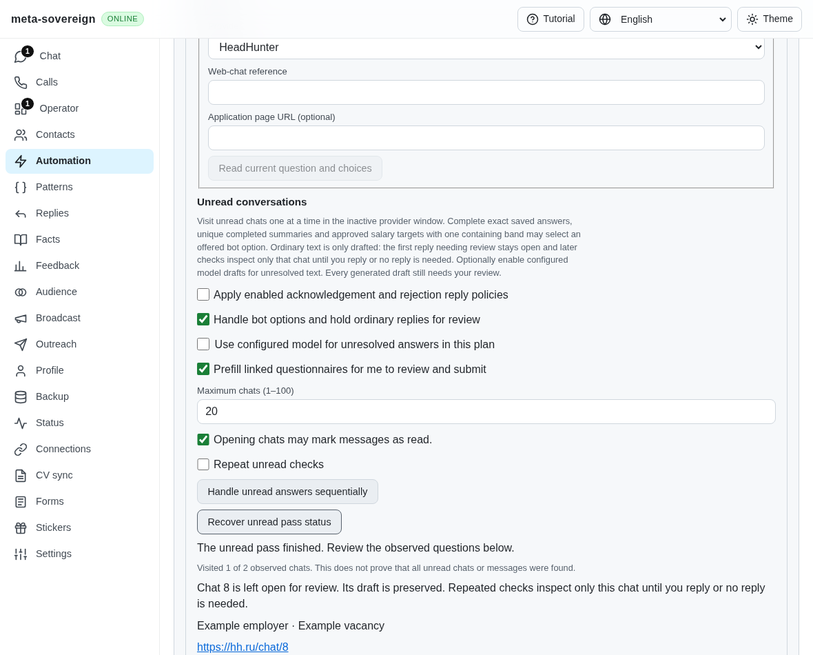
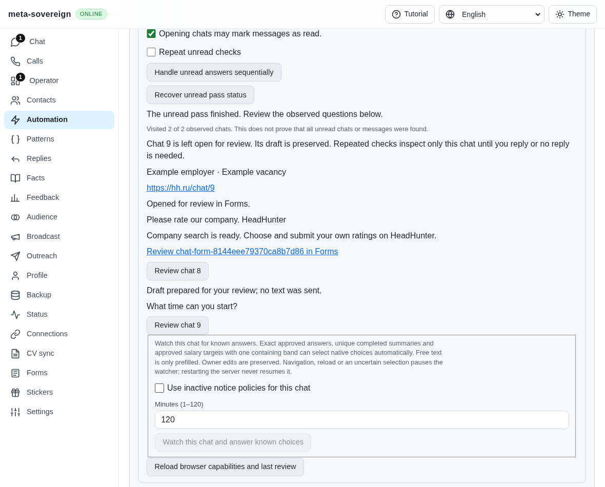

# Employer rating polls linked in HeadHunter chats

The published parent `687101a8` stopped in chat 8 when the employer requested a HeadHunter rating. It visited one of two observed conversations and opened no poll. Enable sequential unread handling and **Prepare linked questionnaires and HeadHunter rating polls for review** in Automation, Chat or Operator to reproduce the flow. An application batch can opt in through its chat worker. [Pinned C11 and C15](https://github.com/konard/hh-job-application-automation/blob/fa0991b8c2d0896fb3b4be6c69947f0590094b15/docs/requirements/forms-and-chats.md#L225) · [PR #57](https://github.com/link-foundation/meta-sovereign/pull/57).

The handoff uses the exact HeadHunter poll link and the company shown in the verified job-chat header. It opens a Forms slot using the saved visibility policy, transfers secure HeadHunter cookies directly between the isolated browser contexts and checks the current chat again before entering the company's name. Cookie values stay in the browser contexts. The slot verifies sign-in and a single editable company search field, then reads the text back. Forms offers Focus for headed slots and Close for all slots. The rating controls and submission are available to the owner on HeadHunter.

A confirmed poll-only handoff allows the pass to continue. Sign-in, an unavailable search, closed voting or a separate unanswered question keeps the native chat in review. A repeat recovers the held session's receipt, while the review uses the same shared capacity as other Forms sessions.

## Verification

60 focused Node checks and 60 Deno checks pass, including the foreground CLI, text and binary Lino, mixed requests, stale source cookies, foreign redirects, detached browser ownership and shared capacity. [Focused regression tests](../../../js/tests/employer-rating.test.js).

Full Chromium visits chats 8 and 9, holds chat 9, and opens the retained poll in Forms. The fixture sees one poll GET with a valid synthetic session, one company search input event, zero selected ratings, zero submissions and zero chat sends. The browser also checks expired voting, signed-out access, an owner-entered search and ambiguous search controls. The scenario runs in the mandatory unread Forms group. [Browser regression](../../../js/tests/helpers/e2e-unread-rating.mjs).

Independent Playwright MCP at 390 × 844 opens the same Forms slot, shows exactly Show browser and Close browser, and confirms the next held chat with no horizontal overflow. The fixture observed both visits, the draft “At 9 a.m.” and zero sends. The browser console reported a missing fixture favicon. [Phone screenshot](../../screenshots/issue-56-employer-rating-mobile.png).

```sh
RUN_BROWSER_E2E=1 E2E_EXECUTABLE_PATH=/opt/google/chrome/chrome \
  npm run test:e2e:question-unread-forms
```





[Routed poll with an entered company and empty ratings](../../screenshots/issue-56-employer-rating-poll.png).

On November 24, 2026, the public poll returned the 2026 tally page. The browser observed zero visible search fields. Live active-voting and authenticated verification remain open for HH10, together with its other unchecked requirements. [HeadHunter voting dates](https://hh.ru/blog/rejting-rabotodatelej-dlya-poiska-raboty) · [Public tally page screenshot](../../screenshots/issue-56-employer-rating-season-closed.png) · [Acceptance inventory](reference-feature-inventory.md).
