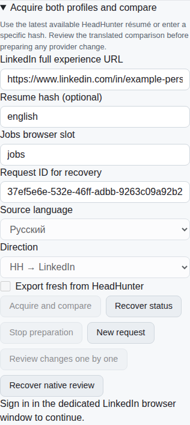
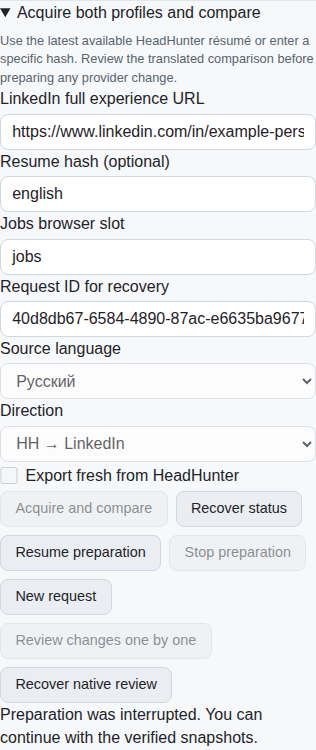

# Resume automatic CV preparation from acknowledged snapshots

On `689e93fd`, a process interruption after LinkedIn acknowledged its snapshot could leave the CV view waiting for sign-in. The HeadHunter and LinkedIn snapshots were already available and the comparison had yet to start. Checking status did not offer a way to continue the original preparation.

```sh
node --test --test-concurrency=1 --test-name-pattern='explicit preparation recovery' js/tests/cv-experience-auto.test.js
```

In the browser fixture, complete an automatic CV preparation, restore the parent record to its LinkedIn checkpoint and remove the unadmitted comparison. Reload **CV → Experience**, open automatic preparation and use **Resume preparation**. Then open the completed comparison. The fixture preserves both native export acknowledgements to model an interruption just before the parent writes its next checkpoint.

Status checks the original child request IDs, validated options and stored snapshot receipts before offering recovery. **Resume preparation**, the foreground CLI command and both Lino encodings continue only from those acknowledged checkpoints or admit the next child where its absence is established. An unconfirmed provider read or an admitted translation with no verified result stays interrupted. The existing **Open comparison** action opens the original comparison request when it completes.

Node and Deno each passed 18 focused checks. Chromium reproduced the missing action using the parent bundle, then verified one explicit resume, the original comparison ID, one total LinkedIn read and a 390-pixel layout. Independent Playwright MCP confirmed the same recovery and reported zero console warnings or errors. The server fixture drained its owned resources. These checks use synthetic exports. Authenticated accounts and the complete native batch remain open under HH17.

| Interrupted on the parent revision                                                                                            | Verified snapshots available                                                                                          |
| ----------------------------------------------------------------------------------------------------------------------------- | --------------------------------------------------------------------------------------------------------------------- |
|  |  |

[Focused tests](../../../js/tests/cv-experience-auto.test.js) · [Logs](data/experience-auto-native-recovery.tar.gz) · [SHA-256 manifest](data/experience-auto-native-recovery.tar.sha256.json)
