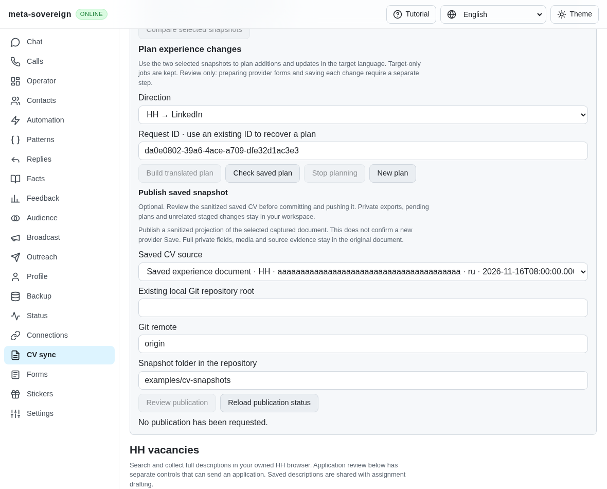
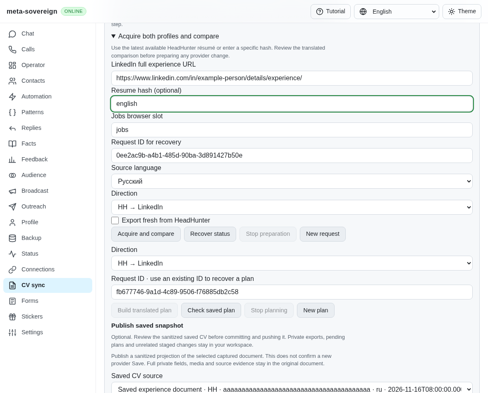
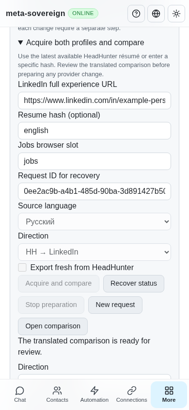
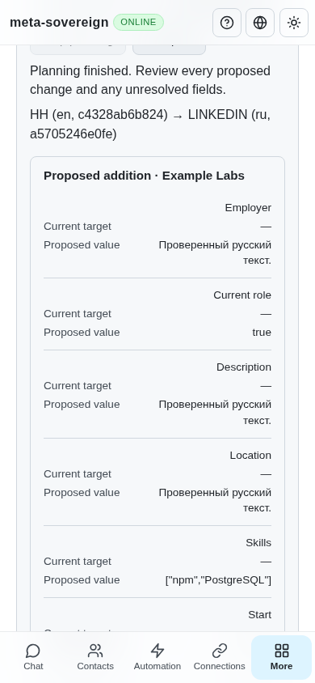

# Acquire and compare HeadHunter and LinkedIn experience in one request

In **CV sync → Experience documents → Acquire both profiles and compare**,
enter the LinkedIn experience URL and language, choose the direction and start
the request. The résumé hash is optional. HeadHunter reuses a verified export
when available and exports on a cache miss or explicit refresh. LinkedIn uses
its dedicated browser. If it needs sign-in, finish it in that window.
**Open comparison** loads the exact two snapshot revisions into the existing
comparison view. The existing per-record review controls still require
separate owner action.

The CLI and both Lino encodings share the private request and checkpoints.
The CLI prints the completed comparison request ID and fingerprint.

```sh
meta-sovereign cv-experience-auto-start --url='https://www.linkedin.com/in/example-person/details/experience/' --to=linkedin --request-id=experience-review
meta-sovereign cv-experience-auto-status --request-id=experience-review
meta-sovereign cv-experience-plan-status --request-id=COMPARISON_ID
```

The Lino routes are `POST /api/cv/experience/auto-start`,
`GET /api/cv/experience/auto-status?requestId=...` and
`POST /api/cv/experience/auto-stop`. Status reads leave the three child
operations alone. Stop waits for its active operation to drain and keeps
completed snapshots. A process interruption preserves the recorded phase and
confirmed revisions, and the same request ID cannot start new reads.

If both snapshots are recorded and the exact comparison has already finished,
status can recover its receipt. The CV review can then recover from that
preparation. [Completed comparison recovery](experience-auto-comparison-recovery.md)

## Reproduction and checks

Before the change, the CV view required separate acquisitions and manual
selection of their snapshots to build a comparison. The actual parent bundle
fails the first check in the isolated Chromium scenario because it has no
single acquisition-and-comparison control. The updated bundle passes. The
scenario withholds the successful Start acknowledgement, reloads at 390
pixels and verifies one Start, the original request ID, focus on the exact
comparison and a document width of 390 pixels.

```sh
node --test --test-concurrency=1 js/tests/cv-experience-auto.test.js
RUN_BROWSER_E2E=1 E2E_EXECUTABLE_PATH=/path/to/chromium node experiments/issue-56/experience-auto-browser.mjs
```

The focused tests use a verified synthetic HeadHunter export, a synthetic
LinkedIn reader and translation adapters. Both Lino encodings verify the exact
snapshot provenance and plan fingerprint in both directions. Cancellation
waits for the child and retains the completed HeadHunter revision. A separate
Playwright MCP run verified lost-acknowledgement recovery and the same
comparison on a phone. The hosted CV translation browser group includes the
same scenario.






HH21 remains unfinished. The automatic path now reaches the translated
comparison. The resumable per-change review queue, directed About edits and
live authenticated provider acceptance still require verification.
