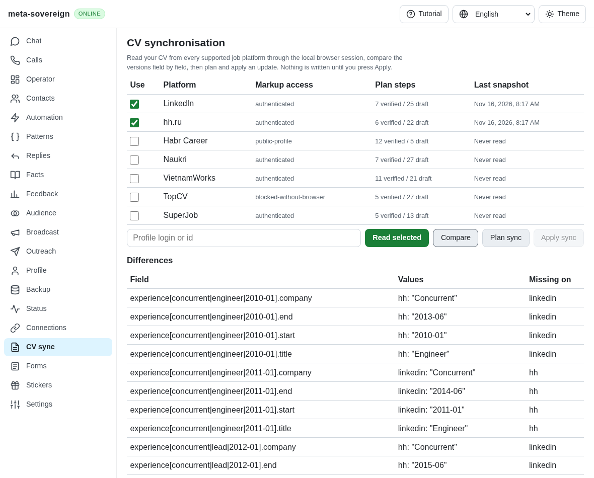
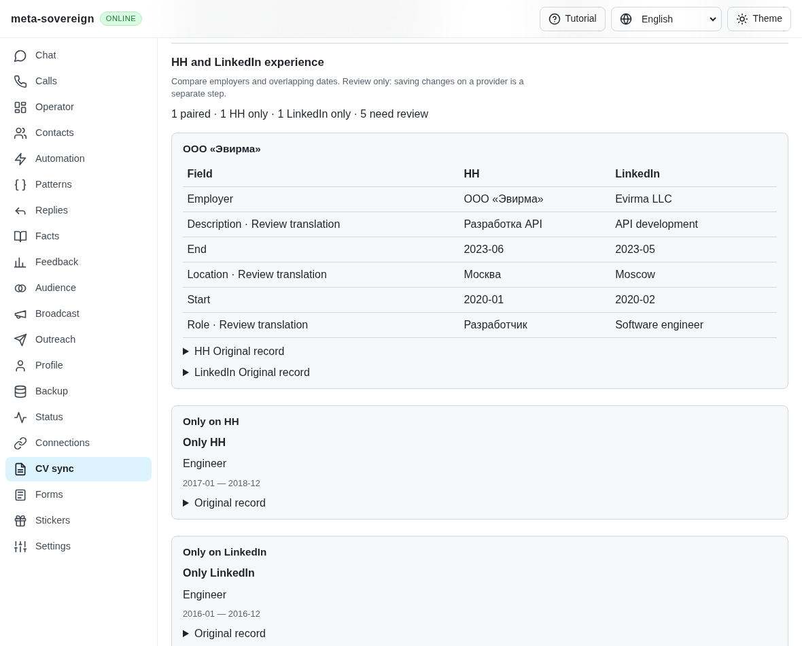
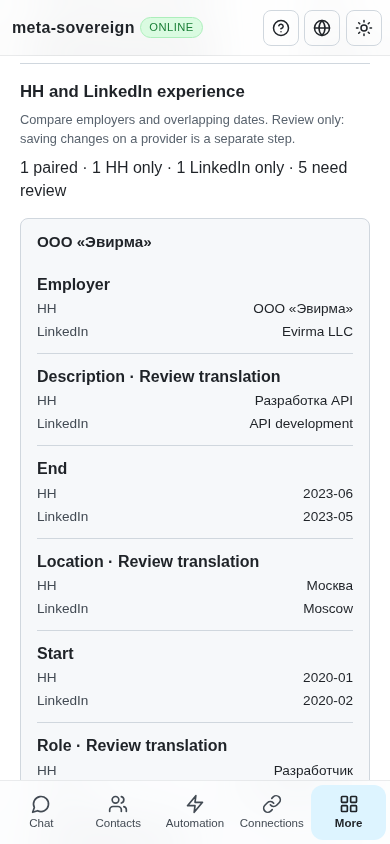

# HH and LinkedIn experience comparison

This is the comparison portion of HH21 in [PR #57](https://github.com/link-foundation/meta-sovereign/pull/57).
The [remaining workflow checklist](experience-sync-plan.md) keeps exports,
translation planning and reviewed native provider updates unfinished.

The generic CV field matrix identifies experience by employer, role and start
date. A Russian role at `ООО «Эвирма»` and its English counterpart at
`Evirma LLC` therefore appear as unrelated missing records. The dedicated
comparison normalizes legal forms and Cyrillic transliteration, then compares
overlapping monthly periods. It pairs only mutual unique candidates. Concurrent
roles and unknown periods remain review items; even an undated competing role
prevents a seemingly unique match. Explicit company aliases are optional data,
never inferred from fuzzy similarity. Year-only dates retain their full range.

Comparison preserves detached original records, including skills, website,
location identifiers, industry identifiers and unknown nested native metadata.
Skill order and localized industry labels do not manufacture changes when the
underlying skill sets or industry identifiers agree. Translated title, location
and description differences request translation review rather than claiming
semantic equivalence. Record, depth, string and aggregate limits bound input;
accessors, malformed dates and contradictory current/end states are refused.
A legacy snapshot that cannot be compared leaves its existing generic matrix
available and reports the experience comparison as unavailable.

`cv-diff --platforms=hh,linkedin` prints the full Markdown comparison;
`--json` includes the same structured `comparison.experience` result.
`POST /api/cv/compare` carries it over default text and negotiated binary Lino.
The existing CV Compare action renders paired values, one-sided jobs and
unresolved records in English, Russian, Hindi and Chinese. The new section
contains no write action and does not authorize or alter the generic sync plan.
The legacy stored CV projection still retains its existing field allowlist:
full structured export/import and the native LinkedIn experience reader remain
separate unfinished checklist items. Metadata preservation here applies to
the supplied comparison snapshots, as the API regression verifies.

Reproduction and verification:

- `experiments/issue-56/experience-before.py` temporarily restores the exact
  published parent `c6c0510d` facade. The facade regression fails once, then the
  drafted file is restored in `finally`.
- `node --test --test-concurrency=1 js/tests/cv-experience.test.js js/tests/cv-experience-surfaces.test.js`
  passes nine focused cases: pairing, differences, metadata, aliases, ambiguity,
  missing dates, detached inputs, bounded refusal, CLI, both Lino encodings and
  all four localized renders. No browser is launched by these checks.
- The four existing CV diff, sync, CLI and web test files pass 53 cases. Four
  focused locale parity/content checks pass. Configured ESLint, formatting,
  secret scanning and diff checks are retained with the evidence.
- The Playwright MCP uses a separate ephemeral memory-store server and real
  shipped SPA. The parent bundle lacks the company/time section; the current
  bundle pairs one role, retains three ambiguous and two incomplete-date
  records, renders all four locales and fits a 390-pixel phone with no page
  errors. The successful capture logged one browser cache-write error for
  `app.min.js`; the bundle nevertheless loaded and all UI assertions passed.
  The earlier successful capture had no console errors. Initial fixture setup
  accidentally followed the server's
  default hosted-UI redirect; the fixture was corrected to explicitly serve
  its local UI before capturing the successful evidence.
- `verifyCvExperience` registers the same browser assertions in the existing
  mandatory CV translation browser group. Full runtime/browser matrices remain
  on hosted CI; local MCP evidence does not establish exact-commit hosted
  acceptance. Parent `c6c0510d` security, desktop, Pages and link runs passed;
  its main checks were still queued when this comparison was prepared.

Before, using the parent bundle:

After, using the shipped comparison:

The [hashed evidence archive](data/experience-comparison.tar.gz) retains
source snapshots, regression logs and all seven validated screenshots. These
fixtures contain synthetic careers and make no provider requests or writes.
