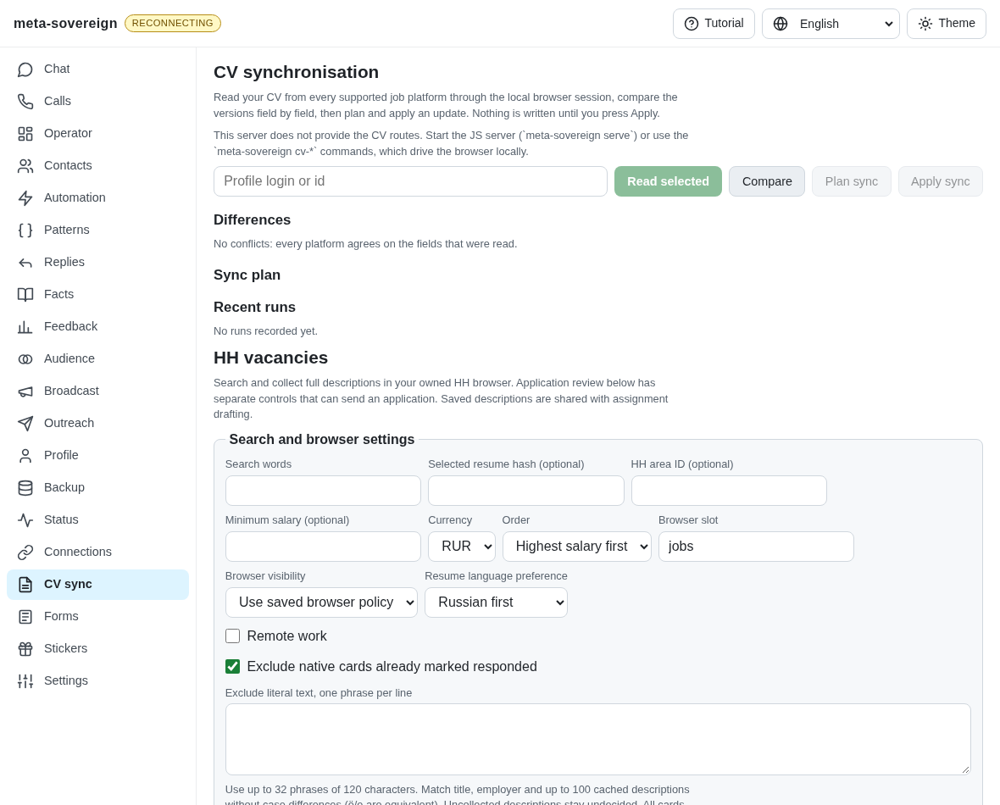
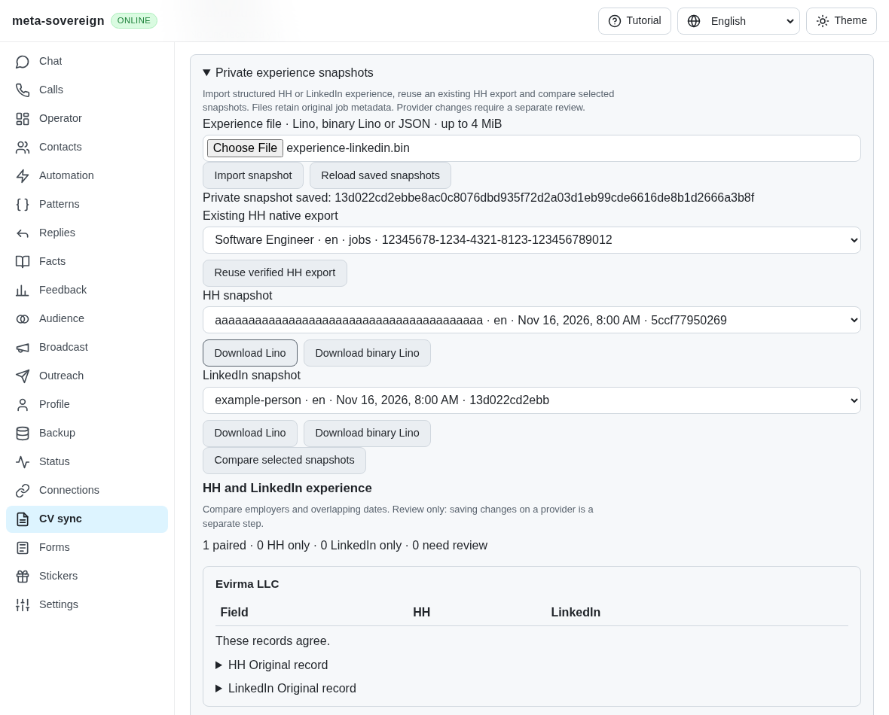
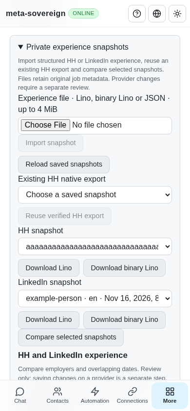

# Private structured experience documents

This is another partial HH21 implementation in [PR #57](https://github.com/link-foundation/meta-sovereign/pull/57).
The [workflow checklist](experience-sync-plan.md) remains unfinished. This unit
adds complete supplied-record interchange and reuse of existing HH exports;
it does not establish complete native acquisition or reviewed provider editing.

The generic CV projection uses a fixed field allowlist and omits unknown
workplace metadata. A separate `cv-experience` version 1 envelope preserves the
original profile and each complete native job, alongside canonical fields used
for company/date comparison. Skills, media URLs/titles, archived website paths,
area identifiers, industry identifiers/labels and unknown nested metadata survive
JSON, text Lino and binary Lino import/export without normalization of originals.
Documents validate platform/source identity, ISO capture time, monthly dates and
current/end consistency. Bounded descriptor cloning rejects accessors without
reading them. File import and export have an explicit 4 MiB encoded ceiling;
record, depth, node and character limits can refuse larger structures. Refusal
never silently truncates a document.

Immutable SHA-256 revisions include the document and its provenance. Private
`secret:cv-experience:` records are excluded from ordinary peer reconciliation;
at-rest encryption follows the store's existing passphrase configuration.
Imports carry `imported` provenance and cannot claim an observed provider save.
Concurrent writes serialize, saves require the store's acknowledgement/flush,
and readers wait for failed saves to restore the last acknowledged state.
Catalogue reads expose at most 100 summaries with explicit truncation; exact
revisions remain addressable. Comparison requires one HH and one LinkedIn
revision and preserves the original records without writing to either provider.

HH conversion requires an existing acknowledged native export receipt, verifies
the private `resume.json` bytes against its size/hash/identity, and retains its
complete supplied jobs under `native`. Profile fields remain separate. Derived
canonical job skills use only that job's skills and narrative; profile-only skills
are not attributed to every job. Reusing the receipt does not launch a browser or
refresh the export. If the existing exporter omitted native metadata, this bridge
cannot recover it. Complete HH acquisition and missing/explicit refresh behavior
remain unfinished, together with the dedicated LinkedIn reader.

CLI commands are `cv-experience-import --file=...`, `cv-experience-stored`,
`cv-experience-export --revision=...`,
`cv-experience-from-hh --export-id=... --resume=... [--browser-slot=jobs]` and
`cv-experience-compare --hh=... --linkedin=...`.
Export defaults to text Lino; `--json` is available. The local routes under
`/api/cv/experience/` provide `stored`, `document`, `import`, `from-hh` and
`compare` over default text and negotiated binary Lino. Mutations require the
existing trusted-origin boundary and responses prohibit caching. No snapshot
operation authorizes a provider mutation or public publication.

The shared CV panel imports all three file formats, reuses a selected HH receipt,
downloads both Lino formats and compares explicit saved revisions. English,
Russian, Hindi and Chinese labels cover progress, refusal, unavailable catalogue
and save acknowledgement. Failed reads retain known snapshots. Failed imports
retain the chosen file and selections; acknowledgement selects the actual saved
revision. Changing selection clears the prior comparison. The first real-browser
pass found duplicate controls caused by duplicate sibling React keys; the keys
were corrected and the browser check now asserts a single HH export control.

Reproduction and verification:

- `python -B experiments/issue-56/experience-documents-before.py` temporarily
  restores the exact published `3d0ded3d` facade. The public interchange regression
  fails once; the drafted facade is restored in `finally`.
- Eighteen focused checks in `cv-experience-documents`, `cv-experience-document-routes`,
  `cv-experience-document-web` and existing `cli-help-imports` tests cover complete
  round trips, invalid/accessor/size refusal, deduplication, private reconciliation,
  flush rollback, verified HH byte reuse/tamper refusal, CLI and both real HTTP
  wire encodings, trusted-origin refusal, exact revision comparison/downloads,
  held/repeated actions, input retention and disposed views.
- Existing CV CLI/web and job technology controls pass 36 checks. Four focused
  dictionary parity/content/interpolation checks pass. Full source builds and
  runtime/browser matrices remain on hosted CI.
- The native Playwright MCP exercised the shipped SPA against an isolated
  ephemeral synthetic fixture: HH receipt reuse, text and binary imports, an
  intentionally refused import followed by successful retry, two downloads,
  four locales, exact revision comparison and a 390-pixel phone layout. It
  reported no page exceptions. The final console has the intentional HTTP 503,
  a missing fixture favicon and three browser cache-write errors for `app.min.js`;
  the bundle loaded and all assertions passed. Earlier failed fixture passes
  are preserved separately. Browser and fixture server were closed.
- The same assertions are registered in the existing mandatory CV translation
  browser group. At preparation time, published parent `3d0ded3d` had 65 passing
  checks, four skipped and four browser checks still running; that does not
  establish acceptance for this later unit. An older parent Windows/Deno log
  retains a cold startup/readiness failure (job 133167558565, lines 5466 and
  5881–5904): roughly four seconds preparing the release, followed by worker
  loading that exceeded the test's ten-second readiness budget. The same lane
  passed on `3d0ded3d`; no root-cause fix is claimed and the timeout is unchanged.

Before:

After:

The [hashed evidence archive](data/experience-documents.tar.gz) retains source
snapshots, focused logs and all seven validated screenshots. Fixtures contain
synthetic careers and make no provider requests or profile writes. All 60
unchecked inventory rows, including HH21, remain unfinished.
